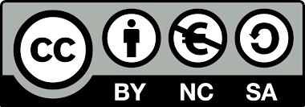

#  Desenvolupament Web en Entorn Servidor

## Índex d'unitats temàtiques

| **🔹 Bloc PHP** &nbsp;&nbsp;&nbsp; |             |
|-----------------------------|-------------|
| UP1                         | Arquitectura Web |
| UP2                         | Llenguatge PHP |
| UP3                         | PHP Orientat a Objectes |
| UP4                         | Programació Web |
| UP5                         | Accés a bases de dades |
| UP6                         | Eines Web |

| **🔸 Bloc Laravel** |             |
|-----------------------------|-------------|
| UP7                         | Framework Laravel |
| UP8                         | Controladors |
| UP9                         | Model de dades |
| UP10                        | Formularis i validacions |
| UP11                        | Serveis REST |
| UP12                        | Autenticació d'usuaris |

## Resultats d'aprenentatge i criteris d'avaluació

| Resultat d'aprenentatge (RA) | Criteris d'avaluació (CE) |
|-------------------------------|------------------------------|
| **RA1. Selecciona les arquitectures i tecnologies de programació Web en entorn servidor** | a) Diferencia models d'execució client/servidor   b) Reconeix els avantatges de la generació dinàmica   c) Identifica mecanismes d'execució en servidors Web   d) Reconeix funcionalitats de servidors d'aplicacions   e) Identifica llenguatges i tecnologies de servidor   f) Verifica la integració de llenguatges de marques i servidor   g) Avalua eines de programació en entorn servidor |
| **RA2. Escriu sentències executables per un servidor Web** | a) Reconeix mecanismes de generació de pàgines amb codi incrustat   b) Identifica tecnologies associades   c) Utilitza etiquetes per a incloure codi   d) Reconeix la sintaxi del llenguatge de programació   e) Escriu i comprova sentències simples   f) Utilitza directives per a modificar el comportament   g) Usa variables i operadors   h) Identifica àmbits d'utilització de variables |
| **RA3. Escriu blocs de sentències incrustats en llenguatges de marques** | a) Usa mecanismes de decisió   b) Empra bucles   c) Utilitza arrays   d) Crea i usa funcions   e) Usa formularis web   f) Recupera informació de formularis   g) Afig comentaris al codi |
| **RA4. Desenvolupa aplicacions Web incrustades en llenguatges de marques** | a) Identifica mecanismes de manteniment d'informació del client   b) Usa sessions   c) Usa cookies   d) Identifica mecanismes d'autenticació   e) Integra mecanismes d'autenticació   f) Fa adaptacions a aplicacions Web existents   g) Usa eines per a programació, prova i depuració |
| **RA5. Desenvolupa aplicacions Web separant presentació i lògica de negoci** | a) Identifica avantatges de separar lògica i presentació   b) Analitza tecnologies i mecanismes de separació   c) Usa objectes i controls en servidor per a generar la interfície   d) Usa formularis dinàmics   e) Configura paràmetres de l'aplicació Web   f) Escriu aplicacions amb manteniment d'estat i separació de lògica   g) Aplica principis de POO   h) Prova i documenta el codi |
| **RA6. Desenvolupa aplicacions d'accés a magatzems de dades** | a) Analitza tecnologies d'accés a dades   b) Crea connexions amb bases de dades   c) Recupera informació   d) Publica informació en aplicacions Web   e) Usa conjunts de dades   f) Actualitza i elimina informació   g) Usa transaccions   h) Prova i documenta aplicacions |
| **RA7. Desenvolupa serveis Web** | a) Reconeix característiques i àmbit dels serveis Web   b) Reconeix avantatges dels serveis Web   c) Identifica tecnologies i protocols implicats   d) Programa un servei Web   e) Crea el document de descripció   f) Verifica el funcionament   g) Consumix serveis Web |
| **RA8. Genera pàgines Web dinàmiques amb tecnologies del servidor** | a) Identifica diferències d'execució client/servidor   b) Reconeix avantatges d'unir les dues tecnologies   c) Identifica llibreries i tecnologies relacionades   d) Genera pàgines amb interacció (alertes, confirmacions)   e) Verifica formularis   f) Modifica dinàmicament contingut i estructura   g) Aplica estes tecnologies a aplicacions Web |
| **RA9. Desenvolupa aplicacions Web híbrides** | a) Reconeix avantatges de reutilitzar codi i informació existent   b) Identifica llibreries i tecnologies aplicables   c) Crea aplicacions que recuperen i processen repositoris existents   d) Crea repositoris específics a partir d'informació externa   e) Usa llibreries de codi per a funcionalitats específiques   f) Programa serveis/aplicacions basats en codi de tercers   g) Prova, depura i documenta aplicacions |

## Relació de continguts amb RA i CE

| Bloc / Contingut de PHP                                 | RA - CE relacionats |
|---------------------------------------------------------|-----------------------|
| **1. Introducció i arquitectura PHP**                   | |
| Evolució de PHP com a llenguatge de servidor            | RA1 (e) |
| Models d'execució client vs servidor                    | RA1 (a) ; RA8 (a) |
| Arquitectura d'aplicacions dinàmiques                   | RA1 (c, d) |
| Integració HTML + PHP                                   | RA1 (f) i RA2 (a, c) |
|                                                         |                       |
| **2. Sintaxi bàsica de PHP**                            | |
| Variables, constants i operadors                        | RA2 (g, h) |
| Estructures de control (if, switch, bucles)             | RA3 (a, b) |
| Arrays i estructures de dades                           | RA3 (c) |
| Comentaris i bones pràctiques                           | RA3 (g) |
|                                                         |                       |
| **3. Funcions i modularització**                        |  |
| Declaració i ús de funcions                             | RA3 (d) |
| Modularització amb includes/require                     | RA2 (c) |
| Llibreries i reutilització de codi                      | RA9 (a, b, e) |
|                                                         |                       |
| **4. Formularis i gestió de dades de l'usuari**         |  |
| Creació de formularis HTML amb PHP                      | RA3 (e) |
| Mètodes de recollida de dades (GET, POST)               | RA3 (f) |
| Validació de formularis                                 | RA8 (e, f) |
| Ús de sessions i cookies                                | RA4 (a, b, c) |
|                                                         |                       |
| **5. Programació orientada a objectes en PHP**          |  |
| Classes, objectes, propietats i mètodes                 | RA5 (g) |
| Encapsulació, herència, interfícies                     | RA5 (g) |
| Aplicació de la POO a la lògica de negoci               | RA5 (a, b, f) |
|                                                         |                       |
| **6. Connexió amb bases de dades**                      | |
| Accés a MySQL/MariaDB amb PDO                           | RA6 (a, b) |
| Consultes CRUD des de PHP                               | RA6 (c, f) |
| Publicació de la informació recuperada                  | RA6 (d) |
| Transaccions i consistència                             | RA6 (g) |
| Seguretat en l'accés a dades                            | RA6 (h) |
|                                                         |                       |
| **7. Manteniment d'estat i autenticació**               | |
| Mecanismes d'autenticació                               | RA4 (d) |
| Implementació de login i control d'accés                | RA4 (e) ; RA5 (f) |
| Seguretat bàsica (injeccions SQL, XSS, CSRF)            | RA6 (g) ; RA8 (g) |
|                                                         |                       |
| **8. Plantilles i separació de capes**                  |  |
| Avantatges de separar presentació i lògica              | RA5 (a) |
| Motors de plantilles (Twig, Blade)                      | RA5 (b, c, d) |
| Aplicacions amb MVC i manteniment d'estat               | RA5 (f, g) |
| Documentació de projectes                               | RA5 (h) |
|                                                         |                       |
| **9. Serveis web i interoperabilitat**                  |  |
| Protocols i tecnologies (REST, SOAP)                    | RA7 (c) |
| Creació d'un servei web en PHP                          | RA7 (d, e) |
| Consum d'API externes                                   | RA7 (g) |
| Descripció i interoperabilitat (OpenAPI, WSDL)          | RA7 (e, f) |
|                                                         |                       |
| **10. Generació dinàmica i aplicacions híbrides**       |  |
| Generació dinàmica de contingut                         | RA8 (d, e, f) |
| Integració PHP + JavaScript (AJAX)                      | RA8 (b, g) |
| Ús de llibreries externes i API de tercers              | RA9 (b, c, e) |
| Creació d'aplicacions híbrides                          | RA9 (c, d, f) |

!!!cc "Llicència"
	{ align=left width=150 height=150}L'ús d'estos materials està subjecte a una llicència Creative Commons CC [BY-NC-SA](https://creativecommons.org/licenses/by-nc-sa/4.0/deed.ca){:target="blank"}. Derivat a partir dels materials:
	
	- [Curs Desenvolupament Web en Entorn Servidor, d'Aitor Medrano i Luis Alemañ](https://aitor-medrano.github.io/dwes2122/index.html){:target="blank"}.
	- [Curs de Laravel, de Nacho Iborra](https://nachoiborraies.github.io/laravel){:target="blank"}.
	- [Curs d'Introducció a Laravel 12, de Guillermo Garrido](https://cefire-ggarrido.github.io/25-26-introduccion-laravel/contenidos/s1-pPDdb0SuEmZ7hQq/){:target="blank"}.
	- [Curs d'introducció a Laravel, de Javier Beteta](https://jbeteta-ies.github.io/2025_Laravel_32/){:target="blank"}.

