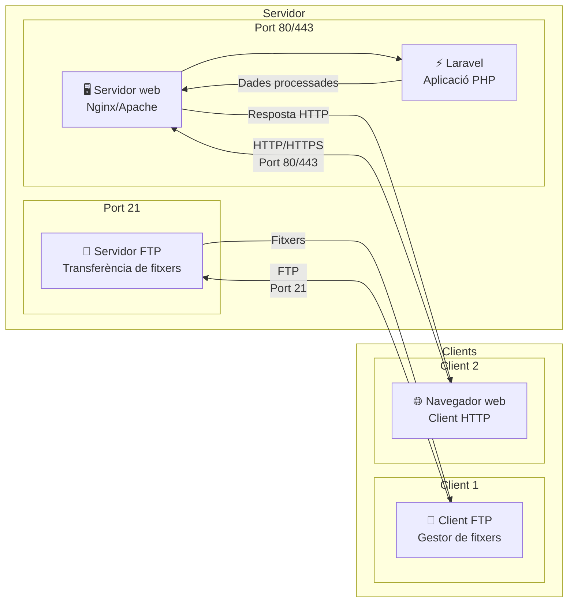

#  6.2. Funcionament d'una app

Ara que s'ha presentat Laravel com el "Xef", cal entendre el "restaurant" on treballa: la web. Tota aplicació Laravel viu dins d'un ecosistema de comunicació ben definit conegut com l'**arquitectura Client-Servidor**. Comprendre este flux és fonamental, perquè és el camí exacte que recorre cada petició des de l'usuari fins al codi i de tornada.

## 2.1. L'arquitectura client-servidor

Este model de comunicació és l'espina dorsal de la web. En ell, les responsabilitats es dividixen clarament entre dos actors principals:

* **El Client**: És qui inicia la comunicació. La seua faena és **sol·licitar** recursos o servicis. En este context, el client per excel·lència és el **navegador web** de l'usuari (Chrome, Firefox, Safari).
* **El Servidor**: És qui està permanentment escoltant i esperant eixes peticions. S'encarrega de processar-les, executar la lògica necessària i tornar una **resposta**.

Dins d'un servidor poden existir diferents programes que estan pendents de les crides dels clients. A estos programes, encara que semble redundant, també se'ls anomena "servidors" o servicis. Alguns exemples podrien ser el servidor FTP, el servidor DNS o el servidor web.

Però si un servidor (la màquina) té només una adreça IP, com sap a quin programa s'envia la petició del client?

Per a saber a quin servidor "programa" s'ha de dirigir cada petició del client, s'establixen els ports. Els ports són un número que s'assigna a cada servici de manera que, si una petició arriba a eixe port, només eixe servici l'atendrà.

Laravel es troba dins d'un **servidor web** que sempre està atenent peticions dels clients web, habitualment pels ports 80 i 443.

Quan algú visita la pàgina web, en realitat està enviant una petició a este servidor, que processa la sol·licitud i torna la resposta corresponent.


<div style="text-align: center;"><figure><figcaption class="figure-caption-small">🖼️ Figura 6.1: Peticions a servidors, els quals processen la petició i envien la resposta</figcaption></figure></div>

Esta separació és el que permet que l'aplicació Laravel puga atendre milers d'usuaris simultàniament. Cada conversa és un cicle de petició i resposta.

## 2.2. HTTP

Client i servidor necessiten un **idioma comú** per a entendre's. Eixe idioma és el **Protocol de Transferència d'Hipertext (HTTP)**. Un **protocol** és com un conjunt de regles d'etiqueta per a la comunicació. Imagina que estàs en una reunió internacional: tots han de seguir les mateixes regles sobre quan parlar, com saludar, etc., perquè la comunicació funcione. HTTP és el "protocol d'etiqueta" que permet que els navegadors i els servidors s'entenguen perfectament.

Hui en dia, la versió segura d'este protocol, **HTTPS (HTTP Secure)**, no és una opció, sinó l'estàndard absolut. HTTPS simplement afig una capa de xifratge (TLS) a la comunicació, i garantix que les dades viatgen de manera privada i íntegra. L'aplicació Laravel, per defecte, funcionarà sobre HTTPS.

**HTTPS** xifra tota la comunicació entre el navegador i el servidor Laravel. Açò significa que si algú intercepta les dades (com ara una contrasenya o informació personal), no podrà llegir-les. Els navegadors moderns marquen com a "no segures" les pàgines que no usen HTTPS, i Google penalitza en els seus resultats de busca els llocs sense xifratge.

### Els mètodes HTTP

Dins de l'idioma HTTP, els **mètodes** són els "**verbs**" que indiquen al servidor la **intenció** de la petició del client. En compte d'inventar accions, REST aprofita estos verbs estàndard.

Quan es treballe amb Laravel, s'associaran estos mètodes a les operacions CRUD (Crear, Llegir, Actualitzar, Esborrar) de manera constant:

* **GET**: **Llegir** un recurs. És l'acció més comuna. Quan s'escriu `midominio.com/usuarios` en el navegador, este envia una petició GET. Li està dient a Laravel: "**Dona'm** la llista d'usuaris".
* **POST**: **Crear** un recurs nou. Quan un usuari emplena un formulari de registre i prem "Enviar", el navegador envia una petició POST amb les dades del nou usuari en el cos. Li diu a Laravel: "**Crea** este usuari".
* **PUT / PATCH**: **Actualitzar** un recurs existent. PUT reemplaça el recurs complet, mentre que PATCH aplica una modificació parcial. Li diuen a Laravel: "**Actualitza** les dades d'este usuari".
* **DELETE**: **Eliminar** un recurs. Li diu a Laravel: "**Esborra** este usuari".

**CRUD** és un acrònim que significa **Create** (Crear), **Read** (Llegir), **Update** (Actualitzar) i **Delete** (Eliminar). Són les quatre operacions bàsiques que pots realitzar amb qualsevol recurs (com ara usuaris, productes, articles, etc.). Laravel està dissenyat per a gestionar estes operacions de manera molt elegant i consistent.

Estos mètodes són el cor del sistema d'**Enrutament** de Laravel. En el fitxer `routes/web.php` del projecte, es definirà explícitament quina ruta i quin mètode HTTP han d'executar una porció del codi. Per exemple: `Route::get('/usuarios', ...)` li diu a Laravel que escolte peticions GET en la URL `/usuarios`.

## 2.3. El cicle de vida complet d'una petició a Laravel

Des que un usuari prem "Enter" fins que veu la pàgina, ocorren una sèrie de passos a la velocitat de la llum. Entendre este viatge donarà un context immens sobre com funciona tot.

**Escenari**: Un usuari escriu `https://miapplaravel.com/productos` en el seu navegador.

1. **Fase 1: Resolució (Client)**

   * **Resolució DNS**: El navegador no sap on està `miapplaravel.com`. Pregunta al **DNS (Sistema de Noms de Domini)**, que actua com l'"agenda de contactes" d'Internet, i este li respon amb l'adreça IP del servidor on s'allotja la teua aplicació.
   * **Connexió TCP i TLS**: El navegador establix una connexió fiable (TCP) amb eixa IP en el port 443 (l'estàndard per a HTTPS) i negocia una connexió xifrada (TLS handshake). Ja hi ha un canal segur.

2. **Fase 2: La petició (Client → Servidor)**

   * **Construcció de la petició HTTP**: El navegador crea el missatge de petició. El fonamental és:

     ``` http
     GET /productos HTTP/1.1
     Host: miapplaravel.com
     User-Agent: Mozilla/5.0...
     ```
   * Este missatge viatja per Internet fins al teu servidor.

3. **Fase 3: Processament (Servidor Laravel)**

   * **Recepció**: Un programari servidor web (com Nginx o Apache) rep la petició i, sabent que és per a una aplicació PHP, la passa al punt d'entrada de Laravel (`public/index.php`).
   * **El Kernel de Laravel**: La petició entra al cor de Laravel, que la dirigix a través d'una sèrie de *middlewares* (filtres de seguretat, autenticació, etc.).
   * **Enrutament**: Laravel consulta el seu "mapa" de rutes (`routes/web.php`) i veu que la petició `GET /productos` ha de ser gestionada pel mètode `index` de la classe `ProductoController`.
   * **Lògica de negoci**: El `ProductoController` s'executa. Li demana al **Model** `Producto` que recupere tots els productes de la base de dades.
   * **Generació de la resposta**: El controlador pren la llista de productes i la passa a una **Vista** (una plantilla de Blade). Blade genera l'HTML final.

     Els middlewares

     Són com filtres de seguretat que revisen cada petició abans que arribe al codi. Poden verificar si l'usuari està autenticat, si té permisos per a accedir a una pàgina determinada, etc.

4. **Fase 4: La resposta (Servidor → Client)**

   * **Construcció de la resposta HTTP**: Laravel empaqueta l'HTML generat en una resposta HTTP, encapçalada per un codi d'estat:

     ``` http
     HTTP/1.1 200 OK
     Content-Type: text/html; charset=UTF-8
     ...

     <html>...</html>
     ```
    El codi `200 OK` li diu al navegador que tot ha anat bé.

5. **Fase 5: Renderització (Client)**

   * **Interpretació**: El navegador rep la resposta, llig l'HTML i renderitza la pàgina visualment per a l'usuari.
   * **Recursos addicionals**: Si l'HTML inclou referències a fitxers CSS, JavaScript o imatges, el navegador iniciarà nous cicles de petició/resposta per a cada un d'ells, fins que la pàgina estiga completa.

HTTP és ***stateless***, cosa que significa que **cada petició és un esdeveniment aïllat i independent**. El servidor no guarda cap record de les peticions anteriors d'un mateix client. Per a gestionar "estats" com un inici de sessió o un carret de la compra, Laravel construïx una capa per damunt d'HTTP, usant mecanismes com les **sessions** i les **cookies**, que sí que recorden l'usuari entre peticions.
