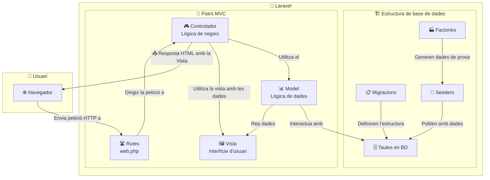

#  6.6. Estructura d'una app

La primera vegada que s'obri un projecte Laravel, la quantitat de carpetes i fitxers pot resultar intimidant. No obstant això, l'estructura és lògica i predictible. No cal conéixer cada fitxer per a començar a desenvolupar; n'hi ha prou d'entendre els directoris principals.

## 6.1. Estructura de directoris essencial

Estes són les principals carpetes que cal conéixer:

* `app/`: **El centre neuràlgic.** Ací viu la major part del codi, la lògica de negoci de l'aplicació.

  + `Http/Controllers`: Els **Controladors**, que actuen com a "gestors de trànsit". Reben les peticions de l'usuari, processen la lògica i decidixen quina resposta enviar.
  + `Models`: Els **Models**, que representen les taules de la base de dades. Un model `User`, per exemple, es correspon amb la taula `users` i permet interactuar-hi de manera senzilla.
* `routes/`: **El mapa de carreteres.** Ací es definixen totes les URL (rutes) de l'aplicació i a quin mètode de quin controlador han de cridar. El fitxer principal per a aplicacions web és `web.php`.
* `resources/`: **La façana i els actius.** Conté tot el que veu l'usuari final.

  + `views`: Ací es guarden les plantilles **Blade**, que són els fitxers "HTML amb superpoders" de l'aplicació.
  + `css`, `js`: Els fitxers d'estils i JavaScript sense compilar.
* `database/`: **Els fonaments.** Tot el que està relacionat amb la base de dades.

  + `migrations`: Són com "plànols de construcció" per a la base de dades. Cada fitxer definix l'estructura d'una taula (columnes, tipus de dades, etc.).
  + `seeders`: Classes que permeten "poblar" la base de dades amb dades de prova o inicials.
* `public/`: **La porta d'entrada.** És l'única carpeta accessible públicament de l'aplicació. Conté el fitxer `index.php`, que inicia tot el procés, així com els recursos ja compilats (CSS, JS, imatges).
* `.env`: **El tauler de control secret.** Este és el fitxer de configuració de l'entorn. Ací es guarda informació sensible que varia entre màquines, com les credencials de la base de dades o les claus d'API externes. **Este fitxer mai s'ha de pujar al control de versions (Git)!**.

## 6.2. El patró MVC

L'estructura bàsica de Laravel seguix el patró de disseny **MVC (Model-Vista-Controlador)**, que separa l'aplicació en tres components amb responsabilitats ben definides:

* **Model (Model)**: Gestiona les dades i la lògica de negoci
* **Vista (View)**: S'encarrega de la presentació (el que veu l'usuari)
* **Controlador (Controller)**: Actua com a intermediari entre el model i la vista

<figure><figcaption class="figure-caption-small">🖼️ Figura 6.2: Diagrama del model-vista-controlador (MVC) que seguix Laravel</figcaption></figure>

#### Què mostra este diagrama?

Este diagrama il·lustra tres aspectes fonamentals de Laravel:

1. **🏗️ Estructura de base de dades**: Com es construïxen i es poblen les taules (Migracions → Taules → Seeders/Factories)
2. **🎯 Patró MVC**: Com interactuen Model, Vista i Controlador per a processar dades
3. **🌐 Flux HTTP**: El camí complet des de la petició de l'usuari fins a la resposta

**Connexió clau**: El diagrama mostra com una petició HTTP travessa el patró MVC per a accedir a dades estructurades en la base de dades.

