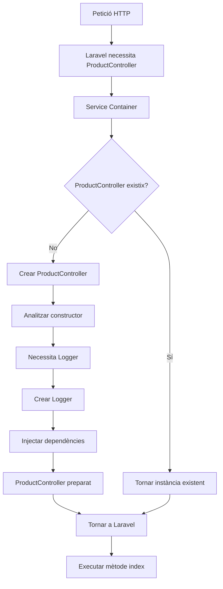
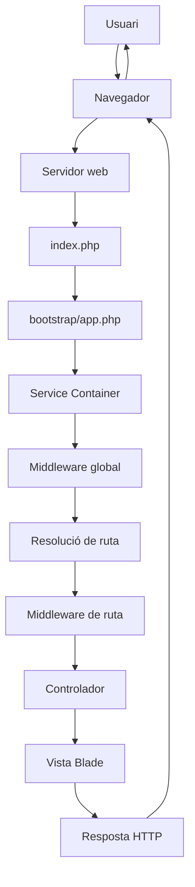

#  7.1. Viatge d'una petició

En la **sessió 1** es van assentar les bases fonamentals del desenvolupament web amb Laravel. Es va explorar l'**arquitectura client-servidor**, comprenent com funciona el protocol **HTTP/HTTPS**, els **mètodes HTTP** (GET, POST, PUT, DELETE) que corresponen a operacions **CRUD**, i el concepte de **stateless**. També es van conéixer els **servidors web** (Nginx/Apache) que actuen com a "porters" de les aplicacions i els diferents **tipus d'allotjament (hosting)** (Compartit, VPS, Dedicat, IaaS/Núvol).

Es va introduir **Laravel** com a framework "opinat" de PHP, explorant el seu ecosistema complet: **Artisan** (la CLI per a generar components), **Tinker** (la consola interactiva REPL) i el **Service Container** (el cervell organitzador que resol dependències automàticament). Es va configurar un **entorn de desenvolupament professional** amb eines essencials com **CLI/Terminal** (WSL2 en Windows), editors de codi, gestors de dependències (**Composer** i **npm**), control de versions (**Git**), gestors de versions (**NVM**) i contenidorització amb **Docker i Laravel Sail**. També es van integrar eines de qualitat de codi (**PHPStan**, **PHP\_CodeSniffer**, **Laravel Pint**) i de depuració (**Laravel Telescope**).

A més, es van conéixer les eines modernes de frontend: **Vite** com a compilador ultraràpid (amb els seus modes de desenvolupament i producció) i **Tailwind CSS** com a framework "utility-first" amb el seu procés de **purge** per a CSS ultraoptimitzat. Finalment, es va explorar l'**anatomia de Laravel**: la seua estructura de directoris (app/, routes/, resources/, database/, public/), fitxers clau com **.env**, i el patró **MVC** (Model-Vista-Controlador) amb el flux complet de petició-resposta.

Ara és moment d'aprofundir en el **cicle de vida de les peticions**. S'explorarà en detall com Laravel processa cada petició HTTP des que arriba al servidor fins que torna la resposta al client, comprenent el **middleware**, aprofundint en el **Service Container** i la **injecció de dependències**, i analitzant el flux intern complet que transforma una simple URL en una pàgina web dinàmica.

## 1. El flux d'una petició HTTP

Quan un usuari accedix a una URL en una aplicació Laravel, s'inicia un procés que transforma una simple petició HTTP en una resposta HTML completa. Este procés es coneix com el **cicle de vida d'una petició**.


### 1.1. Arribada de la petició

El procés comença quan el navegador de l'usuari envia una petició HTTP al servidor web (Apache, Nginx, etc.). Esta petició conté informació crucial:

* **Mètode HTTP** (GET, POST, PUT, DELETE)
* **URL sol·licitada** (/news/123, /users/profile)
* **Capçaleres** (User-Agent, Accept, Cookies)
* **Dades del cos** (per a peticions POST/PUT)

### 1.2. El punt d'entrada: `index.php`

Totes les peticions HTTP en Laravel passen per un únic punt d'entrada: el fitxer `public/index.php`. Este fitxer actua com el "porter" de l'aplicació:

```php
// public/index.php
<?php

// 1. Cargar el autoloader de Composer
require_once __DIR__.'/../vendor/autoload.php';

// 2. Crear la instancia de la aplicación Laravel
$app = require_once __DIR__.'/../bootstrap/app.php';

// 3. Procesar la petición y obtener la respuesta
$response = $app->handle(
    $request = Illuminate\Http\Request::capture()
);

// 4. Enviar la respuesta al navegador
$response->send();

// 5. Finalizar la petición
$app->terminate($request, $response);
```

!!!tenencuenta "index.php accessible"
    El fitxer `index.php` és l'únic fitxer PHP accessible directament des del navegador. Tots els altres fitxers de l'aplicació estan protegits per estar fora del directori `public`, cosa que afig una capa essencial de seguretat.

## 2. El Service Container i la injecció de dependències

Una de les característiques més potents de Laravel és el seu **Service Container**, també conegut com a contenidor de dependències. Este sistema gestiona automàticament la creació i la resolució d'objectes en tota l'aplicació.

### 2.1. Què és el Service Container?

En la **Sessió 1: Introducció a Laravel** es va introduir el concepte bàsic del *Service Container* com a "assistent personal". Quan Laravel necessita crear un objecte (com un controlador, un model, o qualsevol classe), el contenidor s'encarrega de:

1. **Crear la instància** de l'objecte.
2. **Resoldre les seues dependències** automàticament.
3. **Gestionar el cicle de vida** de l'objecte.


```php
<?php
// Ejemplo: Laravel resuelve automáticamente las dependencias
class ProductController extends Controller
{
    public function __construct(
        private Logger $logger // Laravel crea e "inyecta" un objeto de tipo Logger
    ) {}
    
    public function index()
    {
        $this->logger->info('Accediendo a la lista de productos');
    }
}
```

Funcionament del *Service Container*:


<div style="text-align: center;"><figure><figcaption class="figure-caption-small">🖼️ Figura 7.1: Funcionament del Service Container</figcaption></figure></div>

### 2.2. El Bootstrap de l'aplicació

Una vegada la petició arriba a `index.php`, Laravel carrega l'aplicació des de `bootstrap/app.php`, que s'encarrega de configurar i processar la petició. En este procés, Laravel determina a quina ruta s'ha de dirigir la petició, si ha de passar per algun middleware i com gestionar les excepcions.

## 3. Middleware: la capa de processament

El **middleware** és una capa de programari que processa les peticions HTTP abans que arriben als controladors. És com una sèrie de "filtres" que cada petició ha de travessar.


El middleware permet executar codi abans i després que una petició siga processada per l'aplicació. Alguns exemples comuns són:

Tipus de middleware:

| Tipus | Propòsit | Exemple |
| --- | --- | --- |
| **Autenticació** | Verificar la identitat | `auth` |
| **Autorització** | Verificar permisos | `can:edit-posts` |
| **Validació** | Comprovar dades | `throttle:60,1` |
| **Logging** | Registrar l'activitat | `log` |
| **CORS** | Permetre dominis | `cors` |

### 3.1. El cicle complet d'una petició

A continuació es presenta el flux complet d'una petició HTTP en Laravel:


<div style="text-align: center;"><figure><figcaption class="figure-caption-small">🖼️ Figura 7.2: Diagrama del flux complet d'una petició en Laravel</figcaption></figure></div>

Este patró, que separa les responsabilitats i processa les peticions a través de capes ben definides, és la base del desenvolupament web modern i serà el pilar sobre el qual es construiran les aplicacions.

