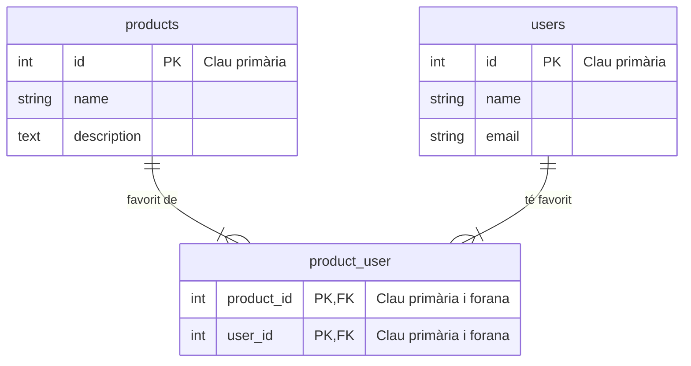

#  8.1. Migracions i estructura

Ara que s'ha introduït Laravel i la seua arquitectura MVC, és moment d'aprofundir en com gestionar l'estructura de la base de dades utilitzant migracions i models Eloquent. En este apartat s'exploren els conceptes fonamentals de les bases de dades relacionals i el sistema de migracions de Laravel. S'aprén a dissenyar, crear i modificar l'estructura de les taules, construint esquemes amb relacions definides que garantixen la integritat de les dades.

## 1. Conceptes fonamentals de bases de dades relacionals

Per a entendre com es relacionen les dades en una aplicació Laravel, és crucial comprendre els principis bàsics de les bases de dades relacionals.

### 1.1. Què és una base de dades relacional?

Una **base de dades relacional** és un sistema de gestió de dades que organitza la informació en taules relacionades entre si. Cada taula representa una entitat del món real i les relacions entre taules permeten navegar entre dades relacionades.


### 1.2. Tipus de relacions

#### U a u (1:1)

Una entitat es relaciona amb exactament una entitat d'una altra taula. Un producte té una única oferta especial i eixa oferta pertany a un únic producte.

<div style="text-align: center;">
    <figure>
        ```mermaid
        erDiagram
            products {
                int id PK "Clau primària"
                string name
                string description
            }
            offers {
                int id PK "Clau primària"
                decimal discount_price
                date start_date
                int product_id FK "Clau forana"
            }
            products ||--|| offers : "té"
        ```
        <figcaption class="figure-caption-small">🖼️ Figura 8.1: Exemple d'entitat/relació 1:1</figcaption>
    </figure>
</div>


#### U a molts (1:N)

Una entitat es relaciona amb múltiples entitats d'una altra taula. Una categoria pot tindre molts productes, però un producte pertany a una sola categoria.

<div style="text-align: center;">
    <figure>
        ```mermaid
        erDiagram
            categories {
                int id PK "Clau primària"
                string name
                string slug
            }
            products {
                int id PK "Clau primària"
                string name
                decimal price
                int category_id FK "Clau forana"
            }
            categories ||--o{ products : "té"
        ```
        <figcaption class="figure-caption-small">🖼️ Figura 8.2: Exemple d'entitat/relació 1:N</figcaption>
    </figure>
</div>

???+examplelaravel "Exemple"
    * Categoria "Electrònica" **→** Productes: "iPhone", "Samsung", "iPad"
    * Categoria "Roba" **→** Productes: "Samarreta", "Pantaló", "Sabates"

#### Molts a molts (N:M)

Múltiples entitats es relacionen amb múltiples entitats d'una altra taula, a través d'una **taula pivot** intermèdia. Un producte pot estar en la llista de favorits de molts usuaris i un usuari pot tindre molts productes favorits.


<figcaption class="figure-caption-small">🖼️ Figura 8.3: Exemple d'entitat/relació N:M</figcaption>

???+examplelaravel "Exemple"
    * Usuari "Ana" → Favorits: "Portàtil", "Ratolí sense fil"
    * Producte "Portàtil" → En favorits de: "Ana", "Luis", "Carla"

## 2. Sistema de migracions

### 2.1. Què són les migracions?

Les **migracions** són fitxers que definixen en primer lloc l'estructura de la base de dades i posteriorment els canvis que s'hi fan de manera versionada i reversible. D'esta manera, permeten gestionar l'evolució de l'esquema de la base de dades com a codi.


### 2.2. Estructura d'una migració

Les migracions són classes PHP que estenen `Migration` i contenen dos mètodes principals: **`up()`** i **`down()`**.

El mètode **`up()`** definix els canvis que s'han d'aplicar (crear taules, afegir columnes, etc.), mentre que **`down()`** especifica com revertir eixos canvis (eliminar taules, llevar columnes, etc.).

```php
<?php

use Illuminate\Database\Migrations\Migration;
use Illuminate\Database\Schema\Blueprint;
use Illuminate\Support\Facades\Schema;

return new class extends Migration
{
    /**
     * Run the migrations.
     */
    public function up(): void
    {
        // Definir cambios a aplicar
    }

    /**
     * Reverse the migrations.
     */
    public function down(): void
    {
        // Definir cómo deshacer los cambios
    }
};
```

## 3. Creació de migracions

### 3.1. Comandament per a crear migracions

Per a crear una nova migració, s'utilitza el comandament Artisan **`make:migration`**:

```bash
# crear una migración básica
sail artisan make:migration create_products_table
```

!!!tenencuenta "Recorda"
    Laravel està dissenyat per a treballar en **anglés**. Els noms de taules, columnes i models han d'estar en anglés, i cal respectar:

    * **Taules**: plural en anglés (`products`, `categories`, `users`)
    * **Models**: singular en anglés (`Product`, `Category`, `User`)
    * **Columnes**: snake\_case en anglés (`created_at`, `category_id`, `is_active`)

    Això permet que Laravel funcione automàticament sense configuració addicional.

### 3.2. Migració per a crear una taula

Quan es crea una migració per a una taula, el fitxer generat contindrà un esquema bàsic.

Ací hi ha un exemple d'una migració per a crear una taula `products` amb diversos tipus de columnes i una relació amb la taula `categories`.

```php
<?php

use Illuminate\Database\Migrations\Migration;
use Illuminate\Database\Schema\Blueprint;
use Illuminate\Support\Facades\Schema;

return new class extends Migration
{
    public function up(): void
    {
        Schema::create('products', function (Blueprint $table) {
            $table->id();                    // Clave primaria auto-incremental
            $table->string('name');          // Campo de texto
            $table->text('description');     // Campo de texto largo
            $table->decimal('price', 10, 2); // Campo decimal (10 dígitos, 2 decimales)
            $table->foreignId('category_id') // Clave foránea
                  ->constrained()            // Referencia a tabla categories
                  ->onDelete('cascade');     // Eliminar en cascada
            $table->timestamps();            // created_at y updated_at
        });
    }

    public function down(): void
    {
        Schema::dropIfExists('products');
    }
};
```

### 3.3. Tipus de columnes comuns

Esta és una taula amb els tipus de columnes més comuns en migracions:

| Tipus | Descripció | Exemple |
| --- | --- | --- |
| `id()` | Clau primària autoincremental | `$table->id()` |
| `string('name')` | Camp de text (255 caràcters) | `$table->string('name')` |
| `text('description')` | Camp de text llarg | `$table->text('description')` |
| `integer('quantity')` | Nombre enter | `$table->integer('quantity')` |
| `decimal('price', 8, 2)` | Nombre decimal | `$table->decimal('price', 8, 2)` |
| `boolean('is_active')` | Valor booleà | `$table->boolean('is_active')` |
| `date('birth_date')` | Data | `$table->date('birth_date')` |
| `timestamp('deleted_at')` | Data i hora | `$table->timestamp('deleted_at')` |


!!!tenencuenta "Important"
    `id()` és una drecera per a `$table->bigIncrements('id')`, que crea una columna de clau primària autoincremental de tipus BIGINT. Els BIGINT permeten un rang de valors molt més gran que INT, la qual cosa és útil per a taules amb molts registres. Això afecta totes les claus primàries i foranes que uses en les teues taules.

    A més, els tipus de columnes poden tindre modificadors addicionals com **`nullable()`**, **`default()`**, **`unique()`**, etc.
    
    !!! examplelaravel "Exemple"
        ```php
        $table->string('email')->unique(); // crea una columna de texto única.
        ```


## 4. Relacions en migracions

Per a definir relacions entre taules, s'utilitzen claus foranes i taules pivot.

### 4.1. Claus foranes
Les claus foranes es definixen usant **`foreignId()`** o **`foreign()`**. 

Ací hi ha dos mètodes per a fer-ho:

=== "Mètode 1: Usant `foreignId` (**recomanat**)"
    ```php
    <?php

    $table->foreignId('category_id')
        ->constrained()           // Referencia a tabla categories
        ->onDelete('cascade');    // Eliminar en cascada
    ```
=== "Mètode 2: Usant `foreign` (més control)"
    ```php
    <?php
    $table->unsignedBigInteger('category_id');
    $table->foreign('category_id')
        ->references('id')
        ->on('categories')
        ->on


És millor usar **`foreignId()`** per la seua simplicitat i llegibilitat. Però si necessites més control (com referenciar una columna diferent o una taula distinta), `foreign()` és l'opció adequada.

!!!tenencuenta "Important"
    Laravel busca automàticament la taula relacionada assumint que el nom de la columna forana seguix la convenció `{tabla_singular}_id`. 

    Per exemple, s'assumix que `category_id` referencia la taula `categories`. Si la teua columna no seguix esta convenció, has d'especificar la taula i la columna manualment usant el mètode 2 `foreign()` amb `references()` i `on()`.

### 4.2. Taula pivot per a relacions molts a molts

Com s'ha esmentat abans, les relacions molts a molts requerixen una taula pivot intermèdia que continga les claus foranes de les dues taules relacionades.

```php
<?php

use Illuminate\Database\Migrations\Migration;
use Illuminate\Database\Schema\Blueprint;
use Illuminate\Support\Facades\Schema;

return new class extends Migration
{
    public function up(): void
    {
        Schema::create('product_user', function (Blueprint $table) {
            $table->id();
            $table->foreignId('product_id')
                  ->constrained()
                  ->onDelete('cascade');
            $table->foreignId('user_id')
                  ->constrained()
                  ->onDelete('cascade');
            $table->timestamps();
            
            // Evitar duplicados
            $table->unique(['product_id', 'user_id']);
        });
    }

    public function down(): void
    {
        Schema::dropIfExists('product_user');
    }
};
```

!!!tenencuenta "Important"
    La taula pivot ha de tindre un nom que combine les dues taules **en orde alfabètic**, separades per un guió baix **`_`**. 

    En este cas, `product_user` és correcte perquè "product" va abans que "user" alfabèticament. Això permet que Laravel reconega automàticament la taula pivot en definir les relacions en els models.

## 5. Execució de migracions

Per a aplicar les migracions i crear o modificar l'estructura de la base de dades, s'utilitzen comandaments Artisan específics.

### 5.1. Comandaments de migració

```bash
# Ejecutar todas las migraciones pendientes
sail artisan migrate
```
```bash
# Ver el estado de las migraciones
sail artisan migrate:status
```
```bash
# Revertir la última migración
sail artisan migrate:rollback
```
```bash
# Revertir todas las migraciones
sail artisan migrate:reset
```
```bash
# Revertir y volver a ejecutar
sail artisan migrate:refresh
```
```bash
# Revertir, ejecutar y poblar con seeders (★ MUY USADO EN DESARROLLO)
sail artisan migrate:refresh --seed
```

**migrate:refresh vs migrate:fresh**

**`migrate:refresh`** (recomanat per a desenvolupament):

* Executa el mètode `down()` de totes les migracions en orde invers.
* Després executa el mètode `up()` de totes les migracions.
* Respecta les definicions de `down()` i `up()`.
* Preserva la lògica de reversió.

**`migrate:fresh`** (més dràstic):

* Elimina TOTES les taules directament (DROP).
* Ho crea tot des de zero.
* NO executa els mètodes `down()`.
* Més ràpid però menys precís.

**`migrate:refresh --seed`** (★ el més usat en desenvolupament):

* Fa un refresh de la base de dades.
* Executa automàticament tots els seeders en acabar.
* Ideal per a reiniciar l'estat de desenvolupament amb dades de prova.
* Comandament usat constantment durant el desenvolupament.

## 6. Actualització de migracions

A mesura que l'aplicació evoluciona, és habitual necessitar modificar l'estructura de la base de dades. En lloc d'editar migracions antigues (la qual cosa és una mala pràctica), es creen noves migracions que descriuen els canvis.

Si necessites afegir una nova columna `stock` a la taula `products`, es crea una nova migració així:

```bash
# crear una nueva migración para añadir una columna
sail artisan make:migration add_stock_to_products_table --table=products
```

En esta migració, es definix el canvi en el mètode `up()` i com revertir-lo en `down()`. Per tant, els mètodes només contenen la modificació:

```php
<?php
use Illuminate\Database\Migrations\Migration;
use Illuminate\Database\Schema\Blueprint;
use Illuminate\Support\Facades\Schema;
return new class extends Migration
{
    public function up(): void
    {
        Schema::table('products', function (Blueprint $table) {
            $table->integer('stock')->default(0); // Nueva columna stock
        });
    }

    public function down(): void
    {
        Schema::table('products', function (Blueprint $table) {
            $table->dropColumn('stock'); // Eliminar columna stock
        });
    }
};
```

!!!tenencuenta "Regla d'or de les migracions"
    **MAI** modifiques una migració que ja s'ha executat en producció. Si necessites fer canvis, crea una nova migració.

