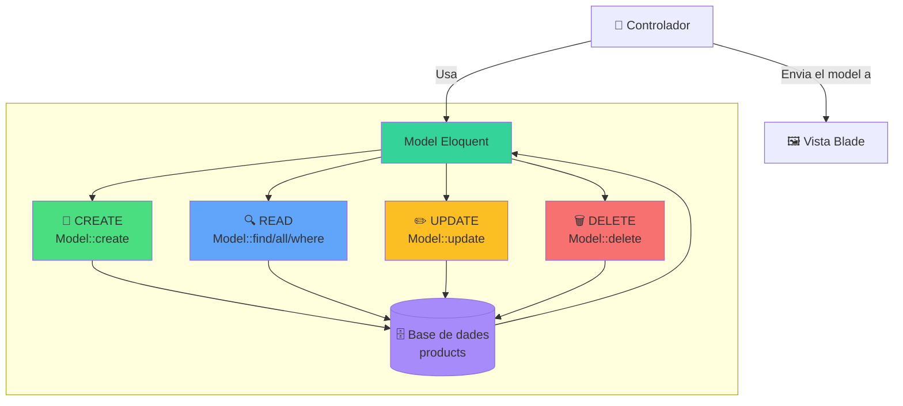

#  8.3. CRUD amb Eloquent

Per a gestionar les dades en una aplicació, és fonamental dominar les operacions CRUD: Crear (Create), Llegir (Read), Actualitzar (Update) i Eliminar (Delete). Eloquent ORM de Laravel simplifica enormement estes operacions, i proporciona mètodes intuïtius i potents per a interactuar amb la base de dades.

## 3.1. Què són les operacions CRUD?

Com es va veure en la sessió 2, amb els controladors de tipus resource, Laravel ja proporciona una estructura bàsica per a gestionar les operacions CRUD. No obstant això, Eloquent porta això al nivell següent en oferir mètodes específics i optimitzats per a cada operació.

Els models compten amb mètodes integrats que faciliten la interacció amb la base de dades, i permeten realitzar operacions CRUD de manera senzilla i elegant.

Algunes de les operacions CRUD més comunes inclouen:

| Operació | Mètode Eloquent | SQL equivalent |
| --- | --- | --- |
| **Create** | `Model::create()` | `INSERT INTO` |
| **Read** | `Model::find()`, `Model::all()` | `SELECT` |
| **Update** | `Model::update()` | `UPDATE` |
| **Delete** | `Model::delete()` | `DELETE` |


<figcaption class="figure-caption-small">🖼️ Figura 8.4: CRUD amb Eloquent</figcaption>


#### Interpretació del diagrama

Este diagrama mostra el flux complet de les operacions CRUD:

1. **Controlador** → Utilitza el model per a iniciar una operació (CREATE, READ, UPDATE o DELETE).
2. **Eloquent** → Traduïx l'operació a SQL i l'executa en la base de dades.
3. **Base de dades** → Processa l'operació i retorna el resultat.
4. **Model Eloquent** → Convertix el resultat en un objecte PHP.
5. **Vista Blade** → Mostra les dades de l'objecte PHP a l'usuari.

**Tot el procés ocorre de forma transparent** sense ni una sola línia d'SQL.

## 3.2. Operació CREATE (crear)

L'operació CREATE permet inserir nous registres en la base de dades. Per a això, Eloquent proporciona diversos mètodes que faciliten la creació de nous registres.

### 3.2.1. Mètodes per a crear registres

Si només cal crear un registre, es poden usar els mètodes següents:

```php
<?php

// Método 1: crear y guardar manualmente
$product = new Product();
$product->name = 'iPhone 15';
$product->description = 'Último modelo de iPhone';
$product->price = 999.99;
$product->category_id = 1;
$product->save(); // Hasta que no se llame a save(), no se guarda en la base de datos
```

```php
<?php

// Método 2: crear directamente y guardar (create)
$product = Product::create([
    'name' => 'iPhone 15',
    'description' => 'Último modelo de iPhone',
    'price' => 999.99,
    'category_id' => 1
]);
```

```php
<?php

// Método 3: crear sin guardar (make)
$product = Product::make([
    'name' => 'iPhone 15',
    'description' => 'Último modelo de iPhone',
    'price' => 999.99,
    'category_id' => 1
]);
$product->save(); // Guardar cuando sea necesario
```

**Assignació massiva i seguretat**

Cal assegurar-se que el model tinga la propietat `$fillable` o `$guarded` correctament configurada per a permetre l'assignació massiva quan s'usa `create()` o `make()`.

### 3.2.2. Crear múltiples registres

També és possible crear múltiples registres alhora. Per a això es pot usar un array d'arrays:

```php
<?php

// crear múltiples productos
$products = Product::create([
    [
        'name' => 'iPhone 15',
        'price' => 999.99,
        'category_id' => 1
    ],
    [
        'name' => 'Samsung Galaxy',
        'price' => 899.99,
        'category_id' => 1
    ],
    [
        'name' => 'iPad Pro',
        'price' => 1099.99,
        'category_id' => 1
    ]
]);
```

## 3.3. Operació READ (llegir)

Per a llegir dades de la base de dades, Eloquent oferix una varietat de mètodes per a recuperar registres de manera eficient.

### 3.3.1. Consultes bàsiques

Algunes de les consultes més comunes inclouen:

```php
<?php

// Obtener todos los registros
$products = Product::all();

// Obtener un registro por ID
$product = Product::find(1);

// Obtener un registro o fallar. Lanza una excepción si no existe
$product = Product::findOrFail(1);

// Obtener el primer registro
$product = Product::first();

// Se posiciona en el último registro y lo obtiene
$product = Product::latest()->first();

// Contar registros
$count = Product::count();
```

### 3.3.2. Consultes amb condicions

El més habitual en les consultes és filtrar els resultats amb condicions. Eloquent també proporciona mètodes intuïtius per a això:

```php
<?php

// WHERE básico
$products = Product::where('category_id', 1)->get();

// WHERE con múltiples condiciones con AND
$products = Product::where('category_id', 1)
                   ->where('price', '>', 100)
                   ->get();

// WHERE con OR
$products = Product::where('category_id', 1)
                   ->orWhere('category_id', 2)
                   ->get();

// WHERE IN
$products = Product::whereIn('category_id', [1, 2, 3])->get();

// WHERE LIKE
$products = Product::where('name', 'like', '%iPhone%')->get();

// WHERE BETWEEN
$products = Product::whereBetween('price', [100, 500])->get();

// WHERE NULL
$products = Product::whereNull('deleted_at')->get();

// Verificar si existe
$exists = Product::where('name', 'iPhone 15')->exists();
```

### 3.3.3. Ordenació i limitació

D'altra banda, és habitual ordenar i limitar els resultats:

```php
<?php

// Ordenar por un campo
$products = Product::orderBy('price', 'desc')->get();
$products = Product::orderBy('name', 'asc')->get();

// Ordenar por múltiples campos
$products = Product::orderBy('category_id')
                   ->orderBy('price', 'desc')
                   ->get();

// Devolver un número limitado de registros
$products = Product::take(10)->get();

// Saltar un número de registros (offset)
$products = Product::skip(10)->get();
```

**Encadenament de mètodes**

Eloquent permet encadenar múltiples mètodes per a construir consultes complexes de manera llegible i fluida.

```php
<?php

$products = Product::where('category_id', 1)
                   ->where('price', '>', 100)
                   ->orderBy('price', 'desc')
                   ->take(10)
                   ->get();
```

### 3.3.4 Paginació simple i avançada

Laravel oferix dos mètodes de paginació per a gestionar grans conjunts de dades. La diferència rau en la quantitat d'informació que s'obté segons el mètode utilitzat.

```php
<?php

// Paginación completa con enlaces (anterior, siguiente, números de página)
$products = Product::paginate(15);

// Paginación simple (solo anterior/siguiente, más rápida)
$products = Product::simplePaginate(15);
```

| Característica | `paginate()` | `simplePaginate()` |
| --- | --- | --- |
| **Números de pàgina** | ✅ Tots els números | ❌ Només anterior/següent |
| **Recompte total** | ✅ Mostra el total de registres | ❌ No compta |
| **Rendiment** | Més lent (compta registres) | Més ràpid |
| **Ús recomanat** | Llistats complets | Feeds infinits, mòbils |

Per a mostrar els enllaços de paginació en la vista Blade, s'utilitza el mètode `links()`:

```php
<?php

@foreach($products as $product)
    {{ -- Contenido -- }}
@endforeach

{{ $products->links() }} {{ -- Genera los enlaces automáticamente -- }}
```

### 3.4. Consultes avançades
Eloquent també admet consultes més avançades com seleccions específiques, agrupaments, unions i subconsultes. Encara que estes són menys comunes, són molt útils en casos específics.

```php
<?php

// SELECT específico
$products = Product::select('name', 'price')->get();

// GROUP BY
$products = Product::groupBy('category_id')
                   ->selectRaw('category_id, count(*) as total')
                   ->get();

// HAVING
$products = Product::groupBy('category_id')
                   ->having('count', '>', 5)
                   ->get();

// JOIN
$products = Product::join('categories', 'products.category_id', '=', 'categories.id')
                   ->select('products.*', 'categories.name as category_name')
                   ->get();

// Subconsultas
$products = Product::where('price', '>', function($query) {
    $query->selectRaw('AVG(price)')
          ->from('products');
})->get();
```

## 3.4. Operació UPDATE (actualitzar)

Per a actualitzar registres existents, Eloquent proporciona mètodes que permeten modificar un o diversos registres de manera senzilla.

Bàsicament, és molt semblant a l'operació CREATE, però en este cas es treballa amb registres que ja existixen. La principal diferència en cridar el mètode `save()` és que Eloquent detecta si el model ja existix en la base de dades (té un ID) i realitza una operació `UPDATE` en lloc d'`INSERT`.

### 3.4.1. Actualitzar registres individuals

```php
<?php

// Método 1: Actualizar por instancia
$product = Product::find(1);
$product->name = 'iPhone 15 Pro';
$product->price = 1099.99;
$product->save();
```

```php
<?php

// Método 2: Actualizar directamente
Product::where('id', 1)->update([
    'name' => 'iPhone 15 Pro',
    'price' => 1099.99
]);
```

```php
<?php

// Método 3: Actualizar o crear
$product = Product::updateOrCreate(
    ['name' => 'iPhone 15'],
    ['price' => 999.99]
);
```

### 3.4.2. Actualitzar múltiples registres

```php
<?php

// Actualizar múltiples registros
Product::where('category_id', 1)->update([
    'is_active' => true
]);

// Actualizar con incremento/decremento
Product::where('category_id', 1)->increment('price', 10);
Product::where('category_id', 1)->decrement('price', 5);

// Actualizar con condiciones
Product::where('price', '<', 100)->update([
    'is_discounted' => true
]);
```

### 3.4.3. Crear o actualitzar (Upsert)
Esta funció combina la creació i l'actualització en una sola operació. Si el registre existix (basant-se en unes condicions), s'actualitza; si no, se'n crea un de nou.

```php
<?php

// crear o actualizar basado en condiciones
$product = Product::updateOrCreate(
    ['name' => 'iPhone 15'], // Condiciones para buscar
    [
        'price' => 999.99,
        'category_id' => 1
    ] // Datos para crear o actualizar
);

// crear o actualizar múltiples registros
Product::upsert([
    ['name' => 'iPhone 15', 'price' => 999.99],
    ['name' => 'Samsung Galaxy', 'price' => 899.99]
], ['name'], ['price']); // name es la clave única, price se actualiza
```

## 3.5. Operació DELETE (eliminar)

L'última operació CRUD és eliminar registres. Eloquent oferix mètodes per a eliminar un o diversos registres de manera segura.

### 3.5.1. Eliminar registres individuals

```php
<?php

// Método 1: Eliminar por instancia
$product = Product::find(1);
$product->delete();

// Método 2: Eliminar directamente
Product::destroy(1);

// Método 3: Eliminar múltiples por ID
Product::destroy([1, 2, 3]);

// Método 4: Eliminar con condiciones
Product::where('price', '<', 50)->delete();
```

**Soft Deletes (eliminació suau)**

Els **Soft Deletes** permeten "eliminar" registres sense esborrar-los físicament (es marquen amb `deleted_at`). Això és útil per a mantindre un historial i poder restaurar dades si cal. Per a usar Soft Deletes, cal afegir el trait `SoftDeletes` al model i assegurar-se que la taula tinga una columna `deleted_at`.

### 3.5.2. Eliminar amb relacions

Quan es treballa amb relacions, és important gestionar les eliminacions de manera adequada per a mantindre la integritat referencial.

Cal definir el comportament de les relacions en els models (per exemple, `onDelete('cascade')` en les migracions) perquè, en eliminar un registre, s'eliminen o s'actualitzen els registres relacionats segons siga necessari.

```php
<?php

// Eliminar en cascada (definido en migración)
$category = Category::find(1);
$category->delete(); // Elimina todos los productos relacionados

// Eliminar con verificación
$product = Product::find(1);
if ($product->orders()->count() == 0) {
    $product->delete();
} else {
    // No se puede eliminar, tiene pedidos
}
```

## 3.6. Bones pràctiques

### 3.6.1. Optimització de consultes

De vegades, les consultes poden tornar-se ineficients si no s'optimitzen correctament. Per exemple, el problema N+1 ocorre quan es fan múltiples consultes addicionals per a carregar relacions.

En este cas s'arrepleguen tots els productes i després, per a cada producte, es fa una consulta addicional per a obtindre'n la categoria. Això pot generar moltes consultes innecessàries.

La solució és usar **Eager Loading** amb el mètode `with()` per a carregar les relacions de manera anticipada en una sola consulta. En este cas, es carrega la categoria de tots els productes en una sola consulta addicional.

A més, es pot optimitzar encara més seleccionant només els camps necessaris en lloc de carregar totes les dades, ja que això reduïx la quantitat de dades transferides, millora el rendiment i assegura la privacitat de les dades.


=== "❌ Problema N+1"
    ```php
    <?php

    $products = Product::all();
    foreach ($products as $product) {
        echo $product->category->name; // Consulta adicional por cada producto
    }
    ```

=== "✅ Eager Loading"
    ```php
    <?php

    $products = Product::with('category')->get();
    foreach ($products as $product) {
        echo $product->category->name; // Sin consultas adicionales
    }
    ```
=== "🔝 Seleccionar només els camps necessaris"
    ```php
    <?php

    $products = Product::with('category:id,name')
                    ->select('id', 'name', 'category_id')
                    ->get();
    ```

## 3.7. Treball amb Collections

Quan es fan consultes amb Eloquent, el resultat no és un array simple, sinó una **Collection** (col·lecció). Les Collections són objectes potents que oferixen mètodes útils per a manipular i verificar dades.


### 3.7.2. Mètodes essencials de Collection

```php
<?php

// Obtener productos (devuelve una Collection)
$products = Product::all();

// Verificar si la colección está vacía
if ($products->isEmpty()) {
    echo "No hay productos";
}

// Verificar si la colección tiene elementos (MUY USADO EN VISTAS)
if ($products->isNotEmpty()) {
    echo "Hay productos disponibles";
}

// Contar elementos
$total = $products->count();

// Obtener el primer elemento
$firstProduct = $products->first();

// Obtener el último elemento
$lastProduct = $products->last();

// Filtrar elementos
$expensiveProducts = $products->filter(function($product) {
    return $product->price > 100;
});

// Mapear/transformar elementos
$productNames = $products->map(function($product) {
    return $product->name;
});

// Verificar si contiene un elemento
$hasProduct = $products->contains('id', 1);

// Sumar valores
$totalPrice = $products->sum('price');

// Obtener valores únicos
$uniqueCategories = $products->pluck('category_id')->unique();
```

### 3.7.3. Ús en controladors i vistes

**En el controlador:**

```php
<?php

public function index()
{
    $products = Product::with('category')->get(); // Devuelve Collection
    
    return view('products.index', [
        'products' => $products
    ]);
}
```

**En les vistes Blade:**

```html
{{ -- Verificar si hay productos usando Collection -- }}
@if($products->isNotEmpty())
    <div class="grid">
        @foreach($products as $product)
            <x-product-card :product="$product" />
        @endforeach
    </div>
@else
    <p>No hay productos disponibles</p>
@endif

{{ -- Mostrar contador -- }}
<p>Total de productos: {{ $products->count() }}</p>

{{ -- Verificar si está vacío -- }}
@if($products->isEmpty())
    <div class="alert">
        No se encontraron productos
    </div>
@endif
```
