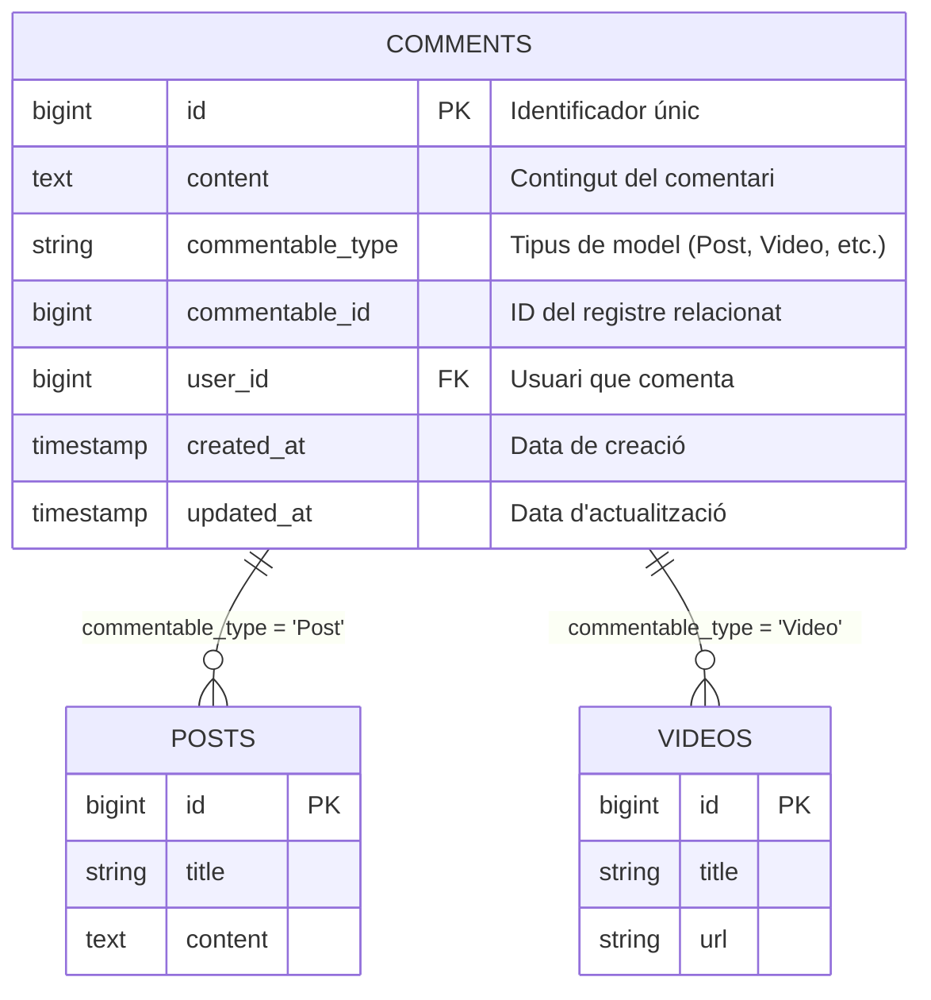

#  8.4. Relacions Eloquent

Com es va veure en el primer apartat, s'implementen relacions entre models (u a u, u a molts, molts a molts), i s'aprén a navegar entre dades relacionades de manera elegant i eficient.

Eloquent ORM facilita la definició i la gestió de relacions entre models, i permet accedir a dades relacionades amb una sintaxi intuïtiva i expressiva.

## 4.1. Què són les relacions en Eloquent?

Les **relacions** en Eloquent definixen com els models estan connectats entre si, i permeten navegar entre dades relacionades de manera elegant i eficient sense escriure SQL complex.


Les relacions Eloquent són com el sistema de referències creuades que connecta tota la informació de la biblioteca!


#### Relacions polimòrfiques

A més de les relacions bàsiques, Eloquent també admet **relacions polimòrfiques**. Estes permeten que un model es relacione amb múltiples tipus de models (p. ex.: Comentaris → Posts/Vídeos). Per a això utilitza una estructura especial en la base de dades amb camps `*_type` i `*_id` per a identificar el model relacionat i el seu identificador.


<figcaption class="figure-caption-small">🖼️ Figura 8.5: Exemple d'estructura de taula polimòrfica - Comentaris</figcaption>


Este tipus de relació és més complexa i durant el curs no es veurà en detall. Però és bo saber que existix.

## 4.2. Relació u a u (1:1)

Per a definir una relació u a u, s'utilitzen els mètodes **`hasOne()`** i **`belongsTo()`** en els models corresponents.

S'afegirà `hasOne()` en el model que "té" la relació i `belongsTo()` en el model que "pertany" a un altre.

```php
<?php

namespace App\Models;

use Illuminate\Database\Eloquent\Model;

class Product extends Model
{
    // Un producto tiene una oferta
    public function offer()
    {
        return $this->hasOne(Offer::class);
    }
}
```

```php
<?php

namespace App\Models;

use Illuminate\Database\Eloquent\Model;

class Offer extends Model
{
    // Una oferta pertenece a un producto
    public function product()
    {
        return $this->belongsTo(Product::class);
    }
}
```

## 4.3. Relació u a molts (1:N)

La relació u a molts és una de les més comunes. Un registre d'una taula pot estar relacionat amb múltiples registres d'una altra taula.

Per a definir una relació u a molts, s'utilitzen els mètodes **`hasMany()`** i **`belongsTo()`** en els models corresponents.

Com en la relació u a u, s'afig `hasMany()` en el model que "té" la relació i `belongsTo()` en el model que "pertany" a un altre.

```php
<?php

namespace App\Models;

use Illuminate\Database\Eloquent\Model;

class Category extends Model
{
    // Una categoría tiene muchos productos
    public function products()
    {
        return $this->hasMany(Product::class);
    }
}
```

```php
<?php

namespace App\Models;

use Illuminate\Database\Eloquent\Model;

class Product extends Model
{
    // Un producto pertenece a una categoría
    public function category()
    {
        return $this->belongsTo(Category::class);
    }
}
```

## 4.4. Relació molts a molts (N:N)

La relació molts a molts permet que múltiples registres d'una taula estiguen relacionats amb múltiples registres d'una altra taula.

Per a definir una relació molts a molts, s'utilitza el mètode **`belongsToMany()`** en els dos models.

```php
<?php

namespace App\Models;

use Illuminate\Database\Eloquent\Model;

class Product extends Model
{
    // Un producto puede estar en el carrito de muchos usuarios
    public function users()
    {
        return $this->belongsToMany(User::class);
    }
}
```

```php
<?php

namespace App\Models;

use Illuminate\Database\Eloquent\Model;

class User extends Model
{
    // Un usuario puede tener muchos productos en su carrito/favoritos
    public function products()
    {
        return $this->belongsToMany(Product::class);
    }
}
```

Si no s'especifica, Eloquent assumix que el nom de la taula pivot es forma amb els noms de les taules en orde alfabètic (p. ex.: `product_user`). Si la taula té un nom diferent, es pot passar com a segon paràmetre a `belongsToMany()`.

```php
<?php
return $this->belongsToMany(Product::class, 'cart_items');
```

### 4.4.1. Taula pivot amb camps addicionals

Sovint, les taules pivot necessiten emmagatzemar informació addicional més enllà de les claus foranes. Per exemple, en un carret de la compra, cal saber la **quantitat** de cada producte.

Per a això, es poden definir camps addicionals en la migració de la taula pivot i després accedir-hi usant el mètode `withPivot()` en la definició de la relació.

```php
<?php
// Modelo User con acceso a campos pivot
class User extends Model
{
    public function products()
    {
        return $this->belongsToMany(Product::class, 'product_user')
            ->withPivot('quantity')      // Incluir campo quantity
            ->withTimestamps();          // Incluir created_at y updated_at
    }
}
```

```php
<?php

namespace App\Models;

use Illuminate\Database\Eloquent\Model;

// Modelo Product (relación inversa)
class Product extends Model
{
    public function users()
    {
        return $this->belongsToMany(User::class, 'product_user')
            ->withPivot('quantity')
            ->withTimestamps();
    }
}
```

### 4.4.4. Accedir a dades pivot en controladors i vistes

Una vegada definida la relació amb `withPivot()`, es pot accedir a les dades addicionals de la taula pivot a través de l'objecte `pivot`.

```php
<?php
{{ -- Mostrar productos del carrito con cantidad -- }}
@foreach($cartProducts as $product)
    <div class="cart-item">
        <h3>{{ $product->name }}</h3>
        <p>Precio: €{{ $product->price }}</p>
        
        {{  -- Acceder al campo quantity de la tabla pivot --  }}
        <p>Cantidad: {{ $product->pivot->quantity }}</p>
        
        {{  -- Calcular subtotal --  }}
        @php
            $subtotal = $product->price * $product->pivot->quantity;
        @endphp
        <p>Subtotal: €{{ number_format($subtotal, 2) }}</p>
        
        {{  -- Fecha de añadido (timestamps) --  }}
        <small>Añadido: {{ $product->pivot->created_at->format('d/m/Y') }}</small>
    </div>
@endforeach
```

### 4.5. Usar relacions

Per a obtindre dades de les relacions només cal cridar-les com si foren una propietat més.

```php
<?php
$category = Category::find(1); // Se obtiene la categoría con ID 1
$products = $category->products; // Llama a la relación 1:N

$product = $products::first(); // Se obtiene el primer producto de la categoría
$offer = $product->offer; // Llama a la relación 1:1

$users = $product->users; // Llama a la relación N:N
```

Si es vol filtrar la consulta de la relació, es pot cridar com un mètode (amb parèntesis) per a obtindre el constructor de consultes i aplicar condicions.

```php
<?php
$category = Category::find(1);
$products = $category->products()->where('price', '>', 100)->get(); // Necesita el parentesis
```

Si es vol modificar la informació de les dades relacionades, amb les relacions 1:1 i 1:N es pot usar el mètode **`save()`** o **`create()`** en la relació. Però amb les relacions N:N s'usen els mètodes **`attach()`**, **`detach()`** i **`sync()`**.

```php
<?php
// Añadir productos a la pivot (product_user)
$user = User::find(1);
$user->products()->attach([1, 2, 3]); // Se añaden productos con ID 1, 2 y 3 al usuario

// Sincronizar carrito (elimina los que no están en el array). Si no existe, lo añade.
$user->products()->sync([1, 2, 3]);

// Añadir producto con datos adicionales (cantidad)
$user->products()->attach(1, ['quantity' => 2]);

// Añadir productos con datos adicionales (cantidad)
$user->products()->attach([
    2 => ['quantity' => 1],
    3 => ['quantity' => 5]
]);

// Actualizar la cantidad de un producto en el carrito
$user->products()->updateExistingPivot($productId, [
    'quantity' => 3
]);
```

#### Actualitzar dades pivot

El mètode `updateExistingPivot()` només actualitza les dades addicionals de la taula pivot. No sincronitza l'existència del registre. Si el registre no existix, no es crea.

