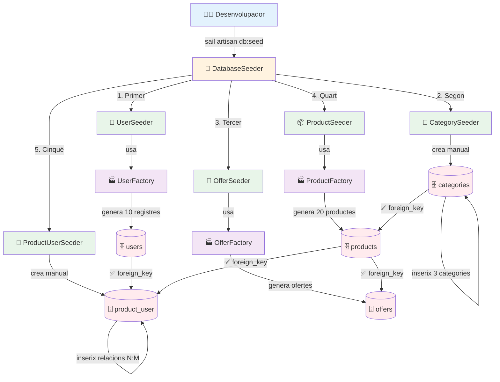

#  8.5. Seeders i Factories

Una vegada que s'ha aprés a gestionar l'estructura de la base de dades amb migracions i a interactuar amb les dades per mitjà d'Eloquent ORM, el pas següent és omplir la base de dades amb dades inicials i de prova. Això s'aconseguix utilitzant **seeders** i **factories**, eines que permeten automatitzar la creació de grans quantitats de dades realistes per a facilitar el desenvolupament i les proves.

## 5.1. Què són els Seeders?

Els **seeders** són classes que definixen dades inicials per a omplir la base de dades amb informació fixa o de prova. Permeten establir un estat inicial consistent de la base de dades per a desenvolupament i testing.


Els seeders són com el pla d'adquisició inicial que assegura que la teua biblioteca tinga tot allò essencial des del primer dia!

## 5.2. Creació de Seeders

### 5.2.1. Comandament per a crear Seeders

Per a crear un seeder, s'utilitza el comandament Artisan **`make:seeder`** seguit del nom del seeder.

```bash
# Crear un seeder básico
sail artisan make:seeder CategorySeeder
```

### 5.2.2. Estructura bàsica d'un Seeder
Una vegada creat, un seeder té una estructura bàsica amb un mètode `run()` on es definix la lògica per a inserir dades en la base de dades.

```php
<?php

namespace Database\Seeders;

use Illuminate\Database\Seeder;
use App\Models\Category;

class CategorySeeder extends Seeder
{
    /**
     * Run the database seeds.
     */
    public function run(): void
    {
        // Lógica para poblar la base de datos
    }
}
```

### 5.2.3. Seeder bàsic amb dades estàtiques

Dins del mètode `run()`, es poden inserir dades manualment utilitzant els models Eloquent. Per a això, el més convenient és tindre un array amb les dades i després iterar-hi per a crear els registres.

```php
<?php

namespace Database\Seeders;

use Illuminate\Database\Seeder;
use App\Models\Category;

class CategorySeeder extends Seeder
{
    public function run(): void
    {
        $categories = [
            [
                'name' => 'Electrónica',
                'slug' => 'electronica',
                'description' => 'Dispositivos electrónicos de última generación'
            ],
            [
                'name' => 'Ropa',
                'slug' => 'ropa',
                'description' => 'Moda y accesorios para todas las estaciones'
            ],
            [
                'name' => 'Hogar',
                'slug' => 'hogar',
                'description' => 'Artículos para el hogar y decoración'
            ]
        ];

        foreach ($categories as $category) {
            Category::create($category);
        }
    }
}
```

### 5.2.4. Seeder amb relacions
Els seeders també poden crear dades que depenguen d'altres registres, respectant les relacions definides en la base de dades.

Per exemple, un `ProductSeeder` que crea productes associats a categories i ofertes existents. A continuació es mostra un exemple d'un seeder que crea categories, productes i ofertes, respectant les relacions entre ells.

```php
<?php

namespace Database\Seeders;

use Illuminate\Database\Seeder;
use App\Models\Category;
use App\Models\Product;
use App\Models\Offer;

class ProductSeeder extends Seeder
{
    public function run(): void
    {
        // Crear categorías
        $electronics = Category::create([
            'name' => 'Electrónica',
            'slug' => 'electronica'
        ]);

        $clothing = Category::create([
            'name' => 'Ropa',
            'slug' => 'ropa'
        ]);

        // Crear productos
        $iphone = Product::create([
            'name' => 'iPhone 15',
            'description' => 'Último modelo de iPhone',
            'price' => 999.99,
            'category_id' => $electronics->id
        ]);
        
        // Crear oferta para el iPhone
        Offer::create([
            'product_id' => $iphone->id,
            'discount_price' => 799.99,
            'start_date' => now(),
            'end_date' => now()->addDays(7)
        ]);

        $shirt = Product::create([
            'name' => 'Camiseta Premium',
            'description' => 'Camiseta de algodón orgánico',
            'price' => 29.99,
            'category_id' => $clothing->id
        ]);
    }
}
```

!!!tenencuenta "Atenció"
    Este seeder crea múltiples entitats en un mateix seeder. En aplicacions reals, **és recomanable separar cada entitat en el seu propi seeder** per a mantindre el codi net i modular.

## 5.3. Què són les Factories?

Quan els seeders necessiten crear grans quantitats de dades que no són fixes, les factories són l'eina ideal per a generar estes dades, ja que permeten definir patrons i variacions en les dades generades.

Les **factories** són classes que generen dades de prova realistes de forma automatitzada. Utilitzen la llibreria `Faker` per a crear dades variades i creïbles per a desenvolupament i testing.


Les factories són la teua impremta automàtica que omple la biblioteca amb contingut realista per a provar tot el sistema!

## 5.4. Creació de Factories

### 5.4.1. Comandament per a crear Factories

Per a crear una factory, s'utilitza el comandament Artisan **`make:factory`** seguit del nom de la factory i, opcionalment, del model associat.

Si s'especifica el model, la factory es vincula automàticament a eixe model, la qual cosa facilita la creació d'instàncies d'este.

```bash
# Crear un factory básico
sail artisan make:factory ProductFactory

# Crear factory con modelo especificado
sail artisan make:factory ProductFactory --model=Product
```

### 5.4.2. Estructura bàsica d'una Factory

Les factories tenen una estructura bàsica que inclou un mètode `definition()` on es definixen els atributs del model i com es generen els seus valors utilitzant Faker.

```php
<?php

namespace Database\Factories;

use Illuminate\Database\Eloquent\Factories\Factory;
use App\Models\Category;

class ProductFactory extends Factory
{
    /**
     * Define the model's default state.
     */
    public function definition(): array
    {
        // Definir los atributos con datos generados por Faker
    }
}
```

### 5.4.3. Factory bàsica amb dades realistes

Les factories han de definir atributs amb dades generades per Faker per a crear registres variats i realistes.

Per exemple, una factory per al model `Product` podria ser així:

```php
<?php

namespace Database\Factories;

use Illuminate\Database\Eloquent\Factories\Factory;
use App\Models\Category;

class ProductFactory extends Factory
{
    public function definition(): array
    {
        return [
            'name' => $this->faker->randomElement([
                'iPhone 15 Pro',
                'Samsung Galaxy S24',
                'MacBook Air M3',
                'iPad Pro 12.9"',
                'AirPods Pro',
                'Apple Watch Series 9'
            ]),
            'description' => $this->faker->paragraph(3),
            'price' => $this->faker->randomFloat(2, 99, 1999),
            'category_id' => Category::factory(),
            'image' => $this->faker->imageUrl(400, 300, 'products'),
            'is_active' => $this->faker->boolean(90), // 90% activos
        ];
    }
}
```

#### Faker

Faker és una llibreria que genera dades falses però realistes, com ara noms, adreces, textos, números, dates, etc. Laravel la integra per a facilitar la creació de dades de prova.

Més informació: [**Faker PHP**](https://fakerphp.github.io/){:target="blank"}.

???teolaravel "Taula dels mètodes de Faker més comuns"

    | Categoria                   | Mètode Faker                                      | Tipus de dada | Exemple generat                               | Ús habitual / Comentari                                             |
    | --------------------------- | ------------------------------------------------- | ------------ | --------------------------------------------- | ------------------------------------------------------------------- |
    | **Text bàsic**              | `$this->faker->word()`                            | string       | `"mesa"`                                      | Paraula solta, útil per a noms curts de productes o categories.     |
    |                             | `$this->faker->sentence()`                        | string       | `"El producto es de gran calidad."`           | Una frase aleatòria; ideal per a descripcions.                      |
    |                             | `$this->faker->paragraph()`                       | string       | `"Lorem ipsum dolor sit amet..."`             | Text més llarg, per a camps de tipus “detall” o “biografia”.        |
    |                             | `$this->faker->text(100)`                         | string       | `"Innovador sistema de ahorro de energía..."` | Text de longitud controlada.                                        |
    
    
    | Categoria                   | Mètode Faker                                      | Tipus de dada | Exemple generat                               | Ús habitual / Comentari                                             |
    | --------------------------- | ------------------------------------------------- | ------------ | --------------------------------------------- | ------------------------------------------------------------------- |
    | **Persones i usuaris**      | `$this->faker->name()`                            | string       | `"Raúl García"`                               | Nom complet.                                                        |
    |                             | `$this->faker->firstName()`                       | string       | `"Laura"`                                     | Nom de pila.                                                        |
    |                             | `$this->faker->lastName()`                        | string       | `"Martínez"`                                  | Cognom.                                                             |
    |                             | `$this->faker->firstNameMale()`                   | string       | `"Arturo"`                                    | Nom masculí.                                                        |
    |                             | `$this->faker->firstNameFemale()`                 | string       | `"Alba"`                                      | Nom femení.                                                         |
    |                             | `$this->faker->title()`                           | string       | `"Sr"` / "Sra."`                              | Títol aleatori.                                                     |
    |                             | `$this->faker->titleMale()`                       | string       | `"Sr"`                                        | Títol masculí.                                                      |
    |                             | `$this->faker->titleFemale()`                     | string       | `"Sra."`                                      | Títol femení.                                                       |
    |                             | `$this->faker->userName()`                        | string       | `"lmartinez87"`                               | Nom d'usuari.                                                       |
    |                             | `$this->faker->email()`                           | string       | `"raul@example.com"`                          | Correu electrònic.                                                  |
    |                             | `$this->faker->safeEmail()`                       | string       | `"maria@test.com"`                            | Correu segur (no real).                                             |
    |                             | `$this->faker->unique()->email()`                 | string       | `"cliente1@example.com"`                      | Assegura que no es repetisquen correus.                             |
    |                             | `$this->faker->phoneNumber()`                     | string       | `"+34 687 234 556"`                           | Telèfon realista, format variable.                                  |
    
    
    | Categoria                   | Mètode Faker                                      | Tipus de dada | Exemple generat                               | Ús habitual / Comentari                                             |
    | --------------------------- | ------------------------------------------------- | ------------ | --------------------------------------------- | ------------------------------------------------------------------- |
    | **Adreces i llocs**         | `$this->faker->address()`                         | string       | `"Calle Mayor, 12, Valencia"`                 | Adreça completa.                                                    |
    |                             | `$this->faker->city()`                            | string       | `"Alginet"`                                   | Ciutat.                                                             |
    |                             | `$this->faker->country()`                         | string       | `"España"`                                    | País.                                                               |
    |                             | `$this->faker->postcode()`                        | string       | `"46230"`                                     | Codi postal.                                                        |
    
    | Categoria                   | Mètode Faker                                      | Tipus de dada | Exemple generat                               | Ús habitual / Comentari                                             |
    | --------------------------- | ------------------------------------------------- | ------------ | --------------------------------------------- | ------------------------------------------------------------------- |
    | **Internet i tecnologia**   | `$this->faker->url()`                             | string       | `"https://example.com"`                       | Adreça web.                                                         |
    |                             | `$this->faker->ipv4()`                            | string       | `"192.168.0.15"`                              | IP local o pública.                                                 |
    |                             | `$this->faker->password()`                        | string       | `"A8s!x0qZ"`                                  | Contrasenya aleatòria.                                              |
    |                             | `$this->faker->uuid()`                            | string       | `"d3f4a6e8-9c2a-11ec-b909-0242ac120002"`      | Identificador únic global.                                          |
    
    | Categoria                   | Mètode Faker                                      | Tipus de dada | Exemple generat                               | Ús habitual / Comentari                                             |
    | --------------------------- | ------------------------------------------------- | ------------ | --------------------------------------------- | ------------------------------------------------------------------- |
    | **Dates i temps**           | `$this->faker->date()`                            | date         | `"2025-11-06"`                                | Data aleatòria.                                                     |
    |                             | `$this->faker->time()`                            | time         | `"15:34:21"`                                  | Hora.                                                               |
    |                             | `$this->faker->dateTimeBetween('-1 year', 'now')` | datetime     | `"2024-09-12 08:23:11"`                       | Molt útil per a “data d'alta” o “data de comanda”.                  |
    |                             | `$this->faker->dateTimeThisMonth()`               | datetime     | `"2025-11-03 19:45:00"`                       | Dates recents.                                                      |
    
    | Categoria                   | Mètode Faker                                      | Tipus de dada | Exemple generat                               | Ús habitual / Comentari                                             |
    | --------------------------- | ------------------------------------------------- | ------------ | --------------------------------------------- | ------------------------------------------------------------------- |
    | **Números i quantitats**    | `$this->faker->randomDigit()`                     | int          | `7`                                           | Dígit (0–9).                                                        |
    |                             | `$this->faker->randomNumber(3)`                   | int          | `382`                                         | Número amb longitud definida.                                       |
    |                             | `$this->faker->numberBetween(10, 100)`            | int          | `64`                                          | Número en un rang concret.                                          |
    |                             | `$this->faker->randomFloat(2, 1, 500)`            | float        | `87.35`                                       | Números amb decimals, ideal per a preus.                            |
    |                             | `$this->faker->boolean()`                         | bool         | `true`                                        | Vertader o fals (50%).                                              |
    |                             | `$this->faker->boolean(20)`                       | bool         | `false`                                       | Probabilitat personalitzada (20% de true).                          |
    
    
    | Categoria                   | Mètode Faker                                      | Tipus de dada | Exemple generat                               | Ús habitual / Comentari                                             |
    | --------------------------- | ------------------------------------------------- | ------------ | --------------------------------------------- | ------------------------------------------------------------------- |
    | **Comerç i empresa**        | `$this->faker->company()`                         | string       | `"TechNova S.L."`                             | Nom d'empresa.                                                      |
    |                             | `$this->faker->catchPhrase()`                     | string       | `"Soluciones inteligentes para el hogar"`     | Eslògan corporatiu.                                                 |
    |                             | `$this->faker->jobTitle()`                        | string       | `"Desarrollador Web"`                         | Càrrec o lloc de treball.                                           |
    |                             | `$this->faker->bs()`                              | string       | `"orchestrate vertical markets"`              | Frase d'estil “argot de negocis”.                                   |
    
    | Categoria                   | Mètode Faker                                      | Tipus de dada | Exemple generat                               | Ús habitual / Comentari                                             |
    | --------------------------- | ------------------------------------------------- | ------------ | --------------------------------------------- | ------------------------------------------------------------------- |
    | **Geografia i coordenades** | `$this->faker->latitude()`                        | float        | `39.20012`                                    | Coordenada de latitud.                                              |
    |                             | `$this->faker->longitude()`                       | float        | `-0.42917`                                    | Coordenada de longitud.                                             |
    
    
    | Categoria                   | Mètode Faker                                      | Tipus de dada | Exemple generat                               | Ús habitual / Comentari                                             |
    | --------------------------- | ------------------------------------------------- | ------------ | --------------------------------------------- | ------------------------------------------------------------------- |
    | **Miscel·lània**            | `$this->faker->colorName()`                       | string       | `"azul marino"`                               | Nom de color.                                                       |
    |                             | `$this->faker->fileExtension()`                   | string       | `"pdf"`                                       | Extensió de fitxer.                                                 |
    |                             | `$this->faker->mimeType()`                        | string       | `"image/png"`                                 | Tipus MIME.                                                         |
    |                             | `$this->faker->creditCardNumber()`                | string       | `"4532 7896 1234 5678"`                       | Targeta simulada.                                                   |
    |                             | `$this->faker->iban()`                            | string       | `"ES91 2100 0418 4502 0005 1332"`             | IBAN vàlid.                                                         |
    |                             | `$this->faker->currencyCode()`                    | string       | `"EUR"`                                       | Codi ISO de moneda.                                                 |
    |                             | `$this->faker->imageUrl(640, 480, 'products')`    | string (URL) | `"https://loremflickr.com/640/480/products"`  | Imatge simulada per categoria.                                      |
    
    
    | Categoria                   | Mètode Faker                                      | Tipus de dada | Exemple generat                               | Ús habitual / Comentari                                             |
    | --------------------------- | ------------------------------------------------- | ------------ | --------------------------------------------- | ------------------------------------------------------------------- |
    | **Localització**            | `$this->faker->locale()`                          | string       | `"es_ES"`                                     | Idioma i regió.                                                     |


???teolaravel "Possibilitat de canviar l'idioma dels fakers"
    Si volem canviar l'idioma d'anglés a espanyol en la creació de factories, hem de fer els canvis següents:

    - En el fitxer `config/app.php`:
    ```bash
    'locale' => env('APP_LOCALE', 'es'),

    'fallback_locale' => env('APP_FALLBACK_LOCALE', 'es'),

    'faker_locale' => env('APP_FAKER_LOCALE', 'es_ES'),
    ```
    - En el fitxer `.env`:
    ```bash
    APP_LOCALE=es
    APP_FALLBACK_LOCALE=es
    APP_FAKER_LOCALE=es_ES
    ```    
    - Netejar la memòria cau de configuració perquè Laravel la torne a llegir: 
    ```bash
    php artisan config:clear
    php artisan cache:clear
    php artisan optimize:clear
    ```   
    - Després pots comprovar quin idioma està actiu:
    ```bash
    php artisan tinker
    >>> config('app.faker_locale');
    => "es_ES"
    ```   

## 5.5. Ús de Factories

Es poden crear registres individuals o múltiples utilitzant les factories. A continuació es mostren exemples de com utilitzar les factories.

```php
// Crear un producto
$product = Product::factory()->create();

// Crear un producto con datos específicos
$product = Product::factory()->create([
    'name' => 'iPhone 15',
    'price' => 999.99
]);

// Crear 10 productos
$products = Product::factory(10)->create();

// Crear productos con datos específicos
$products = Product::factory(5)->create([
    'category_id' => 1
]);

// Crear productos sin guardar en base de datos
$products = Product::factory(10)->make();
```

### 5.5.3. Factories en Seeders

Les factories s'utilitzen dins dels seeders per a crear registres en la base de dades. Per tant, el més habitual és veure'n l'ús dins del mètode `run()` dels seeders.

En este exemple es mostra un seeder que utilitza factories per a crear categories, productes i ofertes, i per a assignar productes a usuaris.

```php
<?php

namespace Database\Seeders;

use Illuminate\Database\Seeder;
use App\Models\Product;
use App\Models\Category;
use App\Models\Offer;
use App\Models\User;

class ProductSeeder extends Seeder
{
    public function run(): void
    {
        // Crear categorías
        $categories = Category::factory(5)->create();

        // Crear productos
        $products = Product::factory(50)->create();

        // Crear ofertas para algunos productos
        $products->random(10)->each(function ($product) {
            Offer::factory()->create([
                'product_id' => $product->id
            ]);
        });

        // Asignar productos a usuarios (carrito/favoritos)
        $users = User::factory(10)->create();
        $users->each(function ($user) use ($products) {
            $user->products()->attach(
                $products->random(rand(1, 5))->pluck('id')->toArray(),
                ['quantity' => rand(1, 3)]
            );
        });
    }
}
```

#### Funcions avançades

La funció `each()` permet iterar sobre una col·lecció i aplicar una funció a cada element, la qual cosa facilita la creació de relacions i dades addicionals de forma dinàmica.

D'altra banda, `pluck()` extrau un array amb els valors d'una columna específica de la col·lecció, útil per a obtindre IDs o altres atributs.

## 5.6. Seeder principal

Quan es treballa amb bases de dades relacionals amb claus foranes, **l'orde d'execució dels seeders és crucial**. Cal crear primer les entitats "pare" abans que les entitats "filla" que en depenen.


Per a això cal assegurar-se que les taules que no tinguen claus foranes s'executen primer, i que les taules que depenen d'altres (per exemple, productes que depenen de categories) s'executen després.

Per a executar els seeders i omplir la base de dades, s'utilitza el seeder principal `DatabaseSeeder`, que al seu torn crida la resta de seeders en l'orde definit.

```php
<?php
namespace Database\Seeders;
use Illuminate\Database\Seeder;
class DatabaseSeeder extends Seeder
{
    public function run(): void
    {
        $this->call([
            UserSeeder::class,
            CategorySeeder::class,
            OfferSeeder::class,
            ProductSeeder::class,
            ProductUserSeeder::class,
        ]);
    }
}
```

En el diagrama següent es mostra un exemple de com els seeders i les factories treballen junts per a omplir la base de dades. Estos s'han d'executar en un orde específic per a respectar les relacions de claus foranes entre taules.


<figcaption class="figure-caption-small">🖼️ Figura 8.6: L'orde d'execució dels seeders ha de ser concret</figcaption>