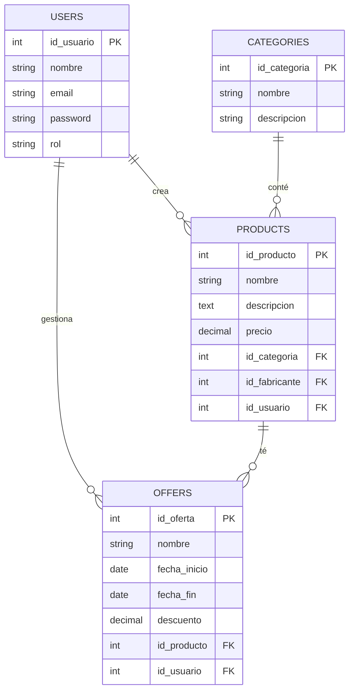

#  Pràctica guiada

???teolaravel "Glossari tècnic"
	| Terme | Definició |
	| --- | --- |
	| **Base de dades relacional** | Sistema de gestió de dades que organitza la informació en taules relacionades entre si. |
	| **CRUD** | Acrònim de Create, Read, Update, Delete: les operacions bàsiques de gestió de dades. |  
	| **Eloquent** | ORM inclòs en Laravel que facilita la interacció amb la base de dades mitjançant models PHP. |  
	| **Esquema** | Estructura completa de la base de dades, incloent-hi taules, columnes, relacions i restriccions. |  
	| **Factory** | Classe que genera de manera automatitzada dades de prova realistes per al desenvolupament i les proves. |  
	| **Migració** | Fitxer que definix canvis en l'estructura de la base de dades de manera versionada i reversible. |  
	| **Model** | Classe PHP que representa una taula de la base de dades i definix com interactuar amb les seues dades. |  
	| **ORM** | Mapatge objecte-relacional que permet interactuar amb la base de dades mitjançant objectes en lloc d'SQL directe. |  
	| **Relació** | Connexió lògica entre dues taules que permet navegar entre dades relacionades. |                
	| **Seeder** | Classe que definix dades inicials per a omplir la base de dades amb informació de prova. |                


???teolaravel "FAQ (preguntes freqüents sobre la pràctica)"
	* **Error "SQLSTATE[42S01]: Base table or view already exists" en executar les migracions**
	
		Verifica els passos següents:
	
		1. Executa `php artisan migrate:status` per a veure quines migracions ja s'han executat
		2. Si necessites tornar a crear les taules, executa `php artisan migrate:fresh` (elimina totes les taules i les torna a crear)
		3. Verifica que no hi ha migracions duplicades a `database/migrations/`
		4. Comprova que el nom de les taules a `Schema::create()` és únic
		5. Si treballes en equip, sincronitza les migracions amb Git abans d'executar-les
	* **Error "SQLSTATE[HY000] [1215] Cannot add foreign key constraint" a les migracions**
	
		Verifica els passos següents:
	
		1. Les migracions s'executen en l'ordre correcte (primer les taules referenciades i després les que hi fan referència)
		2. Els tipus de dades coincidixen exactament (`foreignId()` utilitza BIGINT UNSIGNED)
		3. El nom de la taula referenciada existix i és correcte a `constrained('tabla')`
		4. Les claus foranes apunten a camps que són PRIMARY KEY o que tenen un índex UNIQUE
		5. Utilitza `Schema::enableForeignKeyConstraints()` si cal
	* **Error "Class 'App\Models\NombreModelo' not found" en controladors o seeders**
		
		Verifica els passos següents:
		
		1. El model existix a `app/Models/` amb el nom correcte (distingix majúscules i minúscules)
		2. El namespace del model és correcte (`namespace App\Models;`)
		3. Has importat el model a la part superior del fitxer amb `use App\Models\NombreModelo;`
		4. El nom de la classe coincidix amb el nom del fitxer
		5. Executa `composer dump-autoload` per a regenerar l'autoloader

	* **Error "SQLSTATE[23000]: Integrity constraint violation" en executar els seeders**
	
		Verifica els passos següents:

		1. Els seeders s'executen en l'ordre correcte, respectant les claus foranes
		2. Els ID de les dades mock coincidixen amb els ID reals de la base de dades
		3. No hi ha valors duplicats en camps `unique()` (com `slug` o `email`)
		4. Els camps `NOT NULL` tenen valors assignats
		5. Executa `php artisan migrate:fresh --seed` per a netejar-ho i tornar-ho a crear tot
	* **Els models no tornen dades o tornen col·leccions buides**
	
		Verifica els passos següents:
		
		1. Has executat correctament els seeders amb `php artisan db:seed`
		2. Verifica que hi ha dades a la taula amb `php tinker` i `NombreModelo::count()`
		3. El nom de la taula al model coincidix amb la taula real (Laravel utilitza la pluralització)
		4. Si utilitzes una taula personalitzada, definix `protected $table = 'nombre_tabla';` al model
		5. Verifica la connexió a la base de dades amb `php artisan migrate:status`
	* **Error "Call to a member function on null" en accedir a les relacions**
	
		Verifica els passos següents:
		
		1. La relació està definida correctament en tots dos models (bidireccional)
		2. Les claus foranes tenen el nom correcte (`tabla_id` en singular)
		3. Utilitza `with()` per a carregar les relacions: `Product::with('category')->find($id)`
		4. Utilitza operadors null-safe: `$product->offer?->name` per a relacions opcionals
		5. Verifica que hi ha dades relacionades a la base de dades
	* **El problema N+1: moltes consultes SQL en llistar productes amb categories/ofertes**
	
		Solució amb Eager Loading (càrrega anticipada):
		
		1. Utilitza `with()` per a carregar les relacions per avançat: `Product::with(['category', 'offer'])->get()`
		2. Per a diverses relacions: `Product::with(['category', 'offer', 'users'])->get()`
		3. Al controlador, substituïx `Product::all()` per `Product::with(['category', 'offer'])->get()`
		4. Verifica les consultes amb Laravel Telescope o `DB::enableQueryLog()`
		5. Utilitza `load()` per a carregar relacions després: `$products->load('category')`
	* **Error "Mass assignment" en crear registres amb `Model::create()`**
	
		Verifica els passos següents:
		
		1. Definix `$fillable` al model amb els camps que es poden assignar massivament
		2. O utilitza `$guarded = []` per a permetre tots els camps (menys segur)
		3. Com a alternativa, crea el model i assigna els camps manualment: `$model = new Model(); $model->campo = $valor;`
		4. Verifica que els noms dels camps de `$fillable` coincidixen amb els de la taula
		5. Utilitza temporalment `unguard()` als seeders si cal
	* **Els seeders no inserixen dades o fallen sense mostrar cap error**
	
		Verifica els passos següents:
			
		1. El seeder està registrat a `DatabaseSeeder.php` amb `$this->call(NombreSeeder::class)`
		2. L'ordre d'execució respecta les claus foranes (primer les taules referenciades)
		3. Les dades del trait `LoadsMockData` tenen l'estructura correcta
		4. Executa `php artisan db:seed --class=NombreSeeder` per a veure errors específics
		5. Revisa els logs a `storage/logs/laravel.log` per a veure errors detallats
	* **Error en utilitzar `attach()` amb una taula pivot: "Column not found"**
	
		Verifica els passos següents:
		
		1. La taula pivot seguix la convenció: ordre alfabètic i en singular (`product_user`, no `user_product`)
		2. Els camps addicionals es passen en el segon paràmetre: `attach($id, ['quantity' => 2])`
		3. Definix `withPivot('quantity')` a la relació del model
		4. La taula pivot té `withTimestamps()` si utilitzes `created_at`/`updated_at`
		5. Utilitza `sync()` en lloc d'`attach()` si vols substituir les relacions existents
	* **Com puc verificar si les relacions funcionen correctament?**
	
		Utilitza Tinker per a provar-ho:
		
		1. Obri Tinker: `php artisan tinker`
		2. Obtín un producte: `$product = Product::first()`
		3. Accedix a la categoria: `$product->category`
		4. Accedix a l'oferta: `$product->offer`
		5. Llista els usuaris: `$product->users` (hauria de tornar una col·lecció)
	* **Error "Too few arguments to function" en mètodes de relació**
	
		Verifica els passos següents:
		
		1. Els mètodes de relació NO porten paràmetres quan es definixen: `public function category()`
		2. Quan hi accedixes com a propietat, NO utilitzes parèntesis: `$product->category`
		3. Quan hi accedixes com a mètode (per al query builder), SÍ que has d'utilitzar parèntesis: `$product->category()->where(...)`
		4. Verifica que el mètode torna un objecte de relació: `return $this->belongsTo(Category::class)`
		5. No confongues els accessors/mutators amb les relacions
	* **Els timestamps (`created_at`, `updated_at`) no s'actualitzen automàticament**
	
		Verifica els passos següents:
		
		1. La migració inclou `$table->timestamps()` per a crear els camps
		2. El model NO té `public $timestamps = false;`
		3. Utilitza mètodes d'Eloquent (`create()`, `update()`) en lloc d'SQL directe
		4. Per a una taula pivot, utilitza `withTimestamps()` en la definició de la relació
		5. Verifica que els camps de la base de dades són de tipus `TIMESTAMP`
	* **Com puc depurar quines consultes SQL executa Eloquent?**
	
		Utilitza estes tècniques:
		
		1. Laravel Telescope: `php artisan telescope:install` i revisa la pestanya Queries
		2. Query Log: `DB::enableQueryLog()` abans i `dd(DB::getQueryLog())` després
		3. En Tinker: `DB::connection()->enableQueryLog()` i després executa les consultes
		4. Mètode `toSql()`: `Product::with('category')->toSql()` mostra l'SQL sense executar-lo
		5. Bolcat del model: `Product::first()->toArray()` per a veure l'estructura de dades
   
### Objectiu

L'objectiu d'esta pràctica és migrar la botiga en línia de la pràctica 2 de dades mock a una base de dades real amb Laravel. S'implementaran migracions per a definir l'estructura de la base de dades, models Eloquent per a interactuar amb les dades, operacions CRUD completes, relacions entre models i seeders per a omplir la base de dades amb dades inicials.

#### Continuïtat amb la pràctica 2

Esta pràctica està basada en la botiga en línia creada en la **pràctica 2**. Es migraran les dades mock (categories, productes, ofertes, carret) a una base de dades real, mantenint la mateixa funcionalitat i estructura.

- **Base de dades**: s'utilitzarà MySQL a través de Laravel Sail per a la persistència de dades.

- **Dades mock**: els fitxers mock creats en la pràctica 2 (`mock-categories.php`, `mock-products.php`, `mock-offers.php`, `mock-cart.php`) es reutilitzaran als seeders per a omplir la base de dades.

#### Què farem?

En esta pràctica aprendràs a:

* **Migrar de dades mock a una base de dades real**: transformar els arrays PHP en taules MySQL.
* **Crear migracions**: definir l'estructura de les taules (categories, productes, ofertes, carret).
* **Implementar models Eloquent**: crear models amb relacions entre entitats.
* **Fer operacions CRUD completes**: crear, llegir, actualitzar i eliminar dades.
* **Crear seeders**: omplir la base de dades reutilitzant les dades mock de la pràctica 2.
* **Actualitzar els controladors**: substituir el trait `LoadsMockData` per consultes Eloquent.


### Diagrama de relacions entre taules


<figcaption class="figure-caption-small">🖼️ Figura 8.7: Model E/R de la pràctica guiada</figcaption>


### FASE 1: Configurar la base de dades

#### 1. Verificar la configuració de la base de dades

Abans de començar a treballar amb la base de dades, és fonamental assegurar-se que Laravel Sail està configurat correctament per a treballar amb MySQL.

Com ja es va veure en la pràctica 1, Laravel utilitza el fitxer **`.env`** per a emmagatzemar la configuració de l'aplicació, incloent-hi les dades de connexió a la base de dades.

Obri el fitxer `.env` i verifica que conté la configuració següent:


!!!questionlaravel "Configuració de la base de dades"

    ```env
    DB_CONNECTION=mysql
    DB_HOST=mysql
    DB_PORT=3307
    DB_DATABASE=tenda
    DB_USERNAME=root
    DB_PASSWORD=
    ```

Què significa cada paràmetre?

* **DB\_CONNECTION**: el tipus de base de dades que utilitzarem (MySQL, en este cas).
* **DB\_HOST**: l'adreça del servidor de base de dades (127.0.0.1 és localhost).
* **DB\_PORT**: el port on escolta MySQL (3306 és el port per defecte).
* **DB\_DATABASE**: el nom de la base de dades que utilitzarem.
* **DB\_USERNAME**: l'usuari per a connectar-se a MySQL.
* **DB\_PASSWORD**: la contrasenya de l'usuari.

#### 2. Iniciar Laravel Sail (per a l'opció A de la pràctica 1)

!!!tenencuenta "Opcional"
    Si vas fer la instal·lació de Laravel en Docker en la primera pràctica guiada.

Laravel Sail utilitza Docker per a crear contenidors que inclouen tots els serveis necessaris (PHP, MySQL, Redis, etc.). Abans de treballar amb la base de dades, hem d'assegurar-nos que estos serveis estan en funcionament.

!!!questionlaravel "Executa l'ordre següent per a iniciar els contenidors"
    ```bash
    sail up -d
    ```

    ???examplelaravel "Exemple de resposta"

        ```bash
        artur@pc_classe:~/development/laravel/MyShop$ sail up -d
        [+] Running 7/7
        ✔ sail-8.4/app                     Built                          0.0s
        ✔ Network myshop_sail              Created                        0.0s
        ✔ Volume myshop_sail-redis         Created                        0.0s
        ✔ Volume myshop_sail-mysql         Created                        0.0s
        ✔ Container myshop-mysql-1         Started                        0.8s
        ✔ Container myshop-redis-1         Started                        0.8s
        ✔ Container myshop-laravel.test-1  Started                        1.0s
        ```

#### 3. Verificar la connexió a la base de dades

Una vegada els contenidors estan en funcionament, podem verificar que Laravel es pot connectar correctament a la base de dades MySQL.

!!!questionlaravel "Executa l'ordre següent"

    ```bash
    sail artisan migrate:status
    ```

    ???examplelaravel "Exemple de resposta"

        ```bash
        artur@pc_classe:~/development/laravel/MyShop$ sail artisan migrate:status

        Migration name ................................................ Batch / Status
        0001_01_01_000000_create_users_table .............................. [1] Ran
        0001_01_01_000001_create_cache_table .............................. [1] Ran
        0001_01_01_000002_create_jobs_table ............................... [1] Ran
        2025_09_30_140225_create_telescope_entries_table .................. [1] Ran
        ```
---
### FASE 2: Crear les migracions

#### 1. Què són les migracions?

Les migracions són com un "control de versions" per a la base de dades: permeten definir i modificar l'estructura de les taules de manera programàtica, mantenint un historial de canvis.

!!!tenencuenta "&nbsp;"
    Anteriorment, en la pràctica 2, vam crear fitxers mock (`mock-categories.php`, `mock-products.php`, `mock-offers.php`) que contenien arrays amb dades de prova. 

Ara crearem **migracions** que definiran les **taules reals** a MySQL amb la mateixa estructura que tenien eixos arrays.

**D'arrays a taules**:

- Abans (pràctica 2):

```php
// database/data/mock-categories.php
return [
    1 => ['id' => 1, 'name' => 'Categoría 1', 'slug' => 'categoria-1']
];
```

- **Ara** (pràctica 3):

```php
// database/migrations/xxxx_create_categories_table.php
Schema::create('categories', function (Blueprint $table) {
    $table->id();
    $table->string('name');
    $table->string('slug')->unique();
});
```

#### 2. Crear la migració de categories

La taula `categories` emmagatzemarà les categories de productes (*esta taula correspon al fitxer `database/data/mock-categories.php` que vas crear en la pràctica 2*).

Els atributs de la taula seran els mateixos que tenies a l'array mock:

* **id**: identificador únic de la categoria.
* **name**: nom de la categoria.
* **slug**: identificador amigable per a URL (per exemple, "electronica", "ropa-hombre").
* **description**: descripció breu de la categoria (pot ser null).
* **timestamps**: Laravel afig automàticament `created_at` i `updated_at`.


!!!questionlaravel "Executa l'ordre següent per a crear la migració"
    ```bash
    sail artisan make:migration create_categories_table
    ```

    ???examplelaravel "Exemple de resposta"

        ```bash
        artur@pc_classe:~/development/laravel/MyShop$ sail artisan make:migration create_categories_table

        INFO  Migration [database/migrations/2025_01_15_103045_create_categories_table.php] created successfully.
        ```

!!!questionlaravel "Substituir el contingut del fitxer de `database/migrations/`"
    Obri el fitxer generat a `database/migrations/` (el nom inclourà la data i l'hora) i substituïx-ne el contingut:

    ```php
    <?php

    use Illuminate\Database\Migrations\Migration;
    use Illuminate\Database\Schema\Blueprint;
    use Illuminate\Support\Facades\Schema;

    return new class extends Migration
    {
        /**
         * Run the migrations.
         */
        public function up(): void
        {
            Schema::create('categories', function (Blueprint $table) {
                $table->id();
                $table->string('name');
                $table->string('slug')->unique();
                $table->text('description')->nullable();
                $table->timestamps();
            });
        }

        /**
         * Reverse the migrations.
         */
        public function down(): void
        {
            Schema::dropIfExists('categories');
        }
    };
    ```

**Mètodes up() i down()**

* **up()**: definix què cal fer quan s'executa la migració (crear la taula).
* **down()**: definix com revertir la migració (eliminar la taula).

Això permet fer i desfer canvis a la base de dades fàcilment.

#### 3. Crear la migració d'ofertes

La taula `offers` emmagatzemarà les ofertes especials amb descomptes (*esta taula correspon al fitxer `database/data/mock-offers.php` que vas crear en la pràctica 2*).

En la pràctica 2, una oferta tenia els atributs següents:

* **id**: identificador únic de l'oferta.
* **name**: nom de l'oferta (per exemple, "Descuento Primavera").
* **slug**: identificador amigable per a URL.
* **discount\_percentage**: percentatge de descompte (per exemple, 20 per a un 20%).
* **description**: descripció breu de l'oferta.

!!!questionlaravel "Executa l'ordre següent per a crear la migració"

    ```bash
    sail artisan make:migration create_offers_table
    ```

    ???examplelaravel "Exemple de resposta"
        ```bash
        artur@pc_classe:~/development/laravel/MyShop$ sail artisan make:migration create_offers_table

        INFO  Migration [database/migrations/2025_01_15_103112_create_offers_table.php] created successfully.
        ```

!!!questionlaravel "Obri el fitxer generat i substituïx-ne el contingut"

    ```php
    <?php

    use Illuminate\Database\Migrations\Migration;
    use Illuminate\Database\Schema\Blueprint;
    use Illuminate\Support\Facades\Schema;

    return new class extends Migration
    {
        /**
         * Run the migrations.
         */
        public function up(): void
        {
            Schema::create('offers', function (Blueprint $table) {
                $table->id();
                $table->string('name');
                $table->string('slug')->unique();
                $table->integer('discount_percentage');
                $table->text('description')->nullable();
                $table->timestamps();
            });
        }

        /**
         * Reverse the migrations.
         */
        public function down(): void
        {
            Schema::dropIfExists('offers');
        }
    };
    ```

Tipus de dades a les migracions:

* `id()`: crea un camp autoincremental (equivalent a BIGINT UNSIGNED).
* `string()`: crea un camp VARCHAR (per defecte, de 255 caràcters).
* `integer()`: crea un camp INT.
* `text()`: crea un camp TEXT (per a textos llargs).
* `nullable()`: permet valors NULL al camp.
* `unique()`: afig un índex únic al camp.
* `timestamps()`: crea automàticament `created_at` i `updated_at`.

#### 4. Crear la migració de productes

La taula `products` és el cor de la nostra botiga. Emmagatzemarà tots els productes amb els seus detalls i les relacions amb categories i ofertes (*esta taula correspon al fitxer `database/data/mock-products.php` que vas crear en la pràctica 2*).

En la pràctica 2, un producte tenia estos atributs:

* **id**: identificador únic del producte.
* **name**: nom del producte.
* **description**: descripció del producte.
* **price**: preu del producte.
* **category\_id**: ID de la categoria a la qual pertany.
* **offer\_id**: ID de l'oferta aplicable (pot ser null si no té oferta).

Regles de negoci (de la pràctica 2):

* **Una oferta** es pot aplicar a **diversos productes** (relació 1:N).
* **Un producte** només pot tindre **una oferta activa** alhora (o cap).
* No tots els productes tenen ofertes (en eixe cas `offer_id` és `null`).


!!!questionlaravel "Executa l'ordre següent per a crear la migració"

    ```bash
    sail artisan make:migration create_products_table
    ```

    ???examplelaravel "Exemple de resposta"

        ```bash
        artur@pc_classe:~/development/laravel/MyShop$ sail artisan make:migration create_products_table

        INFO  Migration [database/migrations/2025_01_15_103145_create_products_table.php] created successfully.
        ```

!!!questionlaravel "Obri el fitxer generat i substituïx-ne el contingut"

    ```php
    <?php

    use Illuminate\Database\Migrations\Migration;
    use Illuminate\Database\Schema\Blueprint;
    use Illuminate\Support\Facades\Schema;

    return new class extends Migration
    {
        /**
         * Run the migrations.
         */
        public function up(): void
        {
            Schema::create('products', function (Blueprint $table) {
                $table->id();
                $table->string('name');
                $table->text('description');
                $table->decimal('price', 10, 2);
                $table->foreignId('category_id')->constrained()->onDelete('cascade');
                $table->foreignId('offer_id')->nullable()->constrained()->onDelete('set null');
                $table->timestamps();
            });
        }

        /**
         * Reverse the migrations.
         */
        public function down(): void
        {
            Schema::dropIfExists('products');
        }
    };
    ```

Claus foranes i restriccions:

* `foreignId('category_id')`: crea un camp BIGINT UNSIGNED per a la relació.
* `constrained()`: crea automàticament la clau forana cap a la taula `categories`.
* `onDelete('cascade')`: si s'elimina la categoria, s'eliminen tots els seus productes.
* `nullable()`: permet que `offer_id` siga NULL (productes sense oferta).
* `onDelete('set null')`: si s'elimina l'oferta, el camp es posa a NULL.

!!!tenencuenta "Important"
    Les migracions s'han d'executar en ordre. Per això creem primer `categories` i `offers`, i després `products`, que hi fa referència.

#### 5. Crear la migració de la taula pivot Product-User

La taula `product_user` implementa una relació **N:M** directa entre productes i usuaris (*esta taula correspon al fitxer `database/data/mock-cart.php` que vas crear en la pràctica 2, però ara amb una estructura més clara que seguix les convencions de Laravel*).

En la pràctica 2, el carret tenia esta estructura:

* **id**: identificador únic de l'ítem al carret.
* **user\_id**: ID de l'usuari propietari del carret.
* **product\_id**: ID del producte afegit al carret.
* **quantity**: quantitat d'unitats d'eixe producte.

##### Producte-Usuari (taula pivot)

**Relació N:M**: un producte pot estar en diversos carrets (de diferents usuaris) i un usuari pot tindre diversos productes al carret.

La taula `product_user` actua com a **taula pivot enriquida** entre productes i usuaris:

* **product\_id**: referència al producte (primer per ordre alfabètic).
* **user\_id**: identifica l'usuari propietari del carret.
* **quantity**: quantitat concreta d'eixe producte en eixe carret (camp addicional).

!!!tenencuenta "Recorda la convenció de Laravel"
    Les taules pivot seguixen l'ordre alfabètic dels noms de les taules en singular: `product_user` (no `user_product`).

&nbsp;

!!!tenencuenta "Taula pivot enriquida"
    ***Per què no és una taula pivot simple?*** Una taula pivot bàsica només tindria `product_id` i `user_id`. Però necessitem el camp addicional `quantity`; per això `product_user` és una taula pivot **enriquida**.

!!!questionlaravel "Executa l'ordre següent per a crear la migració"

    ```bash
    sail artisan make:migration create_product_user_table
    ```

    ???examplelaravel "Exemple de resposta"

        ```bash
        artur@pc_classe:~/development/laravel/MyShop$ sail artisan make:migration create_product_user_table

        INFO  Migration [database/migrations/2025_01_15_103212_create_product_user_table.php] created successfully.
        ```

!!!questionlaravel "Obri el fitxer generat i substituïx-ne el contingut"

    ```php
    <?php

    use Illuminate\Database\Migrations\Migration;
    use Illuminate\Database\Schema\Blueprint;
    use Illuminate\Support\Facades\Schema;

    return new class extends Migration
    {
        /**
         * Run the migrations.
         */
        public function up(): void
        {
            Schema::create('product_user', function (Blueprint $table) {
                $table->id();
                $table->foreignId('product_id')->constrained()->onDelete('cascade');
                $table->foreignId('user_id')->constrained()->onDelete('cascade');
                $table->integer('quantity')->default(1);
                $table->timestamps();
            });
        }

        /**
         * Reverse the migrations.
         */
        public function down(): void
        {
            Schema::dropIfExists('product_user');
        }
    };
    ```

Valors per defecte i taula pivot enriquida:

* `default(1)`: si no s'especifica la quantitat, s'assigna 1.
* `useCurrent()`: utilitza la data/hora actual com a valor per defecte.
* `timestamp()`: semblant a `timestamps()`, però per a un sol camp.
* `product_id`: clau forana que fa referència al producte (primer per ordre alfabètic).
* `user_id`: clau forana que identifica l'usuari propietari del carret.

#### 6. Executar les migracions

Ara que hem creat totes les migracions, és el moment d'aplicar-les a la base de dades per a crear les taules reals.

Les migracions s'executen en l'ordre en què es van crear (segons la data del nom del fitxer). Laravel s'encarrega de mantindre un registre de quines migracions ja s'han executat.

!!!questionlaravel "Executa l'ordre següent per a aplicar totes les migracions"

    ```bash
    sail artisan migrate
    ```

    ???examplelaravel "Exemple de resposta"

        ```bash
        artur@pc_classe:~/development/laravel/MyShop$ sail artisan migrate

        INFO Running migrations.

        2025_10_01_163110_create_categories_table .............................. 215.03ms DONE
        2025_10_01_163209_create_offers_table .................................. 119.43ms DONE
        2025_10_01_163250_create_products_table ................................ 1s DONE
        2025_10_01_081337_create_product_user_table ............................ 307.25ms DONE
        ```

!!!questionlaravel "Verifica que les taules s'han creat correctament"

    ```bash
    sail artisan migrate:status
    ```

    ???examplelaravel "Exemple de resposta"

        ```bash
        artur@pc_classe:~/development/laravel/MyShop$ sail artisan migrate:status

        Migration name ................................................ Batch / Status
        0001_01_01_000000_create_users_table ........................... [1] Ran
        0001_01_01_000001_create_cache_table ........................... [1] Ran
        0001_01_01_000002_create_jobs_table ............................ [1] Ran
        2025_09_30_140225_create_telescope_entries_table ............... [2] Ran
        2025_10_01_163110_create_categories_table ...................... [3] Ran
        2025_10_01_163209_create_offers_table .......................... [3] Ran
        2025_10_01_163250_create_products_table ........................ [3] Ran
        2025_10_01_081337_create_product_user_table .................... [3] Ran
        ```
---
### FASE 3: Crear els models Eloquent
#### 1. Què són els models Eloquent?

Els models Eloquent són la capa d'abstracció que proporciona Laravel per a interactuar amb la base de dades. Cada model representa una taula i permet fer operacions CRUD (crear, llegir, actualitzar, eliminar) de manera senzilla.

En la pràctica 2 utilitzaves el trait `LoadsMockData` per a carregar arrays des de fitxers PHP. Ara, els models Eloquent substituiran eixa funcionalitat i permetran treballar amb dades reals de la base de dades.

D'arrays a models:

- Abans (pràctica 2):

```php
// Cargar datos mock
$categories = $this->getCategories(); // Array desde archivo PHP
```

- **Ara** (pràctica 3):

```php
// Cargar datos reales
$categories = Category::all(); // Consulta a la base de datos
```

#### 2. Crear el model User

El model `User` ja existix per defecte en Laravel, però hem d'actualitzar-lo per a incloure la relació amb el carret. Este model representa els usuaris de la botiga.

!!!questionlaravel "Obri el fitxer `app/Models/User.php` i afig-hi la relació amb el carret"

    ```php
    <?php

    namespace App\Models;

    use Illuminate\Database\Eloquent\Factories\HasFactory;
    use Illuminate\Foundation\Auth\User as Authenticatable;
    use Illuminate\Notifications\Notifiable;
    use Illuminate\Database\Eloquent\Relations\HasMany;

    class User extends Authenticatable
    {
        use HasFactory, Notifiable;

        protected $fillable = [
            'name',
            'email',
            'password',
        ];

        protected $hidden = [
            'password',
            'remember_token',
        ];

        protected function casts(): array
        {
            return [
                'email_verified_at' => 'datetime',
                'password' => 'hashed',
            ];
        }

        /**
         * Get the products in the user's cart (N:M relationship).
         */
        public function products()
        {
            return $this->belongsToMany(Product::class, 'product_user')
                ->withPivot('quantity')
                ->withTimestamps();
        }
    }
    ```

Relacions del model `User`:

* **`products()`**: relació N:M amb productes a través de la taula pivot `product_user`.
* **`withPivot('quantity')`**: inclou el camp addicional `quantity` de la taula pivot.
* **`withTimestamps()`**: inclou els timestamps de la taula pivot (`created_at`, `updated_at`).

**Accés al carret**: `$user->products` torna els productes del carret de l'usuari.

#### 3. Crear el model Category

El model `Category` representa la taula `categories` i definix la relació amb els productes. Este model substituirà l'ús de l'array mock `mock-categories.php` de la pràctica 2.

!!!questionlaravel "Executa l'ordre següent per a crear el model"

    ```bash
    sail artisan make:model Category
    ```

    ???examplelaravel "Exemple de resposta"

        ```bash
        artur@pc_classe:~/development/laravel/MyShop$ sail artisan make:model Category

        INFO  Model [app/Models/Category.php] created successfully.
        ```

!!!questionlaravel "Obri el fitxer `app/Models/Category.php` i substituïx-ne el contingut"

    ```php
    <?php

    namespace App\Models;

    use Illuminate\Database\Eloquent\Factories\HasFactory;
    use Illuminate\Database\Eloquent\Model;
    use Illuminate\Database\Eloquent\Relations\HasMany;

    class Category extends Model
    {
        use HasFactory;

        protected $fillable = [
            'name',
            'slug',
            'description',
        ];

        /**
         * Get the products for the category.
         */
        public function products(): HasMany
        {
            return $this->hasMany(Product::class);
        }
    }
    ```

Propietats del model:

* **`$fillable`**: definix quins camps es poden assignar massivament (important per a la seguretat).
* **`HasFactory`**: permet utilitzar factories per a generar dades de prova.
* **`products()`**: definix la relació "una categoria té molts productes".

**Relació HasMany**: una categoria pot tindre diversos productes, però cada producte pertany a una sola categoria.

#### 4. Crear el model Offer

El model `Offer` representa la taula `offers` i definix la relació amb els productes. Este model substituirà l'ús de l'array mock `mock-offers.php` de la pràctica 2.

!!!questionlaravel "Executa l'ordre següent per a crear el model"

    ```bash
    sail artisan make:model Offer
    ```

    ???examplelaravel "Exemple de resposta"

        ```bash
        artur@pc_classe:~/development/laravel/MyShop$ sail artisan make:model Offer

        INFO  Model [app/Models/Offer.php] created successfully.
        ```

!!!questionlaravel "Obri el fitxer `app/Models/Offer.php` i substituïx-ne el contingut"

    ```php
    <?php

    namespace App\Models;

    use Illuminate\Database\Eloquent\Factories\HasFactory;
    use Illuminate\Database\Eloquent\Model;
    use Illuminate\Database\Eloquent\Relations\HasMany;

    class Offer extends Model
    {
        use HasFactory;

        protected $fillable = [
            'name',
            'slug',
            'discount_percentage',
            'description',
        ];

        /**
         * Get the products that have this offer.
         */
        public function products(): HasMany
        {
            return $this->hasMany(Product::class);
        }
    }
    ```

Relació amb els productes (*segons les regles de negoci de la pràctica 2*):

* **Una oferta** es pot aplicar a **diversos productes** (relació 1:N).
* **Un producte** només pot tindre **una oferta activa** alhora.
* Per això utilitzem `HasMany` al model `Offer`.

#### 5. Crear el model Product

El model `Product` és el més important de la nostra botiga. Representa la taula `products` i definix totes les relacions amb categories, ofertes i usuaris. Este model substituirà l'ús de l'array mock `mock-products.php` de la pràctica 2.

!!!questionlaravel "Executa l'ordre següent per a crear el model"

    ```bash
    sail artisan make:model Product
    ```

    ???examplelaravel "Exemple de resposta"

        ```bash
        artur@pc_classe:~/development/laravel/MyShop$ sail artisan make:model Product

        INFO  Model [app/Models/Product.php] created successfully.
        ```

!!!questionlaravel "Obri el fitxer `app/Models/Product.php` i substituïx-ne el contingut"

    ```php
    <?php

    namespace App\Models;

    use Illuminate\Database\Eloquent\Casts\Attribute;
    use Illuminate\Database\Eloquent\Factories\HasFactory;
    use Illuminate\Database\Eloquent\Model;
    use Illuminate\Database\Eloquent\Relations\BelongsTo;
    use Illuminate\Database\Eloquent\Relations\HasMany;

    class Product extends Model
    {
        use HasFactory;

        protected $fillable = [
            'name',
            'description',
            'price',
            'category_id',
            'offer_id',
        ];

        /**
         * Get the attributes that should be cast.
         */
        protected function casts(): array
        {
            return [
                'price' => 'decimal:2',
            ];
        }

        /**
         * Get the category that owns the product.
         */
        public function category(): BelongsTo
        {
            return $this->belongsTo(Category::class);
        }

        /**
         * Get the offer that applies to this product.
         */
        public function offer(): BelongsTo
        {
            return $this->belongsTo(Offer::class);
        }

        /**
         * Get the users who have this product in their cart (N:M relationship).
         */
        public function users()
        {
            return $this->belongsToMany(User::class, 'product_user')
                ->withPivot('quantity')
                ->withTimestamps();
        }

        /**
         * Get the product's final price after applying discounts.
         */
        protected function finalPrice(): Attribute
        {
            return Attribute::make(
                get: function () {
                    if ($this->offer && $this->offer->discount_percentage > 0) {
                        $discount = $this->price * ($this->offer->discount_percentage / 100);
                        return round($this->price - $discount, 2);
                    }
                    return $this->price;
                },
            );
        }
    }
    ```

**Accessor finalPrice()**

Hem afegit un **accessor** `finalPrice()` que calcula automàticament el preu final del producte aplicant el descompte de l'oferta, si n'hi ha. Això simplifica moltíssim el codi de les vistes, ja que elimina la necessitat de blocs `@php` per a calcular preus.

Relacions del model `Product`:

* **`category()`**: cada producte pertany a una categoria (BelongsTo).
* **`offer()`**: cada producte pot tindre una oferta (BelongsTo, nullable).
* **`users()`**: relació N:M amb usuaris a través de la taula pivot `product_user`.

**`$casts`**: convertix automàticament el camp `price` a decimal amb 2 decimals.

**Accés als carrets**: `$product->users` torna els usuaris que tenen este producte al carret.

---
### FASE 4: Crear els seeders

#### 1. Què són els seeders?

Els seeders són classes que permeten omplir la base de dades amb dades inicials. En lloc d'inserir dades manualment a MySQL, els seeders automatitzen este procés.

En la pràctica 2 vas crear fitxers mock amb dades de prova (`mock-categories.php`, `mock-products.php`, `mock-offers.php`, `mock-cart.php`). Ara **reutilitzarem eixes mateixes dades** als seeders per a omplir la base de dades real.

**Reutilitzant les dades mock**

En lloc de duplicar les dades als seeders, reutilitzarem el trait `LoadsMockData` creat en la pràctica 2. Això manté la coherència de les dades i evita duplicar codi.

**Avantatges**:

* **Coherència**: les mateixes dades en desenvolupament i a la base de dades.
* **Manteniment**: un sol lloc per a modificar les dades.
* **DRY**: no es duplica ni codi ni informació.
* **Migració suau**: transició transparent de mock a base de dades real.

#### 2. Crear el seeder d'usuaris
Com que en la pràctica 2 no tenim dades mock d'usuaris, crearem alguns usuaris de prova per a la funcionalitat del carret amb el sistema de factories de Laravel.

!!!questionlaravel "Executa l'ordre següent per a crear el seeder"

    ```bash
    sail artisan make:seeder UserSeeder
    ```

    ???examplelaravel "Exemple de resposta"

        ```bash
        artur@pc_classe:~/development/laravel/MyShop$ sail artisan make:seeder UserSeeder

        INFO  Seeder [database/seeders/UserSeeder.php] created successfully.
        ```

!!!questionlaravel "Obri el fitxer `database/seeders/UserSeeder.php` i substituïx-ne el contingut"

    ```php
    <?php

    namespace Database\Seeders;

    use App\Models\User;
    use Illuminate\Database\Seeder;

    class UserSeeder extends Seeder
    {
        /**
         * Run the database seeds.
         */
        public function run(): void
        {
            // Crear un usuario específico con datos conocidos
            User::factory()->create([
                'name' => 'Usuario Demo',
                'email' => 'demo@example.com',
            ]);

            // Crear usuarios adicionales con datos aleatorios
            User::factory(2)->create();
        }
    }
    ```

Com funciona?

1. **`User::factory()`**: utilitza la factory predefinida de Laravel per a generar usuaris.
2. **`create([...])`**: crea un usuari amb dades concretes (sobreescriu els valors per defecte).
3. **`factory(2)->create()`**: crea 2 usuaris addicionals amb dades aleatòries generades per Faker.

**Resultat**: es creen 3 usuaris en total (1 amb un correu conegut + 2 aleatoris)

???examplelaravel "Exemple d'UserFactory (ja inclosa en Laravel)"

    Laravel inclou per defecte una factory per a usuaris a `database/factories/UserFactory.php`:

    Codi d'UserFactory (referència)

    ```php
    <?php

    namespace Database\Factories;

    use Illuminate\Database\Eloquent\Factories\Factory;
    use Illuminate\Support\Facades\Hash;
    use Illuminate\Support\Str;

    class UserFactory extends Factory
    {
        protected static ?string $password;

        public function definition(): array
        {
            return [
                'name' => fake()->name(),
                'email' => fake()->unique()->safeEmail(),
                'email_verified_at' => now(),
                'password' => static::$password ??= Hash::make('password'),
                'remember_token' => Str::random(10),
            ];
        }

        public function unverified(): static
        {
            return $this->state(fn (array $attributes) => [
                'email_verified_at' => null,
            ]);
        }
    }
    ```

    Com funciona la UserFactory?

    1. **name**: genera un nom aleatori amb Faker (`fake()->name()`).
    2. **email**: genera un correu únic i segur amb Faker (`fake()->unique()->safeEmail()`).
    3. **email\_verified\_at**: assigna la data i l'hora actuals per a indicar que el correu està verificat (`now()`).
    4. **password**: xifra la contrasenya per defecte amb l'helper de Laravel `Hash::make('password')`.
    5. **remember\_token**: genera un token aleatori de 10 caràcters per a la funcionalitat de "recordar la sessió" (`Str::random(10)`).
    6. **unverified()**: permet crear usuaris amb el correu sense verificar, sobreescrivint el camp `email_verified_at` a `null`.

#### 3. Crear el seeder de categories

El `CategorySeeder` omplirà la taula `categories` amb dades inicials reutilitzant les dades del fitxer `database/data/mock-categories.php` de la pràctica 2.

!!!questionlaravel "Executa l'ordre següent per a crear el seeder"

    ```bash
    sail artisan make:seeder CategorySeeder
    ```

    ???examplelaravel "Exemple de resposta"

        ```bash
        artur@pc_classe:~/development/laravel/MyShop$ sail artisan make:seeder CategorySeeder

        INFO  Seeder [database/seeders/CategorySeeder.php] created successfully.
        ```

!!!questionlaravel "Obri el fitxer `database/seeders/CategorySeeder.php` i substituïx-ne el contingut"

    ```php
    <?php

    namespace Database\Seeders;

    use App\Models\Category;
    use App\Traits\LoadsMockData;
    use Illuminate\Database\Seeder;
    use App\Models\Category;

    class CategorySeeder extends Seeder
    {
        use LoadsMockData;

        /**
         * Run the database seeds.
         */
        public function run(): void
        {
            $categories = $this->getCategories();

            foreach ($categories as $category) {
                Category::create($category);
            }
        }
    }
    ```

Com funciona?

1. **`use LoadsMockData`**: reutilitza el trait de la pràctica 2.
2. **`$this->getCategories()`**: carrega les dades des de `database/data/mock-categories.php`.
3. **`Category::create($category)`**: inserix cada categoria a la base de dades.

**Resultat**: les categories del teu fitxer mock s'inserixen automàticament a la taula `categories`.

#### 4. Crear el seeder d'ofertes
L'`OfferSeeder` omplirà la taula `offers` amb dades inicials reutilitzant les dades del fitxer `database/data/mock-offers.php` de la pràctica 2.


!!!questionlaravel "Executa l'ordre següent per a crear el seeder"

    ```bash
    php artisan make:seeder OfferSeeder
    ```

    ???examplelaravel "Exemple de resposta"

        ```bash
        artur@pc_classe:~/development/laravel/MyShop$ php artisan make:seeder OfferSeeder

        INFO  Seeder [database/seeders/OfferSeeder.php] created successfully.
        ```

!!!questionlaravel "Obri el fitxer `database/seeders/OfferSeeder.php` i substituïx-ne el contingut"

    ```php
    <?php

    namespace Database\Seeders;

    use App\Models\Offer;
    use App\Traits\LoadsMockData;
    use Illuminate\Database\Seeder;

    class OfferSeeder extends Seeder
    {
        use LoadsMockData;

        /**
         * Run the database seeds.
         */
        public function run(): void
        {
            $offers = $this->getOffers();

            foreach ($offers as $offer) {
                Offer::create($offer);
            }
        }
    }
    ```

Com funciona?

1. **`use LoadsMockData`**: reutilitza el trait de la pràctica 2.
2. **`$this->getOffers()`**: carrega les dades des de `database/data/mock-offers.php`.
3. **`Offer::create($offer)`**: inserix cada oferta a la base de dades.

**Resultat**: les ofertes del teu fitxer mock s'inserixen automàticament a la taula `offers`.

#### 5. Crear el seeder de productes

El `ProductSeeder` omplirà la taula `products` amb dades inicials reutilitzant les dades del fitxer `database/data/mock-products.php` de la pràctica 2.

**Important**: els productes s'han de crear **després** de les categories i les ofertes, ja que tenen claus foranes que fan referència a eixes taules.

!!!questionlaravel "Executa l'ordre següent per a crear el seeder"

    ```bash
    php artisan make:seeder ProductSeeder
    ```

    ???examplelaravel "Exemple de resposta"

        ```bash
        artur@pc_classe:~/development/laravel/MyShop$ php artisan make:seeder ProductSeeder

        INFO  Seeder [database/seeders/ProductSeeder.php] created successfully.
        ```

!!!questionlaravel "Obri el fitxer `database/seeders/ProductSeeder.php` i substituïx-ne el contingut"

    ```php
    <?php

    namespace Database\Seeders;

    use App\Models\Product;
    use App\Traits\LoadsMockData;
    use Illuminate\Database\Seeder;

    class ProductSeeder extends Seeder
    {
        use LoadsMockData;

        /**
         * Run the database seeds.
         */
        public function run(): void
        {
            $products = $this->getProducts();

            foreach ($products as $product) {
                Product::create($product);
            }
        }
    }
    ```

Com funciona?

1. **`use LoadsMockData`**: reutilitza el trait de la pràctica 2.
2. **`$this->getProducts()`**: carrega les dades des de `database/data/mock-products.php`.
3. **`Product::create($product)`**: inserix cada producte a la base de dades.

**Resultat**: els productes del teu fitxer mock s'inserixen automàticament a la taula `products` amb les seues relacions amb categories i ofertes.

!!!tenencuenta "Important"
    Laravel gestiona automàticament les claus foranes (`category_id`, `offer_id`) a partir dels ID de les dades mock.

#### 6. Crear el seeder del carret

El `ProductUserSeeder` omplirà la taula `product_user` amb dades inicials reutilitzant les dades del fitxer `database/data/mock-cart.php` de la pràctica 2, però adaptant-les per a utilitzar la relació N:M entre usuaris i productes.

!!!tenencuenta "Important"
    Els ítems del carret s'han de crear **després** dels usuaris i els productes, ja que la taula pivot fa referència a totes dues taules.

!!!questionlaravel "Executa l'ordre següent per a crear el seeder"

    ```bash
    php artisan make:seeder ProductUserSeeder
    ```

    ???examplelaravel "Exemple de resposta"

        ```bash
        artur@pc_classe:~/development/laravel/MyShop$ php artisan make:seeder ProductUserSeeder

        INFO  Seeder [database/seeders/ProductUserSeeder.php] created successfully.
        ```

!!!questionlaravel "Obri el fitxer `database/seeders/ProductUserSeeder.php` i substituïx-ne el contingut"

    ```php
    <?php

    namespace Database\Seeders;

    use App\Models\User;
    use App\Traits\LoadsMockData;
    use Illuminate\Database\Seeder;

    class ProductUserSeeder extends Seeder
    {
        use LoadsMockData;

        /**
         * Run the database seeds.
         */
        public function run(): void
        {
            $cartItems = $this->getCart();

            // Obtener el primer usuario
            $user = User::first();

            foreach ($cartItems as $item) {
                // Usar attach() para añadir productos al carrito del usuario
                $user->products()->attach($item['product_id'], [
                    'quantity' => $item['quantity'],
                ]);
            }
        }
    }
    ```

Com funciona?

1. **`use LoadsMockData`**: reutilitza el trait de la pràctica 2.
2. **`$this->getCart()`**: carrega les dades des de `database/data/mock-cart.php`.
3. **`User::first()`**: obté el primer usuari creat.
4. **`attach()`**: mètode de Laravel per a afegir registres a una taula pivot.
5. **Camp addicional**: `quantity` es passa com a segon paràmetre.

**Resultat**: els ítems del carret del teu fitxer mock s'inserixen automàticament a la taula `product_user` mitjançant la relació N:M.

#### 7. Actualitza el seeder principal

**`DatabaseSeeder`** és el seeder principal que executa tots els altres seeders en l'ordre correcte. És important executar-los en l'ordre adequat per a respectar les claus foranes.

!!!questionlaravel "Obri el fitxer `database/seeders/DatabaseSeeder.php` i substituïx-ne el contingut"

    ```php
    <?php

    namespace Database\Seeders;

    use Illuminate\Database\Seeder;

    class DatabaseSeeder extends Seeder
    {
        /**
         * Seed the application's database.
         */
        public function run(): void
        {
            $this->call([
                UserSeeder::class,
                CategorySeeder::class,
                OfferSeeder::class,
                ProductSeeder::class,
                ProductUserSeeder::class,
            ]);
        }
    }
    ```

**Ordre d'execució**

Els seeders s'executen en este ordre per a respectar les claus foranes:

1. **UserSeeder**: crea els usuaris.
2. **CategorySeeder**: crea les categories.
3. **OfferSeeder**: crea les ofertes.
4. **ProductSeeder**: crea els productes (fa referència a categories i ofertes).
5. **ProductUserSeeder**: omple la taula pivot `product_user` (fa referència a usuaris i productes).

#### 8. Executar els seeders

Ara que tenim tots els seeders configurats, és el moment d'omplir la base de dades amb dades inicials reutilitzant les dades mock de la pràctica 2.

!!!questionlaravel "Executa l'ordre següent per a executar tots els seeders"

    ```bash
    php artisan migrate:refresh --seed
    ```

    ???examplelaravel "Exemple de resposta"

        ```bash
        artur@pc_classe:~/development/laravel/MyShop$ php artisan db:seed

            INFO  Rolling back migrations.

            2025_10_02_081337_create_product_user_table ............... 70.39ms DONE
            2025_10_01_163250_create_products_table ................... 44.02ms DONE
            2025_10_01_163209_create_offers_table ..................... 46.77ms DONE
            2025_10_01_163110_create_categories_table ................. 40.00ms DONE
            2025_09_30_140225_create_telescope_entries_table .......... 162.68ms DONE
            0001_01_01_000002_create_jobs_table ....................... 126.48ms DONE
            0001_01_01_000001_create_cache_table ...................... 87.49ms DONE
            0001_01_01_000000_create_users_table ...................... 244.69ms DONE

        INFO  Running migrations.

        0001_01_01_000000_create_users_table ........................ 506.17ms DONE
        0001_01_01_000001_create_cache_table ........................ 127.41ms DONE
        0001_01_01_000002_create_jobs_table ......................... 325.37ms DONE
        2025_09_30_140225_create_telescope_entries_table ............ 655.89ms DONE
        2025_10_01_163110_create_categories_table ................... 126.18ms DONE
        2025_10_01_163209_create_offers_table ....................... 115.36ms DONE
        2025_10_01_163250_create_products_table ..................... 384.76ms DONE
        2025_10_02_081337_create_product_user_table ................. 217.65ms DONE

        INFO  Seeding database.

        Database\Seeders\UserSeeder ............................. RUNNING
        Database\Seeders\UserSeeder ............................. 68 ms DONE
        Database\Seeders\CategorySeeder ............................. RUNNING
        Database\Seeders\CategorySeeder ............................. 68 ms DONE
        Database\Seeders\OfferSeeder ................................ RUNNING
        Database\Seeders\OfferSeeder ................................ 38 ms DONE
        Database\Seeders\ProductSeeder .............................. RUNNING
        Database\Seeders\ProductSeeder .............................. 79 ms DONE
        Database\Seeders\ProductUserSeeder .......................... RUNNING
        Database\Seeders\ProductUserSeeder .......................... 50 ms DONE
        ```

---
### FASE 5: Actualitzar els controladors

#### 1. Per què cal actualitzar els controladors?

En la pràctica 2, els controladors utilitzaven el trait `LoadsMockData` per a carregar dades des de fitxers PHP. Ara que tenim una base de dades real amb models Eloquent, hem d'**eliminar completament** l'ús del trait `LoadsMockData` als controladors i utilitzar consultes a la base de dades.

Eliminació del trait als controladors

El trait `LoadsMockData` **NOMÉS** s'ha d'utilitzar als seeders per a reutilitzar les dades mock. Els controladors han d'utilitzar **exclusivament** models Eloquent. Elimina `use App\Traits\LoadsMockData;` i `use LoadsMockData;` dels controladors.

#### 2. Actualitzar ProductController

El `ProductController` és el controlador més important de la nostra botiga. Hem de substituir l'ús del trait `LoadsMockData` per consultes Eloquent directes.

!!!questionlaravel "Obri el fitxer `app/Http/Controllers/ProductController.php` i substituïx-ne el contingut"

    ```php
    <?php

    namespace App\Http\Controllers;

    use App\Models\Product;
    use App\Models\Category;
    use App\Models\Offer;
    use Illuminate\Http\Request;
    use Illuminate\View\View;

    class ProductController extends Controller
    {
        /**
         * Display a listing of the resource.
         */
        public function index(): View
        {
            $products = Product::with(['category', 'offer'])->get();
            
            return view('products.index', ['products' => $products]);
        }

        /**
         * Display only products that have an active offer
         */
        public function onSale(): View
        {
            $products = Product::with(['category', 'offer'])
                ->whereNotNull('offer_id')
                ->get();
            
            return view('products.index', ['products' => $products]);
        }

        /**
         * Show the form for creating a new resource.
         */
        public function create()
        {
            // En una aplicación real, aquí se mostraría un formulario para crear un nuevo producto.
            // En este ejemplo, simplemente redirigimos a la lista de productos.
            return redirect()->route('products.index')
                ->with('success', 'Formulario de creación de producto (simulado)');
        }

        /**
         * Store a newly created resource in storage.
         */
        public function store(Request $request)
        {
            // En una aplicación real, aquí se guardaría en la base de datos
            // Por ahora, solo redirigimos a la lista de productos
            return redirect()->route('products.index')
                ->with('success', 'Producto creado exitosamente');
        }

        /**
         * Display the specified resource.
         */
        public function show(string $id): View
        {
            // Validate ID format
            if (!is_numeric($id) || $id < 1) {
                abort(404, 'ID de producto inválido');
            }
            
            $product = Product::with(['category', 'offer'])->find($id);
            
            if (!$product) {
                abort(404, 'Producto no encontrado');
            }
            
            $category = $product->category;
            
            return view('products.show', compact('product', 'category'));
        }

        /**
         * Show the form for editing the specified resource.
         */
        public function edit(string $id)
        {
            // En una aplicación real, aquí se obtendrían los datos del producto correspondiente al id recibido,
            // así como las listas necesarias (por ejemplo, categorías, ofertas, etc.) para mostrarlas en un formulario de edición.
            // En este ejemplo, simplemente redirigimos al detalle del producto.
            return redirect()->route('products.show', $id)
                ->with('success', 'Producto editado');
        }

        /**
         * Update the specified resource in storage.
         */
        public function update(Request $request, string $id)
        {
            // En una aplicación real, aquí se actualizaría en la base de datos
            // Por ahora, solo redirigimos al detalle del producto
            return redirect()->route('products.show', $id)
                ->with('success', 'Producto actualizado exitosamente');
        }

        /**
         * Remove the specified resource from storage.
         */
        public function destroy(string $id)
        {
            // En una aplicación real, aquí se eliminaría de la base de datos
            // Por ahora, solo redirigimos a la lista de productos
            return redirect()->route('products.index')
                ->with('success', 'Producto eliminado exitosamente');
        }
    }
    ```

Canvis principals:

* **Eliminat**: `use App\Traits\LoadsMockData;` i `use LoadsMockData;` (trait eliminat completament).
* **Afegit**: `use App\Models\Product;`, `use App\Models\Category;`, `use App\Models\Offer;`
* **Substituït**: `$this->getProducts()` per `Product::with(['category', 'offer'])->get()`
* **Eliminat**: `$this->enrichProductsWithOffers()` (mètode innecessari amb Eloquent).
* **Mantingut**: la mateixa lògica de negoci i la mateixa estructura de mètodes.

**`with(['category', 'offer'])`**: carrega les relacions de manera eficient (Eager Loading) per a evitar el problema N+1.

#### 3. Actualitzar CategoryController

El `CategoryController` gestiona les categories de productes. Hem d'actualitzar-lo perquè utilitze consultes Eloquent en lloc del trait `LoadsMockData`.

!!!questionlaravel "Obri el fitxer `app/Http/Controllers/CategoryController.php` i substituïx-ne el contingut"

    ```php
    <?php

    namespace App\Http\Controllers;

    use App\Models\Category;
    use App\Models\Product;
    use Illuminate\Http\Request;
    use Illuminate\View\View;

    class CategoryController extends Controller
    {
        /**
         * Show all categories
         */
        public function index(): View
        {
            $categories = Category::all();
            
            return view('categories.index', ['categories' => $categories]);
        }

        /**
         * Show products from a specific category
         */
        public function show(string $id): View
        {
            // Validate ID format
            if (!is_numeric($id) || $id < 1) {
                abort(404, 'ID de categoría inválido');
            }
            
            $category = Category::find($id);
            
            if (!$category) {
                abort(404, 'Categoría no encontrada');
            }
            
            $categoryProducts = $category->products()->with(['offer'])->get();
            
            return view('categories.show', compact('category', 'categoryProducts'));
        }
    }
    ```

Canvis principals:

* **Eliminat**: `use App\Traits\LoadsMockData;` i `use LoadsMockData;` (trait eliminat completament).
* **Afegit**: `use App\Models\Category;`, `use App\Models\Product;`
* **Substituït**: `$this->getCategories()` per `Category::all()`
* **Substituït**: `$this->getProducts()` per `$category->products()->with(['offer'])->get()`
* **Mantingut**: la mateixa lògica de validació i de gestió d'errors.

**`$category->products()`**: utilitza la relació definida al model `Category` per a obtindre els productes d'eixa categoria.

#### **4. Actualitzar OfferController**

L'`OfferController` gestiona les ofertes especials. Hem d'actualitzar-lo perquè utilitze consultes Eloquent en lloc del trait `LoadsMockData`.

!!!questionlaravel "Obri el fitxer `app/Http/Controllers/OfferController.php` i substituïx-ne el contingut"

    ```php
    <?php

    namespace App\Http\Controllers;

    use App\Models\Offer;
    use App\Models\Product;
    use Illuminate\Http\Request;
    use Illuminate\View\View;

    class OfferController extends Controller
    {
        /**
         * Show all offers
         */
        public function index(): View
        {
            $offers = Offer::all();
            
            return view('offers.index', ['offers' => $offers]);
        }

        /**
         * Show products with a specific offer
         */
        public function show(string $id): View
        {
            // Validate ID format
            if (!is_numeric($id) || $id < 1) {
                abort(404, 'ID de oferta inválido');
            }
            
            $offer = Offer::find($id);
            
            if (!$offer) {
                abort(404, 'Oferta no encontrada');
            }
            
            $offerProducts = $offer->products()->with(['category'])->get();
            
            return view('offers.show', compact('offer', 'offerProducts'));
        }
    }
    ```

Canvis principals

* **Eliminat**: `use App\Traits\LoadsMockData;` i `use LoadsMockData;` (trait eliminat completament).
* **Afegit**: `use App\Models\Offer;`, `use App\Models\Product;`
* **Substituït**: `$this->getOffers()` per `Offer::all()`
* **Substituït**: `$this->getProducts()` per `$offer->products()->with(['category'])->get()`
* **Mantingut**: la mateixa lògica de validació i de gestió d'errors.

**`$offer->products()`**: utilitza la relació definida al model `Offer` per a obtindre els productes amb eixa oferta.

#### **5. Actualitzar WelcomeController**

El `WelcomeController` gestiona la pàgina d'inici. Hem d'actualitzar-lo perquè utilitze consultes Eloquent en lloc del trait `LoadsMockData`.


!!!questionlaravel "Obri el fitxer `app/Http/Controllers/WelcomeController.php` i substituïx-ne el contingut"

    ```php
    <?php

    namespace App\Http\Controllers;

    use App\Models\Product;
    use App\Models\Category;
    use Illuminate\Http\Request;
    use Illuminate\View\View;

    class WelcomeController extends Controller
    {
        /**
         * Show the welcome page with featured content
         */
        public function index(): View
        {
            // Get featured products (first 3 products with offers for the featured section)
            $featuredProducts = Product::with(['category', 'offer'])
                ->whereNotNull('offer_id')
                ->take(3)
                ->get();

            // Get featured categories (first 4 categories for the categories section)
            $featuredCategories = Category::take(4)->get();
            
            return view('welcome', compact('featuredProducts', 'featuredCategories'));
        }
    }
    ```

Canvis principals:

* **Eliminat**: `use App\Traits\LoadsMockData;` i `use LoadsMockData;` (trait eliminat completament).
* **Afegit**: `use App\Models\Product;`, `use App\Models\Category;`
* **Substituït**: `$this->getProducts()` per `Product::with(['category', 'offer'])->whereNotNull('offer_id')->take(3)->get()`
* **Substituït**: `$this->getCategories()` per `Category::take(4)->get()`
* **Mantingut**: la mateixa lògica de negoci per a mostrar els productes destacats i les categories.

#### **6. Actualitzar CartController**

El `CartController` gestiona el carret de la compra. Hem d'actualitzar-lo perquè utilitze consultes Eloquent en lloc del trait `LoadsMockData`.


!!!questionlaravel "Obri el fitxer `app/Http/Controllers/CartController.php` i substituïx-ne el contingut"

    ```php
    <?php

    namespace App\Http\Controllers;

    use App\Models\User;
    use Illuminate\Http\Request;
    use Illuminate\View\View;

    class CartController extends Controller
    {
        /**
         * Show cart overview
         */
        public function index(): View
        {
            // Por ahora, mostramos el carrito del primer usuario
            // En la Práctica 4 se implementará la autenticación
            $userId = 1; // Usuario por defecto
            
            $user = User::find($userId);
            $cartProducts = $user->products; // Obtiene productos con datos pivot
            
            return view('cart.index', [
                'cartProducts' => $cartProducts
            ]);
        }

        /**
         * Store a newly created cart item
         */
        public function store(Request $request)
        {
            // En una aplicación real, aquí se guardaría el producto en el carrito
            // Por ahora, solo redirigimos al carrito con un mensaje
            return redirect()->route('cart.index')
                ->with('success', 'Producto añadido al carrito exitosamente');
        }

        /**
         * Update the specified cart item
         */
        public function update(Request $request, string $id)
        {
            // En una aplicación real, aquí se actualizaría la cantidad del producto en el carrito
            // Por ahora, solo redirigimos al carrito con un mensaje
            return redirect()->route('cart.index')
                ->with('success', 'Cantidad actualizada exitosamente');
        }
    }
    ```

Canvis principals:

* **Eliminat**: `use App\Traits\LoadsMockData;` i `use LoadsMockData;` (trait eliminat completament).
* **Afegit**: `use App\Models\User;`
* **Substituït**: `$this->getCart()` per `$user->products` (relació N:M).
* **Simplificat**: utilitza directament la relació `belongsToMany` sense model intermedi.
* **Mantingut**: la mateixa lògica de negoci i la mateixa estructura de mètodes.

**`$user->products`**: obté els productes del carret de l'usuari mitjançant la relació N:M. Les dades pivot (`quantity`) estan disponibles a `$product->pivot`.

#### 7. Actualitzar la ruta de contacte

En la pràctica 2, la ruta de contacte es va definir com una funció anònima. Per coherència, crearem un controlador per a la pàgina de contacte.

!!!questionlaravel "Crea el controlador de contacte"

    ```bash
    php artisan make:controller ContactController
    ```


!!!questionlaravel "Obri el fitxer `app/Http/Controllers/ContactController.php` i substituïx-ne el contingut"

    ```php
    <?php

    namespace App\Http\Controllers;

    use Illuminate\Http\Request;
    use Illuminate\View\View;

    class ContactController extends Controller
    {
        /**
         * Show the contact page
         */
        public function index(): View
        {
            return view('contact');
        }
    }
    ```

!!!questionlaravel "Ara actualitza `routes/web.php`"
    Ara actualitza la ruta a `routes/web.php` (esborra la ruta a `/contact` i afig el codi següent):
    ```php
    // use para CartController
    use App\Http\Controllers\ContactController;

    // Contact page
    Route::get('/contact', [ContactController::class, 'index'])->name('contact');
    ```

Canvis a la ruta de contacte

* **Abans**: funció anònima `function () { return view('contact'); }`
* **Ara**: controlador dedicat `[ContactController::class, 'index']`
* **Avantatge**: coherència amb la resta de controladors i facilitat per a futures ampliacions.

#### 8. Netejar el trait LoadsMockData

Ara que els controladors ja no utilitzen el trait `LoadsMockData`, hem de netejar-lo perquè només continga els mètodes necessaris per als seeders.


!!!questionlaravel "Obri el fitxer `app/Traits/LoadsMockData.php` i elimina els mètodes innecessaris"
    ```php
    <?php

    namespace App\Traits;

    trait LoadsMockData
    {
        /**
         * Load categories from mock file
         */
        protected function getCategories(): array
        {
            return require database_path('data/mock-categories.php');
        }

        /**
         * Load offers from mock file
         */
        protected function getOffers(): array
        {
            return require database_path('data/mock-offers.php');
        }

        /**
         * Load products from mock file
         */
        protected function getProducts(): array
        {
            return require database_path('data/mock-products.php');
        }

        /**
         * Load cart items from mock file
         */
        protected function getCart(): array
        {
            return require database_path('data/mock-cart.php');
        }
    }
    ```

**Mètodes eliminats**

S'han eliminat els mètodes següents, que ja no són necessaris:

* **`enrichProductsWithOffers()`**: ja no cal perquè Eloquent gestiona les relacions automàticament.
* **`getAllMockData()`**: no s'utilitza als seeders individuals.

---
### FASE 6: Actualitzar les vistes

#### 1. Per què cal actualitzar les vistes?

En la pràctica 2, les vistes rebien arrays des dels controladors (dades mock). Ara que els controladors utilitzen models Eloquent, les vistes s'han d'adaptar per a treballar amb objectes en lloc d'arrays.

**D'arrays a objectes Eloquent**

- Abans (pràctica 2):

```php
// En el controlador
$products = $this->getProducts(); // Array
$enrichedProducts = $this->enrichProductsWithOffers($products); // ❌ Método innecesario
return view('products.index', ['products' => $enrichedProducts]);
```

```html
<!-- En la vista -->
@foreach($products as $product)
    <h4>{{ $product['name'] }}</h4> <!-- ❌ Array access -->
    <p>€{{ $product['final_price'] }}</p> <!-- ❌ Campo calculado manualmente -->
@endforeach
```

- **Ara (pràctica 3)**:

```php
// En el controlador
$products = Product::with(['category', 'offer'])->get(); // ✅ Collection de objetos
return view('products.index', ['products' => $products]);
```

```html
<!-- En la vista -->
@foreach($products as $product)
    <h4>{{ $product->name }}</h4> <!-- ✅ Object property -->
    <p>€{{ $product->price }}</p> <!-- ✅ Precio directo del modelo -->
@endforeach
```

#### 2. Actualitzar la vista del carret

La vista del carret s'ha d'actualitzar per a treballar amb la relació N:M. Ara `$cartProducts` conté productes amb dades pivot en lloc d'un array d'ítems.

!!!questionlaravel "Obri el fitxer `resources/views/cart/index.blade.php` i actualitza'n el contingut"

    ```html
    @extends('layouts.app')

    @section('content')
    <div class="container mx-auto px-4 py-8">
        <h1 class="text-3xl font-bold mb-8">🛒 Carrito de Compras</h1>

        @if($cartProducts->isEmpty())
            <div class="bg-white rounded-lg shadow-lg p-8 text-center">
                <div class="text-6xl mb-4">🛒</div>
                <h2 class="text-2xl font-bold text-gray-800 mb-2">Tu carrito está vacío</h2>
                <p class="text-gray-600 mb-6">¡Añade productos para comenzar tu compra!</p>
                <a href="{{ route('products.index') }}" 
                class="inline-block bg-primary-600 text-white px-6 py-3 rounded-lg hover:bg-primary-700 transition">
                    Ver Productos
                </a>
    </div>
        @else
            <div class="bg-white rounded-lg shadow-lg overflow-hidden">
                <table class="w-full">
                    <thead class="bg-gray-50">
                        <tr>
                            <th class="px-6 py-4 text-left text-sm font-semibold text-gray-700">Producto</th>
                            <th class="px-6 py-4 text-left text-sm font-semibold text-gray-700">Precio</th>
                            <th class="px-6 py-4 text-left text-sm font-semibold text-gray-700">Cantidad</th>
                            <th class="px-6 py-4 text-left text-sm font-semibold text-gray-700">Subtotal</th>
                        </tr>
                    </thead>
                    <tbody class="divide-y divide-gray-200">
                        @php
                            $total = 0;
                        @endphp
                        
                        @foreach($cartProducts as $product)
                            @php
                                $subtotal = $product->final_price * $product->pivot->quantity;
                                $total += $subtotal;
                            @endphp
                            
                            <tr class="hover:bg-gray-50">
                                <td class="px-6 py-4">
                                    <div class="flex items-center">
                                        <div class="text-3xl mr-4">📦</div>
                                        <div>
                                            <div class="font-semibold text-gray-900">{{ $product->name }}</div>
                                            <div class="text-sm text-gray-600">{{ $product->category->name }}</div>
                                            @if($product->offer)
                                                <span class="inline-block bg-orange-100 text-orange-800 text-xs px-2 py-1 rounded-full mt-1">
                                                    🏷️ -{{ $product->offer->discount_percentage }}%
                </span>
                                            @endif
                                        </div>
                                    </div>
                                </td>
                                <td class="px-6 py-4">
                                    @if($product->offer)
                                        <div>
                                            <span class="text-sm text-gray-400 line-through">€{{ number_format($product->price, 2) }}</span>
                                            <div class="font-semibold text-orange-600">€{{ number_format($product->final_price, 2) }}</div>
                                        </div>
            @else
                                        <div class="font-semibold text-gray-900">€{{ number_format($product->price, 2) }}</div>
            @endif
                                </td>
                                <td class="px-6 py-4">
                                    <span class="inline-block bg-gray-100 px-3 py-1 rounded">
                                        {{ $product->pivot->quantity }}
                                    </span>
                                </td>
                                <td class="px-6 py-4 font-semibold text-gray-900">
                                    €{{ number_format($subtotal, 2) }}
                                </td>
                            </tr>
                        @endforeach
                    </tbody>
                    <tfoot class="bg-gray-50">
                        <tr>
                            <td colspan="3" class="px-6 py-4 text-right font-semibold text-gray-700">Total:</td>
                            <td class="px-6 py-4 font-bold text-xl text-primary-600">€{{ number_format($total, 2) }}</td>
                        </tr>
                    </tfoot>
                </table>
            </div>

            <div class="mt-6 flex justify-between">
                <a href="{{ route('products.index') }}" 
                class="bg-gray-200 text-gray-700 px-6 py-3 rounded-lg hover:bg-gray-300 transition">
                    ← Seguir Comprando
                </a>
                <button class="bg-primary-600 text-white px-6 py-3 rounded-lg hover:bg-primary-700 transition">
                    Proceder al Pago →
                </button>
        </div>
    @endif
    </div>
    @endsection
    ```

Canvis a la vista del carret:

* **`$cartProducts`**: ara és una Collection de productes amb dades pivot.
* **`$product->pivot->quantity`**: accés a la quantitat des de la taula pivot.
* **`$product->category->name`**: accés directe a la categoria relacionada.
* **`$product->offer`**: accés directe a l'oferta relacionada.
* **`$product->final_price`**: ús de l'accessor per a obtindre el preu final amb els descomptes aplicats automàticament.
* **Càlcul simplificat**: només hem de calcular el subtotal; el preu final ja ve de l'accessor.

#### 3. Actualitzar les classes PHP dels components

Abans d'actualitzar les vistes dels components, hem d'actualitzar les seues **classes PHP** perquè accepten objectes Eloquent en lloc d'arrays.

##### 3.1. Actualitzar la classe ProductCard


!!!questionlaravel "Obri el fitxer `app/View/Components/ProductCard.php` i actualitza el tipus de dada"

    ```php
    <?php

    namespace App\View\Components;

    use App\Models\Product;
    use Closure;
    use Illuminate\Contracts\View\View;
    use Illuminate\View\Component;

    class ProductCard extends Component
    {
        /**
         * Create a new component instance.
         */
        public function __construct(
            public Product $product,
            public string $class = ''
        ) {}

        /**
         * Get the view / contents that represent the component.
         */
        public function render(): View|Closure|string
        {
            return view('components.product-card');
        }
    }
    ```

Canvi important

* **Abans**: `public array $product`
* **Ara**: `public Product $product`
* S'importa el model: `use App\Models\Product;`

##### 3.2. Actualitzar la classe CategoryCard


!!!questionlaravel "Obri el fitxer `app/View/Components/CategoryCard.php` i actualitza el tipus de dada"

    ```php
    <?php

    namespace App\View\Components;

    use App\Models\Category;
    use Closure;
    use Illuminate\Contracts\View\View;
    use Illuminate\View\Component;

    class CategoryCard extends Component
    {
        /**
         * Create a new component instance.
         */
        public function __construct(
            public Category $category,
            public string $class = ''
        ) {}

        /**
         * Get the view / contents that represent the component.
         */
        public function render(): View|Closure|string
        {
            return view('components.category-card');
        }
    }
    ```

Canvi important

* **Abans**: `public array $category`
* **Ara**: `public Category $category`
* S'importa el model: `use App\Models\Category;`

#### 4. Actualitzar les vistes Blade dels components

Ara que les classes PHP estan actualitzades, podem actualitzar les vistes Blade.

##### 4.1. Actualitzar la vista del component CategoryCard

El component `CategoryCard` s'ha d'actualitzar per a treballar amb objectes Eloquent en lloc d'arrays.


!!!questionlaravel "Obri el fitxer `resources/views/components/category-card.blade.php` i actualitza'n el contingut"

    ```html
    <div class="bg-white rounded-lg shadow-lg p-6 product-card cursor-pointer {{ $class }}">
        <div class="text-4xl text-primary-500 mb-4">📦</div>
        <h4 class="text-xl font-bold mb-2 text-gray-900">{{ $category->name }}</h4>
        <p class="text-gray-600 mb-4">{{ $category->description }}</p>
        <a href="{{ route('categories.show', $category->id) }}" 
        class="text-primary-600 font-semibold hover:text-primary-700 transition">
            Ver Productos →
        </a>
    </div>
    ```

Canvis a CategoryCard

* **`$category['name']`** → **`$category->name`**: accés a propietats de l'objecte
* **`$category['description']`** → **`$category->description`**: propietat del model
* **`$category['id']`** → **`$category->id`**: ID del model Eloquent

##### 4.2. Actualitzar la vista del component ProductCard

El component `ProductCard` és el més important, ja que s'utilitza en diverses vistes. Hem d'actualitzar-lo perquè treballe amb objectes Eloquent.


!!!questionlaravel "Obri el fitxer `resources/views/components/product-card.blade.php` i actualitza les seccions que utilitzen dades"

    ```html
    <div class="bg-white rounded-lg shadow-lg overflow-hidden product-card {{ $class }} relative {{ $product->offer ? 'ring-2 ring-orange-400' : '' }}">
        <!-- Badge de oferta destacado (esquina superior derecha) -->
        @if($product->offer)
            <div class="absolute top-0 right-0 bg-gradient-to-r from-orange-500 to-red-500 text-white px-4 py-2 rounded-bl-lg font-bold shadow-lg z-10">
                <span class="text-lg">
                    -{{ $product->offer->discount_percentage }}%
                </span>
        </div>
        @endif
        
        <div class="h-48 bg-gray-200 flex items-center justify-center {{ $product->offer ? 'bg-gradient-to-br from-orange-50 to-red-50' : '' }}">
            <span class="text-4xl">📦</span>
    </div>
        <div class="p-6">
            <h4 class="text-xl font-bold mb-2 text-gray-900">{{ $product->name }}</h4>
            <p class="text-gray-600 mb-4">{{ $product->description }}</p>
            
            <!-- Badge de oferta adicional (nombre de la oferta) -->
            @if($product->offer)
                <div class="mb-4">
                    <span class="inline-block bg-orange-100 text-orange-800 text-xs px-3 py-1 rounded-full font-semibold">
                        🏷️ {{ $product->offer->name }}
                    </span>
                </div>
            @endif
            
            <div class="flex items-center justify-between flex-wrap gap-2">
                <div class="flex flex-col">
                    @if($product->offer)
                        <span class="text-sm text-gray-400 line-through">€{{ number_format($product->price, 2) }}</span>
                        <span class="text-2xl font-bold text-orange-600">€{{ number_format($product->final_price, 2) }}</span>
                    @else
                        <span class="text-2xl font-bold text-primary-600">€{{ number_format($product->price, 2) }}</span>
                    @endif
                </div>
                <a href="{{ route('products.show', $product->id) }}" 
                class="bg-primary-600 text-white px-4 py-2 rounded-lg hover:bg-primary-700 transition">
                    Ver Detalles
                </a>
            </div>
        </div>
    </div>
    ```

Canvis principals:

* **`$product['name']`** → **`$product->name`**: accés a propietats de l'objecte.
* **`$product['offer']`** → **`$product->offer`**: accés a una relació Eloquent.
* **`$product['offer']['discount_percentage']`** → **`$product->offer->discount_percentage`**: accés niat.
* **`$product->final_price`**: ús de l'accessor per a obtindre automàticament el preu final amb els descomptes.
* **Codi més net**: s'ha eliminat el bloc `@php` per al càlcul de descomptes.
* **Mantingut**: la mateixa lògica visual i la mateixa estructura del component.

#### 5. Actualitzar la vista de detall de producte

Esta vista mostra la informació completa d'un producte i ha d'utilitzar objectes Eloquent per a accedir a les relacions.

!!!questionlaravel "Obri el fitxer `resources/views/products/show.blade.php` i actualitza les seccions que utilitzen dades"

    ```html
    @extends('layouts.app')

    @section('title', $product->name . ' - Mi Tienda')

    @section('content')
        <div class="container mx-auto px-6 py-8">
            <div class="grid grid-cols-1 lg:grid-cols-2 gap-8">
                <!-- Imagen del Producto -->
                <div class="bg-white rounded-lg shadow-lg p-6">
                    <div class="h-96 bg-gray-200 flex items-center justify-center">
                        <span class="text-8xl">📦</span>
                    </div>
                </div>

                <!-- Información del Producto -->
                <div class="bg-white rounded-lg shadow-lg p-6">
                    <h1 class="text-3xl font-bold text-gray-900 mb-4">{{ $product->name }}</h1>
                    <p class="text-gray-600 mb-6">{{ $product->description }}</p>
                
                    <!-- Precio -->
                    <div class="mb-6">
                        @if($product->offer)
                            <div class="flex items-baseline gap-3">
                                <span class="text-2xl text-gray-400 line-through">€{{ number_format($product->price, 2) }}</span>
                                <span class="text-4xl font-bold text-orange-600">€{{ number_format($product->final_price, 2) }}</span>
                            </div>
                            <p class="text-sm text-orange-600 mt-2">
                                ¡Ahorra €{{ number_format($product->price - $product->final_price, 2) }}!
                            </p>
                    @else
                            <span class="text-4xl font-bold text-primary-600">€{{ number_format($product->price, 2) }}</span>
                    @endif
                </div>
                
                    <!-- Categoría -->
                    @if($product->category)
                        <div class="mb-6">
                            <span class="text-sm text-gray-500">Categoría:</span>
                            <a href="{{ route('categories.show', $product->category->id) }}" 
                            class="ml-2 bg-primary-100 text-primary-800 px-3 py-1 rounded-full text-sm hover:bg-primary-200 transition">
                                {{ $product->category->name }}
                            </a>
                        </div>
                    @endif
                
                    <!-- Oferta -->
                    @if($product->offer)
                        <div class="mb-6">
                            <span class="text-sm text-gray-500">Oferta activa:</span>
                            <div class="mt-2">
                                <span class="inline-block bg-orange-100 text-orange-800 text-sm px-3 py-1 rounded-full">
                                    🏷️ {{ $product->offer->name }} (-{{ $product->offer->discount_percentage }}%)
                                </span>
            </div>
        </div>
    @endif

                    <!-- Botones de Acción -->
    <div class="flex space-x-4">
                        <a href="{{ route('cart.store') }}" 
                        class="bg-primary-600 text-white px-6 py-3 rounded-lg hover:bg-primary-700 transition">
                🛒 Añadir al Carrito
                        </a>
                        <a href="{{ route('products.index') }}" 
                        class="border border-primary-600 text-primary-600 px-6 py-3 rounded-lg hover:bg-primary-50 transition">
                            ← Volver a Productos
                        </a>
                    </div>
                </div>
            </div>
        </div>
    @endsection
    ```

Canvis a la vista de detall de producte:

* **`$product->name`**: accés directe a les propietats del model.
* **`$product->offer`**: relació carregada amb eager loading.
* **`$product->category`**: relació amb la categoria.
* **`$product->final_price`**: ús de l'accessor per a obtindre automàticament el preu final.
* **`@if($product->offer)`**: verifica si existix la relació (no si és `!== null`).

#### 6. Actualitzar la vista de productes per categoria
Esta vista mostra tots els productes d'una categoria concreta.

!!!questionlaravel "Obri el fitxer `resources/views/categories/show.blade.php` i actualitza'n el contingut"
    
    ```html
    @extends('layouts.app')

    @section('title', $category->name . ' - Mi Tienda')

    @section('content')
        <div class="container mx-auto px-6 py-8">
            <div class="mb-8">
                <h1 class="text-3xl font-bold text-gray-900 mb-4">{{ $category->name }}</h1>
                <p class="text-gray-600 mb-4">{{ $category->description }}</p>
                <a href="{{ route('categories.index') }}" 
                class="text-primary-600 hover:text-primary-700 transition">
                    ← Volver a Categorías
                </a>
            </div>

            @if($categoryProducts->isNotEmpty())
                <div class="grid grid-cols-1 md:grid-cols-2 lg:grid-cols-3 gap-6">
                    @foreach($categoryProducts as $product)
                        <x-product-card :product="$product" />
                    @endforeach
                </div>
        @else
                <div class="text-center py-12">
                    <p class="text-gray-500 text-lg">No hay productos en esta categoría.</p>
                </div>
        @endif
    </div>
    @endsection
    ```

Canvis a la vista de categoria:

* **`$category->name`**: propietat del model Eloquent.
* **`$category->description`**: descripció de la categoria.
* **`$categoryProducts->isNotEmpty()`**: mètode de Collection en lloc de `!empty()`
* Els productes es passen directament al component `ProductCard`

#### 7. Actualitzar la vista de la llista d'ofertes

Esta vista mostra totes les ofertes disponibles a la botiga.

!!!questionlaravel "Obri el fitxer `resources/views/offers/index.blade.php` i actualitza'n el contingut"

    ```html
    @extends('layouts.app')

    @section('title', 'Ofertas - Mi Tienda')

    @section('content')
        <div class="container mx-auto px-6 py-8">
            <div class="mb-8">
                <h1 class="text-3xl font-bold text-gray-900 mb-4">Ofertas Especiales</h1>
                <p class="text-gray-600">Descubre nuestras mejores ofertas y descuentos.</p>
            </div>
            
            <div class="grid grid-cols-1 md:grid-cols-2 lg:grid-cols-3 gap-6">
                @forelse($offers as $offer)
                    <div class="bg-white rounded-lg shadow-lg p-6 border-l-4 border-orange-500">
                        <h3 class="text-xl font-bold text-gray-900 mb-2">{{ $offer->name }}</h3>
                        <p class="text-gray-600 mb-4">{{ $offer->description }}</p>
                        <div class="text-2xl font-bold text-orange-600 mb-4">
                            {{ $offer->discount_percentage }}% de descuento
                        </div>
                        <a href="{{ route('offers.show', $offer->id) }}" 
                        class="bg-orange-600 text-white px-4 py-2 rounded-lg hover:bg-orange-700 transition">
                            Ver Productos
                        </a>
                    </div>
                @empty
                    <div class="col-span-full text-center py-12">
                        <p class="text-gray-500 text-lg">No hay ofertas disponibles.</p>
                    </div>
                @endforelse
            </div>
        </div>
    @endsection
    ```

Canvis a la vista d'ofertes:

* **`$offer->name`**: propietat del model Offer.
* **`$offer->description`**: descripció de l'oferta.
* **`$offer->discount_percentage`**: percentatge de descompte.
* **`$offer->id`**: ID del model per a la ruta.

#### 8. Actualitzar la vista de detall d'oferta

Esta vista mostra els detalls d'una oferta concreta i tots els productes que tenen aplicada eixa oferta.

!!!questionlaravel "Obri el fitxer `resources/views/offers/show.blade.php` i actualitza'n el contingut"

    ```html
    @extends('layouts.app')

    @section('title', $offer->name . ' - Mi Tienda')

    @section('content')
        <div class="container mx-auto px-6 py-8">
            <!-- Header de la Oferta -->
            <div class="bg-gradient-to-r from-orange-500 to-red-500 rounded-lg shadow-lg p-8 mb-8 text-white">
                <div class="flex items-center justify-between">
                    <div>
                        <h1 class="text-4xl font-bold mb-2">{{ $offer->name }}</h1>
                        <p class="text-xl">{{ $offer->description }}</p>
                    </div>
                    <div class="bg-white text-orange-600 rounded-full w-32 h-32 flex items-center justify-center">
                        <div class="text-center">
                            <div class="text-4xl font-bold">{{ $offer->discount_percentage }}%</div>
                            <div class="text-sm">OFF</div>
                        </div>
                    </div>
                </div>
            </div>

            <!-- Productos con esta oferta -->
            <div class="mb-8">
                <h2 class="text-2xl font-bold text-gray-900 mb-6">Productos en Oferta</h2>
                
                @if($offerProducts->isNotEmpty())
                    <div class="grid grid-cols-1 md:grid-cols-2 lg:grid-cols-3 gap-6">
                        @foreach($offerProducts as $product)
                            <x-product-card :product="$product" />
                        @endforeach
                    </div>
                @else
                    <div class="text-center py-12 bg-gray-100 rounded-lg">
                        <p class="text-gray-500 text-lg">No hay productos con esta oferta actualmente.</p>
                    </div>
                @endif
            </div>

            <!-- Botón volver -->
            <div class="mt-8">
                <a href="{{ route('offers.index') }}" 
                class="inline-block bg-gray-600 text-white px-6 py-3 rounded-lg hover:bg-gray-700 transition">
                    ← Volver a Ofertas
                </a>
            </div>
        </div>
    @endsection
    ```

Canvis a la vista de detall d'oferta:

* **`$offer->name`**: nom de l'oferta extret del model.
* **`$offer->description`**: descripció de l'oferta.
* **`$offer->discount_percentage`**: percentatge de descompte.
* **`$offerProducts->isNotEmpty()`**: mètode de Collection en lloc de `!empty()`
* Els productes es passen al component `ProductCard`, que ja està actualitzat.

---
### FASE 7: Provar l'aplicació

#### 1. Verificar que la base de dades està plena

Abans de provar l'aplicació al navegador, és important verificar que els seeders s'han executat correctament i que la base de dades conté les dades esperades.

Laravel Tinker és una eina interactiva que permet executar codi PHP directament en el context de l'aplicació, ideal per a provar consultes i verificar dades.

!!!questionlaravel "Executa l'ordre següent per a obrir Tinker"

    ```bash
    php artisan tinker
    ```

En Tinker, executa les ordres següents per a verificar que les dades s'han inserit correctament:

!!!questionlaravel "1. Verificar la quantitat de registres de cada taula"
    ```bash
    App\Models\User::count()

    App\Models\Category::count()

    App\Models\Offer::count()

    App\Models\Product::count()
    ```

    ???examplelaravel "Exemple de resposta en Tinker"

        ```php
        > App\Models\User::count()
        = 3

        > App\Models\Category::count()
        = 5

        > App\Models\Offer::count()
        = 3

        > App\Models\Product::count()
        = 6
        ```

!!!questionlaravel "2. Verificar que les relacions funcionen"

    **Producte amb categoria i oferta:**

    ```bash
    $product = App\Models\Product::with(['category', 'offer'])->first();
    ```

    ???examplelaravel "Exemple de resposta en Tinker"

        ```php
        > $product = App\Models\Product::with(['category', 'offer'])->first();
        = App\Models\Product {#6158ducts')->first();
            id: 1,
            name: "Producto 1",
            description: "Descripci<C3><B3>n del producto 1",
            price: "29.99",
            category_id: 1,
            offer_id: 1,
            created_at: "2025-10-02 08:54:44",
            updated_at: "2025-10-02 08:54:44",
            category: App\Models\Category {#6192
                id: 1,
                name: "Categor<C3><AD>a 1",
                slug: "categoria-1",
                description: "Descripci<C3><B3>n de la categor<C3><AD>a 1",
                created_at: "2025-10-02 08:54:44",
                updated_at: "2025-10-02 08:54:44",
            },
            offer: App\Models\Offer {#6161
                id: 1,
                name: "Oferta 1",
                slug: "oferta-1",
                discount_percentage: 20,
                description: "Descuento especial del 20%",
                created_at: "2025-10-02 08:54:44",
                updated_at: "2025-10-02 08:54:44",
            },
        }
        ```

!!!questionlaravel "Usuari amb producte:"

    ```bash
    $user = App\Models\User::with('products')->first();
    ```

    ???examplelaravel "Exemple de resposta en Tinker"

        ```php
        > $user = App\Models\User::with('products')->first();
        = App\Models\User {#6770
            id: 1,
            name: "Usuario Demo",
            email: "demo@example.com",
            email_verified_at: "2025-10-02 08:54:43",
            #password: "$2y$12$eXBoAA87wjdZ2sny/PWTkeOor2Z/SvbYbzIiGepRvXKALWs0cvngu",
            #remember_token: "EdO89iK9Jq",
            created_at: "2025-10-02 08:54:44",
            updated_at: "2025-10-02 08:54:44",
            products: Illuminate\Database\Eloquent\Collection {#6788
            all: [
                App\Models\Product {#6750
                id: 1,
                name: "Producto 1",
                description: "Descripci<C3><B3>n del producto 1",
                price: "29.99",
                category_id: 1,
                offer_id: 1,
                created_at: "2025-10-02 08:54:44",
                updated_at: "2025-10-02 08:54:44",
                pivot: Illuminate\Database\Eloquent\Relations\Pivot {#6742
                    user_id: 1,
                    product_id: 1,
                    quantity: 2,
                    added_at: "2025-01-15 10:30:00",
                    created_at: "2025-10-02 08:54:44",
                    updated_at: "2025-10-02 08:54:44",
                },
                },
                App\Models\Product {#6763
                id: 3,
                name: "Producto 3",
                description: "Descripci<C3><B3>n del producto 3",
                price: "19.99",
                category_id: 2,
                offer_id: 2,
                created_at: "2025-10-02 08:54:44",
                updated_at: "2025-10-02 08:54:44",
                pivot: Illuminate\Database\Eloquent\Relations\Pivot {#6792
                    user_id: 1,
                    product_id: 3,
                    quantity: 1,
                    added_at: "2025-01-15 11:15:00",
                    created_at: "2025-10-02 08:54:44",
                    updated_at: "2025-10-02 08:54:44",
                },
                },
                App\Models\Product {#6752
                id: 5,
                name: "Producto 5",
                description: "Descripci<C3><B3>n del producto 5",
                price: "34.99",
                category_id: 3,
                offer_id: 3,
                created_at: "2025-10-02 08:54:44",
                updated_at: "2025-10-02 08:54:44",
                pivot: Illuminate\Database\Eloquent\Relations\Pivot {#6793
                    user_id: 1,
                    product_id: 5,
                    quantity: 3,
                    added_at: "2025-01-15 12:00:00",
                    created_at: "2025-10-02 08:54:44",
                    updated_at: "2025-10-02 08:54:44",
                },
                },
                App\Models\Product {#6755
                id: 2,
                name: "Producto 2",
                description: "Descripci<C3><B3>n del producto 2",
                price: "39.99",
                category_id: 1,
                offer_id: null,
                created_at: "2025-10-02 08:54:44",
                updated_at: "2025-10-02 08:54:44",
                pivot: Illuminate\Database\Eloquent\Relations\Pivot {#6791
                    user_id: 1,
                    product_id: 2,
                    quantity: 1,
                    added_at: "2025-01-15 14:30:00",
                    created_at: "2025-10-02 08:54:44",
                    updated_at: "2025-10-02 08:54:44",
                },
                },
            ],
            },
        }
        (END)
        ```

!!!tenencuenta "Nota"
    Quan executes ordres o consultes llargues a la consola de Tinker, de vegades no es mostra tot el contingut de colp. Si veus el símbol `:`, vol dir que hi ha més contingut per mostrar. Prem `Enter` per a continuar veient la resta fins a arribar a l'etiqueta `(END)`, que indica que ja s'ha mostrat tot.

    Per a eixir de la visualització i tornar a la línia d'ordres de Tinker, simplement prem la tecla **`q`**.

!!!questionlaravel "3. Verificar les dades d'un producte i del carret de l'usuari"
    ```bash
    $product->name
    $product->category->name
    $product->offer ? $product->offer->name : 'Sin oferta'
    $user->name
    $user->products->first()->name
    $user->products->first()->pivot->quantity
    ```

    ???examplelaravel "Exemple de resposta en Tinker"

        ```php
        > $product->name
        = "Producto 1"

        > $product->category->name
        = "Categoría 1"

        > $product->offer ? $product->offer->name : 'Sin oferta'
        = "Oferta 1"

        > $user->name
        = "Usuario Demo"

        > $user->products->first()->name
        = "Producto 1"

        > $user->products->first()->pivot->quantity
        = 2
        ```

!!!questionlaravel "4. Verificar la relació N:M completa"

    ```bash
    foreach ($user->products as $product) {
        echo $product->name . " - Cantidad: " . $product->pivot->quantity . "\n";
    }
    ```

    ???examplelaravel "Exemple de resposta en Tinker"

        ```php
        Producto 1 - Cantidad: 2
        Producto 2 - Cantidad: 1
        Producto 3 - Cantidad: 3
        ```

#### 2. Provar les rutes al navegador

Ara que hem verificat que la base de dades està plena correctament, és el moment de provar l'aplicació al navegador per a assegurar-nos que tot funciona com s'espera.

Visita les URL següents i verifica que cada pàgina es carrega correctament:

* **Pàgina d'inici**: `http://localhost` (WelcomeController)
* **Llista de productes**: `http://localhost/products`
* **Productes en oferta**: `http://localhost/products-on-sale`
* **Producte concret**: `http://localhost/products/1`
* **Llista de categories**: `http://localhost/categories`
* **Categoria concreta**: `http://localhost/categories/1`
* **Llista d'ofertes**: `http://localhost/offers`
* **Oferta concreta**: `http://localhost/offers/1`
* **Carret**: `http://localhost/cart`
* **Contacte**: `http://localhost/contact` (ContactController)

---
### FASE 8: Introducció a les operacions CRUD

#### 1. Què són les operacions CRUD?

CRUD és un acrònim que significa **Create, Read, Update, Delete** (crear, llegir, actualitzar, eliminar). Són les operacions bàsiques que es poden fer sobre qualsevol entitat d'una aplicació.

Fins ara, en esta pràctica només hem implementat l'operació **Read** (llegir dades) als controladors. Les operacions d'escriptura (Create, Update, Delete) es poden provar amb Tinker.

#### 2. Provar operacions CRUD amb Tinker

Encara que en esta pràctica no implementarem formularis, pots provar totes les operacions CRUD amb Tinker:

```bash
php artisan tinker
```

???examplelaravel "Exemples d'operacions CRUD en Tinker"

    **Crear un producte (Create)**:

    ```php
    $product = App\Models\Product::create([
        'name' => 'Producto de Prueba',
        'description' => 'Descripción del producto de prueba',
        'price' => 99.99,
        'category_id' => 1,
        'offer_id' => null
    ]);

    echo "Producto creado con ID: " . $product->id;
    ```

    **Llegir productes (Read)**:

    ```php
    // Obtener todos los productos
    $products = App\Models\Product::all();

    // Obtener un producto específico
    $product = App\Models\Product::find(1);
    echo $product->name;

    // Obtener productos con relaciones
    $product = App\Models\Product::with(['category', 'offer'])->first();
    echo $product->category->name;
    ```

    **Actualitzar un producte (Update)**:

    ```php
    $product = App\Models\Product::find(1);
    $product->update([
        'price' => 89.99,
        'description' => 'Nueva descripción actualizada'
    ]);

    echo "Precio actualizado: €" . $product->price;
    ```

    **Eliminar un producte (Delete)**:

    ```php
    $product = App\Models\Product::find(1);
    $product->delete();

    echo "Producto eliminado";
    ```

    **Verificar les operacions**
    Després de cada operació, pots verificar els canvis a la base de dades:

    ```php
    App\Models\Product::count()  // Ver total de productos
    App\Models\Product::find(1)  // Verificar si existe
    ```

#### 3. Eliminació en cascada
Gràcies a les claus foranes definides a les migracions amb `->onDelete('cascade')`, quan elimines una entitat, s'eliminen automàticament les entitats relacionades:

???examplelaravel "Exemples d'eliminació en cascada"

    ```php
    // Si eliminas una categoría, se eliminan todos sus productos
    $category = App\Models\Category::find(1);
    $category->delete(); // Elimina la categoría y todos sus productos

    // Si eliminas un producto, se eliminan sus relaciones en el carrito
    $product = App\Models\Product::find(1);
    $product->delete(); // Elimina el producto y sus entradas en product_user

    // Si eliminas una oferta, los productos quedan sin oferta (set null)
    $offer = App\Models\Offer::find(1);
    $offer->delete(); // Los productos quedan con offer_id = null
    ```

Compte amb les eliminacions

L'eliminació en cascada és potent però perillosa:

* Eliminar una categoria esborra TOTS els seus productes.
* Eliminar un usuari esborra TOTS els ítems del seu carret.
* Verifica sempre les relacions abans d'eliminar.


???praclaravel "Lliurament de la pràctica"

    #### Requisits del lliurament

    Per a completar esta pràctica, has de lliurar un **PDF** que incloga les **13 captures de pantalla numerades** següents:

    ---

    #### Captura 1: Migracions i seeders executats

    !!!questionlaravel "Executa l'ordre per a refrescar la base de dades i omplir-la"

        ```bash
        php artisan migrate:refresh --seed
        ```

    **Requisits**:

    * Terminal on es veja l'execució completa de l'ordre.
    * Totes les migracions revertides i executades.
    * Tots els seeders executant-se (UserSeeder, CategorySeeder, OfferSeeder, ProductSeeder, ProductUserSeeder).
    * Prompt del terminal `usuario@equipo:~/ruta/proyecto$` visible.

    ---

    #### Captura 2: Verificació de les dades en Tinker

    !!!questionlaravel "Obri Tinker i verifica les dades"

        ```bash
        php artisan tinker
        ```

    !!!questionlaravel "Executa les ordres següents"

        ```php
        App\Models\User::count()
        App\Models\Category::count()
        App\Models\Offer::count()
        App\Models\Product::count()
        ```

    **Requisits**:

    * Terminal amb Tinker obert
    * Les 4 ordres executades amb els seus resultats
    * Quantitats > 0 en totes les taules
    * Prompt visible

    ---

    #### Captura 3: Pàgina d'inici amb dades reals

    Visita `http://localhost` amb el navegador.

    **Requisits**:

    * Pàgina de benvinguda funcionant.
    * Productes destacats amb dades de la base de dades.
    * Categories destacades visibles.
    * Productes amb ofertes que mostren insígnies taronja i descomptes.
    * URL visible a la barra del navegador.

    ---

    #### Captura 4: Llista de tots els productes

    Visita `http://localhost/products` amb el navegador.

    **Requisits**:

    * Tots els productes de la teua botiga.
    * Productes amb oferta que mostren la insígnia de descompte.
    * Preus originals i amb descompte visibles.
    * Dades adaptades a la temàtica triada.
    * URL `http://localhost/products` visible.

    ---

    #### Captura 5: Productes en oferta

    Visita `http://localhost/products-on-sale` amb el navegador.

    **Requisits**:

    * **Només** productes que tenen una oferta activa.
    * Tots els productes amb la insígnia taronja de descompte.
    * Preus ratllats i preus finals en taronja.
    * URL `http://localhost/products-on-sale` visible.

    ---

    #### Captura 6: Detall d'un producte

    Visita `http://localhost/products/1` (o qualsevol ID vàlid) amb el navegador.

    **Requisits**:

    * Informació completa del producte.
    * Categoria del producte visible i enllaçada.
    * Si té oferta, mostrar la informació completa de l'oferta.
    * Preus correctes (amb descompte o sense).
    * URL `http://localhost/products/X` visible.

    ---

    #### Captura 7: Productes per categoria

    Visita `http://localhost/categories/1` (o qualsevol ID vàlid) amb el navegador.

    **Requisits**:

    * Nom i descripció de la categoria.
    * Només productes d'eixa categoria.
    * Productes amb ofertes que mostren els descomptes.
    * Enllaç "Volver a Categorías" visible.
    * URL `http://localhost/categories/X` visible.

    ---

    #### Captura 8: Llista d'ofertes

    Visita `http://localhost/offers` amb el navegador.

    **Requisits**:

    * Totes les ofertes disponibles.
    * Nom, descripció i percentatge de descompte de cada oferta.
    * Enllaços "Ver Productos" visibles.
    * URL `http://localhost/offers` visible.

    ---

    #### Captura 9: Detall d'una oferta

    Visita `http://localhost/offers/1` (o qualsevol ID vàlid) amb el navegador.

    **Requisits**:

    * Capçalera destacada amb el percentatge de descompte.
    * Productes que tenen aplicada eixa oferta.
    * Informació de l'oferta visible.
    * URL `http://localhost/offers/X` visible.

    ---

    #### Captura 10: Carret de la compra

    Visita `http://localhost/cart` amb el navegador.

    **Requisits**:

    * Ítems del carret extrets de la base de dades (taula `product_user`).
    * Informació de cada producte (nom, categoria, preu, quantitat).
    * Productes amb oferta que mostren el descompte aplicat.
    * Subtotals i total calculats correctament.
    * URL `http://localhost/cart` visible.

    ---

    #### Captura 11: Verificació de les relacions en Tinker

    En Tinker, executa:

    ```php
    $product = App\Models\Product::with(['category', 'offer'])->first();
    $product->name
    $product->category->name
    $product->offer ? $product->offer->name : 'Sin oferta'
    ```

    **Requisits**:

    * Terminal amb Tinker on es vegen les ordres executades.
    * Relacions funcionant correctament (sense errors).
    * Accés correcte a `$product->category->name`.
    * Verificació de l'oferta funcionant.

    ---

    #### Captura 12: Verificació de la relació N:M del carret

    En Tinker, executa:

    ```php
    $user = App\Models\User::first();
    $user->products->count()
    $product = $user->products->first();
    $product->pivot->quantity
    ```

    **Requisits**:

    * Terminal amb Tinker on es vegen les ordres executades.
    * Relació N:M funcionant (`$user->products`).
    * Accés correcte a les dades pivot (`$product->pivot->quantity`).
    * Sense errors.

    ---

    #### Captura 13: Operació CRUD - Crear un producte en Tinker

    En Tinker, crea un producte nou:

    ```php
    $product = App\Models\Product::create([
        'name' => 'Producto de Prueba CRUD',
        'description' => 'Este producto fue creado para probar CRUD',
        'price' => 49.99,
        'category_id' => 1,
        'offer_id' => null
    ]);

    echo "Producto creado con ID: " . $product->id;
    App\Models\Product::count()
    ```

    **Requisits**:

    * Terminal on es veja la creació del producte.
    * ID del producte creat visible.
    * Comptador de productes incrementat.
    * Sense errors

    #### 📤 Instruccions de lliurament

    1. **Format**: lliurar un únic fitxer PDF amb totes les captures.
    2. **Organització**: incloure un títol per a cada captura que explique què mostra.
    3. **Qualitat**: les captures han de ser clares i llegibles.
    4. **Funcionalitat**: totes les rutes han de funcionar amb la base de dades real.
    5. **Relacions**: verificar que les relacions entre models funcionen correctament.
    6. **Terminal**: totes les captures han d'incloure el prompt del terminal visible.
    7. **Dades personalitzades**: els productes, les categories i les ofertes han d'estar adaptats a la teua temàtica concreta.
