#  9.1. Formularis segurs

En la **sessió 2** es va aprendre a crear vistes dinàmiques amb Blade i a gestionar dades des dels controladors. En la **sessió 3** es va dominar Eloquent per a persistir dades en la base de dades. Ara és el moment de connectar estes peces: els **formularis** són el pont que permet als usuaris enviar informació que la teua aplicació processarà i emmagatzemarà de manera segura.

Els formularis web són la porta d'entrada de dades en les aplicacions, però també representen un **vector d'atac crític**. Laravel proporciona eines robustes per a crear formularis segurs que protegixen contra vulnerabilitats comunes com CSRF, injecció de codi i manipulació de dades.

## 1. Fonaments dels formularis web

### 1.1. Què és un formulari web?

Un formulari web és un element HTML que permet als usuaris enviar dades al servidor de manera estructurada. Els formularis són essencials per a la interacció usuari-aplicació, però requerixen una implementació acurada per a mantindre la seguretat.


### 1.2. Components d'un formulari segur

Un formulari segur en Laravel està compost per diversos elements que treballen conjuntament per a garantir la integritat i la seguretat de les dades:

| Component | Descripció | Propòsit de seguretat |
| --- | --- | --- |
| **Mètode HTTP** | GET, POST, PUT, DELETE | Especificar el tipus d'operació |
| **Acció (Action)** | URL de destinació | Definir on s'envien les dades |
| **Camps d'entrada** | Input, textarea, select... | Capturar dades de l'usuari |
| **Protecció CSRF** | Token únic | Previndre atacs Cross-Site Request Forgery |
| **Validació** | Regles de dades | Assegurar la integritat i el format correcte |
| **Sanejament** | Neteja de dades | Previndre la injecció de codi |

## 2. Protecció CSRF en Laravel

La protecció CSRF és la primera línia de defensa contra atacs de falsificació de peticions. Laravel inclou esta protecció de manera automàtica i només requerix una directiva senzilla en els teus formularis.

### 2.1. Què és CSRF?

**Cross-Site Request Forgery (CSRF)** és un atac que explota la confiança d'un lloc web en un usuari autenticat. Un atacant pot fer que el navegador de l'usuari envie peticions no desitjades a un lloc web en què l'usuari està autenticat, sense que l'usuari ho sàpia.

### 2.2. Com funciona la protecció CSRF

Laravel genera automàticament un token CSRF únic per a cada sessió d'usuari:

```php
<?php
// Laravel genera automáticamente el token CSRF
@csrf

// Esto equivale a:
<input type="hidden" name="_token" value="{{ csrf_token() }}">
```


<figcaption class="figure-caption-small">🖼️ Figura 9.1: Flux de protecció CSRF</figcaption>

```mermaid
sequenceDiagram
    participant U as 👤 Usuari
    participant B as 🌐 Navegador
    participant L as ⚡ Laravel
    participant D as 🗄️ Base de dades

    U->>B: Visita el formulari de compra
    B->>L: GET /products/create
    L->>L: Genera un token CSRF únic
    Note over L: Token: abc123xyz789
    L->>B: Renderitza el formulari amb el token
    Note over B: <input name="_token" value="abc123xyz789">
    
    U->>B: Omple i envia el formulari
    B->>L: POST /products (amb token)
    Note over B,L: _token: abc123xyz789
    
    L->>L: Verifica el token CSRF
    alt Token vàlid ✅
        L->>D: Guarda el producte
        D->>L: Producte guardat
        L->>B: Redirigix al producte creat
        B->>U: Mostra la confirmació
    else Token invàlid ❌
        L->>B: Error 419 (CSRF Token Mismatch)
        B->>U: Mostra un error de seguretat
    end
```

#### Token CSRF obligatori

Tots els formularis que usen POST, PUT, PATCH o DELETE han d'incloure el token CSRF **`@csrf`**.

Sense **`@csrf`**, Laravel rebutjarà la petició amb l'error **419 (Page Expired)**.

=== "❌ Sense protecció"
    ```php
    <!-- ❌ Sin protección - Error 419 -->

    <form method="POST" action="/products">
        <button>Enviar</button>  
    </form>
    ```
=== "✅ Amb protecció"
    ```html  hl_lines="4"
    <!-- ✅ Con protección - Funciona -->

    <form method="POST" action="/products">
        @csrf #
        <button>Enviar</button>
    </form>
    ```

### 2.3. Implementació de la protecció CSRF

Implementar la protecció CSRF en Laravel és molt senzill.

=== "En formularis Blade"

    La manera més simple i habitual de protegir un formulari és afegir la directiva **`@csrf`** dins de l'element `<form>` (just després de l'etiqueta `<form>` és un bon lloc). Laravel generarà automàticament un camp hidden amb el token.

    ```html  hl_lines="2"
    <form action="{{ route('products.store') }}" method="POST">
        @csrf
        <!-- Campos del formulario -->
        <input type="text" name="name" required>
        <button type="submit">Enviar</button>
    </form>
    ```
=== "En formularis AJAX"
    Per a peticions AJAX (usant fetch, axios o jQuery), necessites incloure el token CSRF en les capçaleres (headers) de la petició. El token s'obté d'una meta tag que Laravel inclou automàticament en el layout.

    ```javascript  hl_lines="2"
    // Obtener el token CSRF
    const token = document.querySelector('meta[name="csrf-token"]').getAttribute('content');

    // Incluir en peticiones AJAX
    fetch('/products', {
        method: 'POST',
        headers: {
            'X-CSRF-TOKEN': token,
            'Content-Type': 'application/json',
        },
        body: JSON.stringify(data)
    });
    ```

## 3. Millors pràctiques de seguretat

La protecció CSRF és només el primer pas. Per a crear formularis veritablement segurs, has d'implementar múltiples capes de seguretat que treballen conjuntament.

### 3.1. Validació de dades
La validació és el procés fonamental de verificar que totes les dades enviades per l'usuari complixen els criteris i les regles que has definit. 

Abans de guardar qualsevol informació en la base de dades o processar-la en la teua aplicació, has d'assegurar-te que siga del tipus correcte, tinga el format esperat i complisca les restriccions de negoci.

???+examplelaravel "Exemple de validació"
    Validació completa d'un formulari de producte
    ```php
    <?php
    $request->validate([
        'name' => 'required|string|max:255',  # (1)!
        'email' => 'required|email|unique:users',  # (2)!   
        'password' => 'required|min:8|confirmed',  # (3)!   
        'price' => 'required|numeric|min:0',  # (4)!        
        'category_id' => 'required|exists:categories,id',  # (5)!
    ]);
    ```

    1. Nom obligatori, text, màx. 255 caràcters
    2. Correu electrònic obligatori, format vàlid, únic
    3. Contrasenya de mínim 8 caràcters, amb confirmació
    4. Preu obligatori, numèric, positiu
    5. La categoria ha d'existir en la BD

!!!tenencuenta "&nbsp;"
    La validació es tractarà en detall en l'**apartat 2 (Sistema de validació)** d'esta sessió, on veuràs totes les regles disponibles, la validació personalitzada i la gestió d'errors.

### 3.2. Sanejament de dades

El sanejament és el procés de netejar i normalitzar les dades rebudes per a eliminar qualsevol codi potencialment perillós o caràcters no desitjats. Això prevé atacs d'injecció de codi (XSS) en què un usuari maliciós intenta inserir JavaScript o HTML que s'executaria en el navegador d'altres usuaris.

```php
<?php
$name = $request->input('name');   # (1)!

$description = strip_tags($request->input('description'));  # (2)!

$username = trim($request->input('username'));  # (3)!
```

1. ✅ Laravel saneja automàticament les dades d'entrada (escapades automàticament)
2. ✅ Llevar les etiquetes HTML si és necessari
3. ✅ Netejar els espais en blanc

**Perill: XSS (Cross-Site Scripting)**

Sense sanejament, un atacant podria injectar codi JavaScript maliciós:

```html
<!-- Usuario malicioso envía en el campo "name": -->
<script>alert('Hackeado!'); document.location='http://sitio-malicioso.com';</script>
```

**Si mostres esta dada sense escapar**, el script s'executarà en el navegador de tots els usuaris.

**Protecció de Laravel:**

```php
<?php
{{ $product->name }}  # (1)!

{!! $product->name !!}  # (2)!
```

1. !!! questionlaravel "No escapa"
    
    Blade escapa automàticament. 
    
    Resultat: `&lt;script&gt;alert('Hackeado!')&lt;/script&gt;`
    
2. !!! warning "Perillós"
    
    No escapa.
    
    Resultat: executa el script maliciós.

### 3.3. Protecció de rutes

No tots els usuaris han de tindre accés a tots els formularis. Usa el middleware **`auth`** per a restringir l'accés a rutes sensibles:

```php
<?php
// Proteger rutas de administración
Route::middleware('auth')->group(function () {
    Route::post('/products', [ProductController::class, 'store']);
    Route::put('/products/{product}', [ProductController::class, 'update']);
    Route::delete('/products/{product}', [ProductController::class, 'destroy']);
});

// Rutas públicas
Route::get('/products', [ProductController::class, 'index']);
```

!!!tenencuenta "&nbsp;"
    El sistema d'autenticació i protecció de rutes es tracta en profunditat en l'**apartat 4 (Autenticació bàsica)**.

### 3.4. Rate Limiting (limitació de peticions)

El *rate limiting* controla quantes vegades un usuari pot enviar un formulari en un període de temps determinat, i prevé atacs de força bruta i spam.

```php hl_lines="4 8"
<?php
// Limitar formulario de login
Route::post('/login', [AuthController::class, 'login'])
       ->middleware('throttle:5,1'); // 5 intentos por minuto

// Limitar creación de productos
Route::post('/products', [ProductController::class, 'store'])
       ->middleware('throttle:10,1'); // 10 productos por minuto
```

!!!tenencuenta "&nbsp;"
    El rate limiting personalitzat amb lògica complexa es tracta en detall en l'**apartat 5 (Middleware personalitzat)**, on aprendràs a crear rate limiting diferenciat per rols, recursos específics, i més.

## 4. Tipus de formularis habituals

Laravel gestiona diferents tipus de formularis segons l'operació CRUD que fan. Cada tipus té característiques específiques de seguretat i mètodes HTTP apropiats.

### 4.1. Formularis de creació

Els formularis de creació usen el mètode POST per a enviar dades noves al servidor. Són la base de qualsevol aplicació que permeta als usuaris afegir contingut.

```html hl_lines="2"
<form action="{{ route('products.store') }}" method="POST">
    @csrf
    <div>
    <label for="name">Nombre del Producto</label>
    <input type="text" id="name" name="name" required>
    </div>
    <div>
    <label for="description">Descripción</label>
    <textarea id="description" name="description" required></textarea>
    </div>
    <button type="submit">Crear Producto</button>
</form>
```

### 4.2. Formularis d'edició

Els formularis d'edició actualitzen dades existents usant el mètode PUT (simulat mitjançant `@method('PUT')`). Han de precarregar els valors actuals perquè l'usuari veja què està modificant.

```html hl_lines="2 3"
<form action="{{ route('products.update', $product->id) }}" method="POST">
    @csrf
    @method('PUT')
    <div>
        <label for="name">Nombre del Producto</label>
    <input type="text" id="name" name="name" value="{{ $product->name }}" required>
    </div>
    <button type="submit">Actualizar Producto</button>
</form>
```

### 4.3. Formularis d'eliminació

Els formularis d'eliminació usen el mètode DELETE per a esborrar recursos. 

Per seguretat, sempre han de requerir la confirmació de l'usuari abans d'executar-se.

```html hl_lines="2 3"
<form action="{{ route('products.destroy', $product }}" method="POST">
    @csrf
    @method('DELETE')
    <button type="submit" onclick="return confirm('¿Estás seguro?')">
        Eliminar Producto
    </button>
</form>
```

## 5. Formularis avançats

Els formularis no només envien text simple. Sovint necessiten gestionar fitxers, múltiples opcions (checkboxes) o seleccions de llistes. Cada cas requerix una configuració específica.

### 5.1. Formularis amb fitxers

Per a pujar fitxers, el formulari requerix l'atribut `enctype="multipart/form-data"`:

```html
<form action="{{ route('products.store') }}" method="POST" enctype="multipart/form-data">
    @csrf
    <input type="file" name="image" accept="image/*">
</form>
```

!!!tenencuenta "&nbsp;"
    El flux complet de pujada de fitxers (validació, emmagatzematge, actualització, eliminació i millors pràctiques) es tracta en l'**apartat 7 (Sistema d'emmagatzematge de fitxers)**.

### 5.2. Formularis amb checkboxes
Els checkboxes permeten seleccionar múltiples opcions. Laravel rep estos valors com un array si uses la notació `name="campo[]"`.

```html
<div>
<label>Etiquetas</label>
    @foreach($tags as $item)
    <label>
        <input type="checkbox" name="tags[]" value="{{ $item->id }}"> {{ $item->name }}
    </label>
    @endforeach
</div>
```

### 5.3. Formularis amb selects

Els elements `<select>` permeten triar una opció d'una llista desplegable. Són ideals per a camps amb opcions limitades i predefinides com categories, països o rols.

```html
<div>
    <label for="category_id">Categoría</label>
    <select id="category_id" name="category_id" required>
        <option value="">Selecciona una categoría</option>
        @foreach($categories as $item)
            <option value="{{ $item->id }}">{{ $item->name }}</option>
        @endforeach
    </select>
</div>
```
