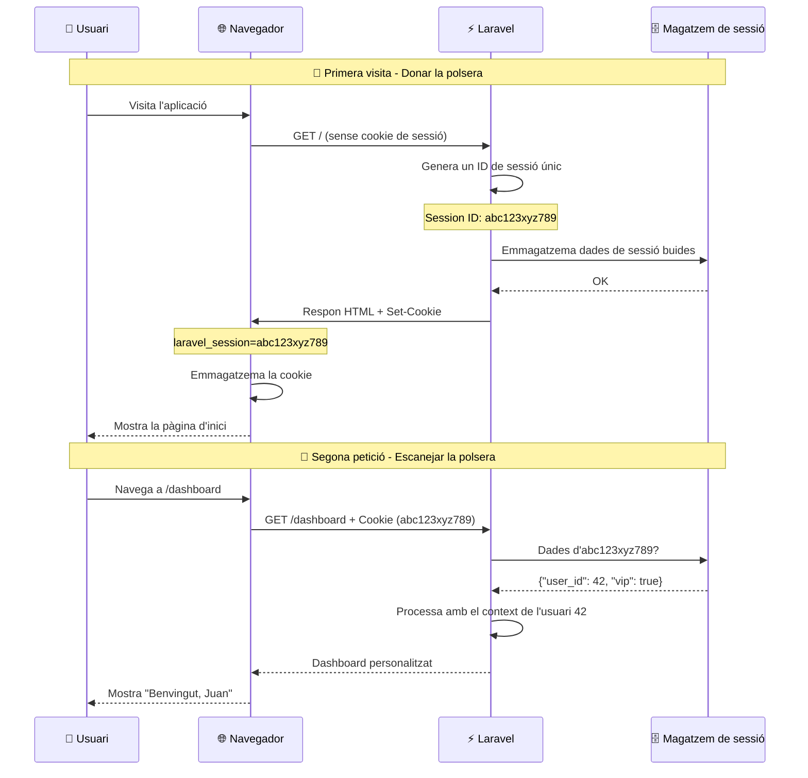

#  9.3. Gestió de sessions i estat

En l'**apartat 2** vas dominar la validació de dades de formularis. Però hi ha un problema fonamental: **HTTP és un protocol stateless** (sense estat), cosa que significa que el servidor no recorda qui eres entre peticions.

Les sessions són un mecanisme fonamental per a mantindre informació de l'usuari entre múltiples peticions HTTP. Permeten que les aplicacions web mantinguen el context de l'usuari, com l'estat del login, les preferències, els carrets de compra i altres dades temporals.

## 1. Fonaments de les sessions

### 1.1. Què és una sessió?

Una sessió és un mecanisme que permet emmagatzemar informació de l'usuari en el servidor i associar-la amb un identificador únic que s'envia al client. Esta informació persistix entre múltiples peticions HTTP.

### 1.2. Per què són necessàries les sessions?

HTTP és un protocol **stateless** (sense estat), cosa que significa que cada petició és independent i el servidor no recorda les peticions anteriors. Les sessions resolen este problema:

| Problema sense sessions | Solució amb sessions |
| --- | --- |
| ❌ No es recorda el login | ✅ Estat d'autenticació persistent |
| ❌ No es manté el carret | ✅ Carret de compra persistent |
| ❌ No es recorden les preferències | ✅ Configuracions de l'usuari |
| ❌ No es pot personalitzar | ✅ Experiència personalitzada |

### 1.3. Flux d'una sessió

A continuació es visualitza com funciona una sessió des que l'usuari entra fins que navega per l'aplicació:


<figcaption class="figure-caption-small">🖼️ Figura 9.3: Flux d'una sessió en Laravel</figcaption>


**El Session ID** (exemple: `abc123xyz789`) és l'**únic vincle** entre el navegador de l'usuari i les seues dades en el servidor.

* **S'envia com a cookie** en cada petició HTTP.
* **Laravel el verifica** automàticament en cada request.
* **Si la cookie es perd o caduca**, l'usuari perd la seua sessió.
* **Si algú et roba la cookie de sessió** → pot suplantar la teua identitat.

**Per això Laravel protegix les sessions:**

- ✅ Tokens llargs i aleatoris (impossibles d'endevinar).
- ✅ Cookies `HttpOnly` (JavaScript no pot llegir-les).
- ✅ Cookies `Secure` en HTTPS (només connexió segura).
- ✅ Regenera l'ID després del login (prevé la *session fixation*).

## 2. Configuració de sessions en Laravel

Laravel permet configurar com i on s'emmagatzemen les sessions. La configuració es troba en el fitxer **`config/session.php`**.

### 2.1. Configuració bàsica

El fitxer de configuració de sessions conté múltiples opcions que controlen el comportament de les sessions en la teua aplicació.

```php
<?php
// config/session.php
return [
    'driver' => env('SESSION_DRIVER', 'file'),
    'lifetime' => env('SESSION_LIFETIME', 120),
    'expire_on_close' => false,
    'encrypt' => false,
    'files' => storage_path('framework/sessions'),
    'connection' => env('SESSION_CONNECTION'),
    'table' => 'sessions',
    'store' => env('SESSION_STORE'),
    'lottery' => [2, 100],
    'cookie' => env('SESSION_COOKIE', Str::slug(env('APP_NAME', 'laravel'), '_').'_session'),
    'path' => '/',
    'domain' => env('SESSION_DOMAIN'),
    'secure' => env('SESSION_SECURE_COOKIE'),
    'http_only' => true,
    'same_site' => 'lax',
];
```

### 2.2. Drivers de sessió

Laravel admet múltiples drivers per a emmagatzemar sessions. Cada un té avantatges específics segons la mida i les necessitats de la teua aplicació.

| Driver | Descripció | Ús recomanat |
| --- | --- | --- |
| **file** | Emmagatzema en fitxers | Desenvolupament, aplicacions xicotetes |
| **cookie** | Emmagatzema en cookies | Aplicacions senzilles |
| **database** | Emmagatzema en base de dades | Aplicacions mitjanes |
| **memcached** | Emmagatzema en Memcached | Aplicacions d'alt rendiment |
| **redis** | Emmagatzema en Redis | Aplicacions d'alt rendiment |

### 2.3. Configurar sessions en base de dades

Per a aplicacions en producció amb múltiples servidors, emmagatzemar les sessions en base de dades és més fiable que en fitxers. Laravel proporciona un comandament per a crear la taula necessària.

```bash
# Crear tabla de sesiones
php artisan session:table
php artisan migrate
```

```php
<?php
// .env
SESSION_DRIVER=database
SESSION_CONNECTION=mysql
```

## 3. Ús de sessions en Laravel

Laravel proporciona una API senzilla i intuïtiva per a treballar amb sessions. Pots emmagatzemar, recuperar, verificar i eliminar dades fàcilment.

### 3.1. Emmagatzemar dades en la sessió

Hi ha múltiples maneres de guardar dades en la sessió. Totes són equivalents; tria la que preferisques segons el teu estil de codi.

```php
<?php
// Almacenar datos en la sesión
session(['key' => 'value']);
session(['user_id' => 123, 'username' => 'juan']);
```

```php
<?php
// Usando el helper session()
session()->put('cart', $cartItems);
session()->put('user.preferences.theme', 'dark');
```

```php
<?php
// Usando la facade Session
Session::put('last_visited', now());
Session::put('user.settings', $settings);
```

### 3.2. Recuperar dades de la sessió

Per a llegir les dades emmagatzemades en la sessió, pots usar el helper **`session()`** o la facade **`Session`**. Tots dos mètodes permeten especificar un valor per defecte si la clau no existix.

```php
<?php
// Recuperar datos de la sesión
$value = session('key');
$userId = session('user_id');
```

```php
<?php
// Con valor por defecto
$theme = session('theme', 'light');
$cart = session('cart', []);
```

```php
<?php
// Usando el helper session()
$user = session()->get('user');
$preferences = session()->get('user.preferences', []);
```

```php
<?php
// Usando la facade Session
$lastVisit = Session::get('last_visited');
$settings = Session::get('user.settings', []);
```

### 3.3. Verificar i eliminar dades

És important poder verificar si una dada existix en la sessió abans d'usar-la, i poder eliminar dades quan ja no siguen necessàries per a mantindre la sessió neta.

```php
<?php
// Verificar si existe
if (session()->has('user_id')) {
    // Usuario autenticado
}
```

```php
<?php
// Verificar si existe y no está vacío
if (session()->exists('cart')) {
    // Carrito existe
}
```

```php
<?php
// Eliminar datos específicos
session()->forget('cart');
session()->forget(['user_id', 'username']);
```

```php
<?php
// Eliminar todos los datos
session()->flush();
```

```php
<?php
// Eliminar datos específicos usando la facade
Session::forget('last_visited');
Session::flush();
```

## 4. Casos d'ús habituals

### 4.1. Carret de compra

Un carret de compra és un dels usos més habituals de les sessions en aplicacions web. Permet als usuaris navegar pel lloc afegint productes sense necessitat de crear un compte immediatament, i manté la seua selecció entre pàgines fins que decidixen finalitzar la compra.

```php
<?php
// Agregar producto al carrito
public function addToCart(Request $request, $productId)
{
    $product = Product::findOrFail($productId);
    $cart = session()->get('cart', []);
    
    if (isset($cart[$productId])) {
        $cart[$productId]['quantity']++;
    } else {
        $cart[$productId] = [
            'name' => $product->name,
            'price' => $product->price,
            'quantity' => 1,
            'image' => $product->image,
        ];
    }
    
    session()->put('cart', $cart);
    
    return redirect()->back()->with('success', 'Producto añadido al carrito');
}

// Ver carrito
public function viewCart()
{
    $cart = session()->get('cart', []);
    $total = 0;
    
    foreach ($cart as $item) {
        $total += $item['price'] * $item['quantity'];
    }
    
    return view('cart.index', compact('cart', 'total'));
}

// Eliminar del carrito
public function removeFromCart($productId)
{
    $cart = session()->get('cart', []);
    
    if (isset($cart[$productId])) {
        unset($cart[$productId]);
        session()->put('cart', $cart);
    }
    
    return redirect()->back()->with('success', 'Producto eliminado del carrito');
}
```

### 4.2. Preferències de l'usuari

Les sessions són ideals per a emmagatzemar preferències temporals de l'usuari com l'idioma seleccionat, el tema visual (mode fosc/clar) o configuracions de visualització. Estes preferències persistixen durant la navegació sense necessitat de consultar-les constantment en la base de dades.

```php
<?php
// Guardar preferencias
public function savePreferences(Request $request)
{
    $preferences = [
        'theme' => $request->theme,
        'language' => $request->language,
        'notifications' => $request->notifications,
        'items_per_page' => $request->items_per_page,
    ];
    
    session()->put('user.preferences', $preferences);
    
    return redirect()->back()->with('success', 'Preferencias guardadas');
}

// Aplicar preferencias
public function applyPreferences()
{
    $preferences = session()->get('user.preferences', []);
    
    // Aplicar tema
    if (isset($preferences['theme'])) {
        // Lógica para aplicar tema
    }
    
    // Aplicar idioma
    if (isset($preferences['language'])) {
        app()->setLocale($preferences['language']);
    }
}
```

### 4.3. Historial de navegació

Guardar un historial de les pàgines que l'usuari ha visitat pot millorar significativament l'experiència d'usuari, i permet funcionalitats com "tornar arrere", "productes vistos recentment" o mostrar suggeriments basats en la seua navegació recent.

```php
<?php
// Agregar página al historial
public function addToHistory($page)
{
    $history = session()->get('navigation.history', []);
    
    // Evitar duplicados consecutivos
    if (empty($history) || end($history) !== $page) {
        $history[] = $page;
        
        // Limitar historial a 10 páginas
        if (count($history) > 10) {
            $history = array_slice($history, -10);
        }
        
        session()->put('navigation.history', $history);
    }
}

// Obtener historial
public function getHistory()
{
    return session()->get('navigation.history', []);
}
```

## 5. Notificacions i missatges flash

### 5.1. Missatges flash

Els *flash messages* són dades de sessió que només persistixen fins a la petició HTTP següent. Són perfectes per a mostrar missatges de confirmació després d'accions com "Producte creat correctament" o "Usuari eliminat", que han d'aparéixer una sola vegada i després desaparéixer.

```php
<?php
// En el controlador
return redirect()->route('products.index')
    ->with('success', 'Producto creado exitosamente');

return redirect()->back()
    ->with('error', 'Error al procesar la solicitud');

return redirect()->route('home')
    ->with('warning', 'Producto con stock bajo')
    ->with('info', 'Nuevos productos disponibles');
```

???+examplelaravel "En el mètode `store()` del controlador:"
    ```
    //...
    return redirect()->route('notes.index')->with('success', 'Nota creada correctamente.');
    ```

???+examplelaravel "En el mètode `update()`:"
    ```
    //...
    return redirect()->route('notes.index')->with('success', 'Nota actualizada correctamente.');
    ```

???+examplelaravel "En el mètode `destroy()`:"
    ```
    //...
    return redirect()->route('notes.index')->with('danger', 'Nota eliminada correctamente.');
    ```

### 5.2. Mostrar missatges en la vista

```html
<!-- Mostrar mensajes flash -->
@if(session('success'))
    <div class="alert alert-success">
        {{ session('success') }}
    </div>
@endif

@if(session('error'))
    <div class="alert alert-danger">
        {{ session('error') }}
    </div>
@endif

@if(session('warning'))
    <div class="alert alert-warning">
        {{ session('warning') }}
    </div>
@endif

@if(session('info'))
    <div class="alert alert-info">
        {{ session('info') }}
    </div>
@endif

<!-- Mostrar todos los mensajes -->
@foreach(['success', 'error', 'warning', 'info'] as $type)
    @if(session($type))
        <div class="alert alert-{{ $type }}">
            {{ session($type) }}
        </div>
    @endif
@endforeach
```

???+examplelaravel "🔝 o incloure-ho com a partial"
    En `/partials/messages.blade.php`:
    ``` 
    @if (session('success'))     
        <div class="alert alert-success"              
                    style="padding: 10px; margin-bottom: 20px;                      
                    background-color: #d4edda;                      
                    color: #155724;                      
                    border-color: #c3e6cb;                      
                    border-radius: 5px;">         
            {{ session('success') }}     
        </div> 
    @endif 

    @if (session('danger'))     
        <div class="alert alert-danger"          
                    style="padding: 10px; margin-bottom: 20px;                  
                    background-color: #f8d7da;                  
                    color: #721c24;                  
                    border-color: #f5c6cb;                  
                    border-radius: 5px;">         
            {{ session('danger') }}     
        </div> 
    @endif 
    ```

    I en el layout:

    ```
    @include('partials.messages')
    ```

???praclaravel "PRÀCTICA 3"
    <div class="figure-center">
    <figure>
        
        <figcaption class="figure-caption-small">🖼️ Figura 9.4: Mostrar el missatge d'èxit de creació correcta</figcaption>
    </figure>
    </div>

???praclaravel "PRÀCTICA 3"
    ### Objectiu de l'activitat
    
    <p style="float: left; margin-left: 1rem;">
    
    </p>

    **Validacions i missatges en el CRUD de productes**
    
    L'objectiu d'esta pràctica és **millorar el CRUD de productes** incorporant validacions, gestió d'errors i missatges de retroalimentació per a l'usuari.

    L'alumnat consolidarà els coneixements de validació de dades en Laravel, i aprendrà a:

    * Usar **Form Requests** personalitzats per a centralitzar les regles de validació.
    * Mostrar missatges d'error al costat dels camps del formulari.
    * Mantindre els valors anteriors amb `old()`.
    * Mostrar **missatges flash** (d'èxit o d'error) després de les operacions del CRUD.
    * Reutilitzar codi mitjançant **partials** i layouts.

    En acabar, l'aplicació oferirà una experiència d'usuari més robusta i professional.

    ---

    ### Instruccions pas a pas

    Seguix les indicacions en orde.

    Treballa sobre el teu projecte del CRUD de productes de la pràctica anterior.

    ---

    ### 1. Crear el FormRequest personalitzat

    1) Genera una nova classe de validació `StoreProductRequest`
   
    2) Afig les regles de validació següents:

       * `name`: obligatori, cadena de text, entre 3 i 255 caràcters.
       * `description`: obligatori, cadena de text, mínim 10 caràcters.
       * `price`: obligatori, numèric, mínim 0.01.
       * `stock`: obligatori, enter, mínim 0.
  
    3) (Opcional) Si el teu formulari conté checkboxes o altres camps que necessiten ser adaptats abans de validar, pots usar el mètode `prepareForValidation()` per a normalitzar-los.

    ---

    ### 2. Aplicar el FormRequest en el controlador

    4) Fes els canvis necessaris en el controlador `ProductController` per a usar el `StoreProductRequest` i validar les dades en els mètodes `store()` i `update()`.

    5) Afig també missatges `flash` per a les operacions que redirigixen al llistat de productes, perquè l'usuari reba retroalimentació.

    Missatges:

    ```
    - Producto creado correctamente.

    - Producto actualizado correctamente.
      
    - Producto eliminado correctamente.
    ```

    ---

    ### 3. Mostrar errors en els formularis

    6) En els formularis de creació i edició de productes, mostra una llista amb els errors de validació al principi del formulari. Si no hi ha errors, no mostres res.
   
    7) Els errors estaran en un `div` amb la classe `alert alert-danger`. Pots utilitzar CSS per a donar-li estil.
   
    8) Davall de cada camp del formulari, mostra l'error específic usant la directiva `@error`. Estos errors poden mostrar-se en una etiqueta `<small>` o en algun contenidor `<div>`, com preferisques. Tindran l'estil `alert alert-danger` o un estil personalitzat. Podem usar CSS per a donar-los estil.
   
    9)  Recorda usar `old()` per a mantindre els valors introduïts per l'usuari en cas d'error de validació.

    ---

    ### 4. Crear el partial per als missatges del sistema

    10)  Crea un `partial` anomenat `messages.blade.php` per a mostrar els missatges flash.

    * Si el missatge és d'èxit, usa la classe `flash alert alert-success`.
    * Si el missatge és d'error, usa la classe `flash alert alert-danger`.
    
    11)   Afig el `partial` en el layout principal perquè es mostre en totes les vistes. D'esta manera, qualsevol missatge flash apareixerà automàticament en totes les vistes.

    ---

    ### 5. Comprovar les rutes del CRUD

    12)   Executa en la consola:

    ```
    php artisan route:list --path=product
    ```

    13)   Comprova que es llisten totes les rutes REST del recurs `product`, incloent-hi `index`, `create`, `store`, `edit`, `update`, `show` i `destroy`.

    ---

    ### 6 Provar les validacions i els missatges

    14)   Intenta crear un producte amb menys de 3 caràcters en el nom o sense descripció.
    → Has de veure missatges d'error en el formulari.
    
    15)   Crea un producte vàlid.
    → Ha de redirigir al llistat amb el missatge **“Producto creado correctamente.”**
    
    16)   Edita un producte i canvia els valors.
    → Ha de mostrar **“Producto actualizado correctamente.”**
    
    17)   Elimina un producte.
    → Ha de mostrar **“Producto eliminado correctamente.”**

### 5.3. Notificacions personalitzades

Per a sistemes de notificacions més complexos, pots crear els teus propis mètodes que encapsulen la lògica de mostrar missatges flash amb diferents tipus i estils.

```php
<?php
// Crear notificación personalizada
public function showNotification($message, $type = 'info')
{
    session()->flash('notification', [
        'message' => $message,
        'type' => $type,
        'timestamp' => now(),
    ]);
}
```

```php
<?php
// En la vista
@if(session('notification'))
    @php $notification = session('notification'); @endphp
    <div class="alert alert-{{ $notification['type'] }}">
        <strong>{{ $notification['timestamp']->format('H:i') }}</strong>
        {{ $notification['message'] }}
    </div>
@endif
```

## 6. Cookies i sessions

Les cookies i les sessions treballen juntes: les cookies emmagatzemen l'ID de sessió en el navegador de l'usuari, mentre que les dades reals són en el servidor. És important entendre com configurar-les correctament per a la seguretat.

### 6.1. Configuració de cookies

Laravel permet configurar com es comporten les cookies de sessió a través del fitxer de configuració. Estes opcions afecten la seguretat i l'abast de les sessions.

```php
<?php
// config/session.php
'cookie' => env('SESSION_COOKIE', 'laravel_session'),
'path' => '/',
'domain' => env('SESSION_DOMAIN'),
'secure' => env('SESSION_SECURE_COOKIE', false),
'http_only' => true,
'same_site' => 'lax',
```

### 6.2. Treballar amb cookies

A més de les cookies de sessió automàtiques, pots crear les teues pròpies cookies per a emmagatzemar xicotetes quantitats de dades en el navegador de l'usuari (preferències, temes, etc.).

```php
<?php
// Crear cookie
Cookie::queue('user_preference', 'dark_theme', 60); // 60 minutos

// Recuperar cookie
$preference = Cookie::get('user_preference');

// Eliminar cookie
Cookie::queue(Cookie::forget('user_preference'));
```

### 6.3. Cookies vs. sessions

Encara que les cookies i les sessions treballen juntes, tenen diferències importants quant a emmagatzematge, seguretat i ús. Conéixer estes diferències t'ajuda a triar l'eina correcta per a cada situació.

| Aspecte | Cookies | Sessions |
| --- | --- | --- |
| **Emmagatzematge** | Client | Servidor |
| **Seguretat** | Menor | Major |
| **Mida** | Limitada (4KB) | Il·limitada |
| **Persistència** | Configurable | Temporal |
| **Accés** | JavaScript | Només servidor |

## 7. Seguretat de les sessions

La seguretat de les sessions és crítica perquè un atacant que robe un ID de sessió pot suplantar la identitat de l'usuari. Laravel proporciona eines per a protegir les sessions contra els atacs més habituals.

### 7.1. Regeneració de l'ID de sessió

Regenerar l'ID de sessió després d'operacions crítiques (com el login) prevé atacs de fixació de sessió en què un atacant intenta forçar un ID de sessió específic.

```php
<?php
// Regenerar ID de sesión
session()->regenerate();

// Regenerar y eliminar datos antiguos
session()->regenerate(true);
```

### 7.2. Configuració de seguretat

Laravel proporciona múltiples opcions de configuració per a reforçar la seguretat de les sessions. Estes configuracions s'han d'ajustar especialment en entorns de producció.

```php
<?php
// config/session.php
'secure' => env('SESSION_SECURE_COOKIE', true), // Solo HTTPS
'http_only' => true, // No accesible desde JavaScript
'same_site' => 'strict', // Protección CSRF
```

### 7.3. Timeout de sessió

Les sessions no han de durar indefinidament. Configurar un timeout automàtic tanca les sessions inactives i reduïx el risc que algú use una sessió abandonada.

```php
<?php
// Configurar timeout
'lifetime' => 120, // 2 horas en minutos

// Verificar sesión expirada
if (session()->has('last_activity')) {
    $lastActivity = session('last_activity');
    if (now()->diffInMinutes($lastActivity) > 120) {
        session()->flush();
        return redirect()->route('login');
    }
}

session()->put('last_activity', now());
```

## 8. Optimització de sessions

En aplicacions amb molts usuaris, les sessions es poden acumular i afectar el rendiment. Laravel inclou mecanismes per a optimitzar i netejar sessions automàticament.

### 8.1. Neteja automàtica

Laravel pot netejar automàticament les sessions caducades usant un sistema de "loteria" que s'executa ocasionalment durant peticions normals.

```php
<?php
// config/session.php
'lottery' => [2, 100], // 2% de probabilidad de limpieza
```

### 8.2. Emmagatzematge eficient

Emmagatzema només les dades estrictament necessàries en la sessió. Evita guardar objectes complets o dades grans que pugues recuperar fàcilment de la base de dades.

```php
<?php
// Almacenar solo datos necesarios
session()->put('user.id', $user->id);
session()->put('user.name', $user->name);
// No almacenar objetos completos
```

### 8.3. Memòria cau de sessions

Per a aplicacions d'alt trànsit, usar Redis o Memcached com a driver de sessions proporciona un rendiment millor que els fitxers o una base de dades relacional.

```php
<?php
// Usar Redis para sesiones
SESSION_DRIVER=redis
REDIS_HOST=127.0.0.1
REDIS_PASSWORD=null
REDIS_PORT=6379
```
