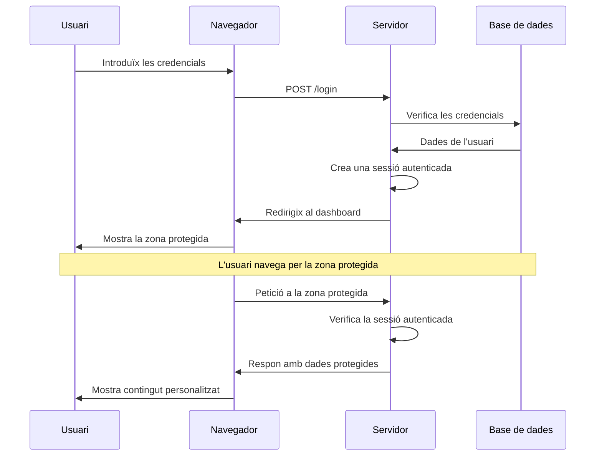

#  9.4. Autenticació bàsica

En l'**apartat 3** vas aprendre com les sessions mantenen l'estat de l'usuari entre peticions. Ara és el moment d'entendre com **verificar la identitat** de l'usuari abans de donar-li accés a zones protegides.

L'autenticació és el procés de verificar la identitat d'un usuari, confirmant que és qui diu ser. En aplicacions web, això normalment implica un sistema de login i logout que permet als usuaris accedir a zones protegides i mantindre la seua sessió activa. Laravel proporciona un sistema d'autenticació robust i flexible amb **Laravel Breeze**.

## 1. Fonaments de l'autenticació

### 1.1. Què és l'autenticació?

L'autenticació és el procés de verificar la identitat d'un usuari mitjançant credencials com el nom d'usuari i la contrasenya. És diferent de l'**autorització**, que determina quines accions pot fer un usuari autenticat.


### 1.2. Autenticació vs. autorització

| Concepte | Descripció | Exemple |
| --- | --- | --- |
| **Autenticació** | Verificar "qui eres" | Login amb correu electrònic i contrasenya |
| **Autorització** | Determinar "què pots fer" | Accés al panell d'administració |


**Exemple pràctic:**

```php
<?php
// Autenticación: ¿Quién eres?
if (Auth::attempt(['email' => $email, 'password' => $password])) {
    // Usuario autenticado exitosamente
    
    // autorización: ¿Puedes hacer esto?
    if (Auth::user()->role === 'admin') {
        // Puede acceder al panel de administración
    }
}
```

**En resum:**

* Primer t'**autentiquen** (demostres qui eres).
* Després t'**autoritzen** (verifiquen què pots fer).

### 1.3. Flux d'autenticació


<figcaption class="figure-caption-small">🖼️ Figura 9.5: Flux d'autenticació en Laravel</figcaption>

## 2. Sistema d'autenticació de Laravel

### 2.1. Laravel Breeze

Laravel Breeze és un *starter kit* oficial que proporciona una implementació completa i minimalista del sistema d'autenticació. Inclou login, registre, recuperació de contrasenya, verificació del correu electrònic i gestió del perfil, tot preparat per a usar i personalitzar.

```bash
# Instalar Laravel Breeze
composer require laravel/breeze --dev
php artisan breeze:install blade
npm install
npm run build
php artisan migrate
```

!!!tenencuenta "Breeze en Laravel 12 i 13"
    Des de Laravel 12, Breeze ja no rep actualitzacions i no apareix a l'instal·lador (`laravel new`): per a projectes nous, Laravel recomana els seus nous *starter kits* (React, Vue o Livewire). Tot i això, Breeze continua instal·lant-se sense problemes amb `composer require laravel/breeze --dev` en Laravel 12 i 13, i és l'opció més senzilla quan l'aplicació només utilitza **Blade**, com en esta unitat. L'alternativa oficial amb Blade és el *starter kit* de **Livewire**.

### 2.2. Estructura d'autenticació

Laravel Breeze crea l'estructura següent:

```text
app/
├── Http/Controllers/Auth/
│   ├── AuthenticatedSessionController.php
│   ├── ConfirmablePasswordController.php
│   ├── EmailVerificationNotificationController.php
│   ├── NewPasswordController.php
│   ├── PasswordController.php
│   ├── PasswordResetLinkController.php
│   └── RegisteredUserController.php
├── Http/Requests/Auth/
│   └── LoginRequest.php
├── Models/
│   └── User.php
resources/views/auth/
├── login.blade.php
├── register.blade.php
├── forgot-password.blade.php
└── reset-password.blade.php
```

### 2.3. Model User

El model `User` és el cor del sistema d'autenticació. Hereta d'`Authenticatable` i definix quins camps es poden omplir, quins són ocults i com s'han de convertir (cast).

```php
<?php

namespace App\Models;

use Illuminate\Contracts\Auth\MustVerifyEmail;
use Illuminate\Database\Eloquent\Factories\HasFactory;
use Illuminate\Foundation\Auth\User as Authenticatable;
use Illuminate\Notifications\Notifiable;

class User extends Authenticatable
{
    use HasFactory, Notifiable;

    protected $fillable = [
        'name',
        'email',
        'password',
    ];

    protected $hidden = [
        'password',
        'remember_token',
    ];

    protected function casts(): array
    {
        return [
            'email_verified_at' => 'datetime',
            'password' => 'hashed',
        ];
    }
}
```

## 3. Implementació de login i logout

El procés de login i logout és fonamental en qualsevol sistema d'autenticació. Laravel Breeze proporciona controladors i vistes predefinits que pots usar directament o personalitzar segons les teues necessitats.

### 3.1. Controlador d'autenticació

L'**`AuthenticatedSessionController`** gestiona les peticions de login, la verificació de credencials, la regeneració de la sessió i el logout. Este controlador treballa conjuntament amb **`LoginRequest`** per a validar les credencials.

```php
<?php

namespace App\Http\Controllers\Auth;

use App\Http\Controllers\Controller;
use App\Http\Requests\Auth\LoginRequest;
use Illuminate\Http\RedirectResponse;
use Illuminate\Http\Request;
use Illuminate\Support\Facades\Auth;
use Illuminate\View\View;

class AuthenticatedSessionController extends Controller
{
    /**
     * Display the login view.
     */
    public function create(): View
    {
        return view('auth.login');
    }

    /**
     * Handle an incoming authentication request.
     */
    public function store(LoginRequest $request): RedirectResponse
    {
        $request->authenticate();

        $request->session()->regenerate();

        return redirect()->intended(route('dashboard', absolute: false));
    }

    /**
     * Destroy an authenticated session.
     */
    public function destroy(Request $request): RedirectResponse
    {
        Auth::guard('web')->logout();

        $request->session()->invalidate();

        $request->session()->regenerateToken();

        return redirect('/');
    }
}
```

### 3.2. Formulari de login

El formulari de login demana el correu electrònic i la contrasenya de l'usuari. Inclou protecció CSRF, l'opció de "recorda'm" i un enllaç per a recuperar la contrasenya.

```html
<!-- resources/views/auth/login.blade.php -->
<form method="POST" action="{{ route('login') }}">
    @csrf

    <!-- Email Address -->
    <div>
        <label for="email">Email</label>
        <input id="email" type="email" name="email" value="{{ old('email') }}" required autofocus>
        @error('email')
            <span class="text-red-600">{{ $message }}</span>
        @enderror
    </div>

    <!-- Password -->
    <div>
        <label for="password">Contraseña</label>
        <input id="password" type="password" name="password" required>
        @error('password')
            <span class="text-red-600">{{ $message }}</span>
        @enderror
    </div>

    <!-- Remember Me -->
    <div>
        <label for="remember_me">
            <input id="remember_me" type="checkbox" name="remember">
            Recordarme
        </label>
    </div>

    <div>
        <button type="submit">Iniciar Sesión</button>
    </div>
</form>
```

### 3.3. Formulari de registre

El formulari de registre permet crear usuaris nous. Demana el nom, el correu electrònic, la contrasenya i la confirmació de la contrasenya. La validació assegura que tots els camps siguen correctes.

```html
<!-- resources/views/auth/register.blade.php -->
<form method="POST" action="{{ route('register') }}">
    @csrf

    <!-- Name -->
    <div>
        <label for="name">Nombre</label>
        <input id="name" type="text" name="name" value="{{ old('name') }}" required autofocus>
        @error('name')
            <span class="text-red-600">{{ $message }}</span>
        @enderror
    </div>

    <!-- Email Address -->
    <div>
        <label for="email">Email</label>
        <input id="email" type="email" name="email" value="{{ old('email') }}" required>
        @error('email')
            <span class="text-red-600">{{ $message }}</span>
        @enderror
    </div>

    <!-- Password -->
    <div>
        <label for="password">Contraseña</label>
        <input id="password" type="password" name="password" required>
        @error('password')
            <span class="text-red-600">{{ $message }}</span>
        @enderror
    </div>

    <!-- Confirm Password -->
    <div>
        <label for="password_confirmation">Confirmar Contraseña</label>
        <input id="password_confirmation" type="password" name="password_confirmation" required>
    </div>

    <div>
        <button type="submit">Registrarse</button>
    </div>
</form>
```

## 4. Protecció de rutes

### 4.1. Middleware d'autenticació

El middleware **`auth`** és la manera principal de protegir rutes en Laravel, i assegura que només els usuaris autenticats puguen accedir a certes pàgines o recursos. Si un usuari no autenticat intenta accedir-hi, serà redirigit automàticament a la pàgina de login.

```php
<?php
// Rutas protegidas
Route::middleware('auth')->group(function () {
    Route::get('/dashboard', [DashboardController::class, 'index']);
    Route::get('/profile', [ProfileController::class, 'edit']);
    Route::patch('/profile', [ProfileController::class, 'update']);
    Route::delete('/profile', [ProfileController::class, 'destroy']);
});

// Rutas públicas
Route::get('/', [HomeController::class, 'index']);
Route::get('/products', [ProductController::class, 'index']);
Route::get('/products/{id}', [ProductController::class, 'show']);
```

### 4.2. Verificar l'autenticació en controladors

A més de protegir les rutes a `web.php`, pots indicar el middleware des del mateix controlador. Des de Laravel 11 es fa amb la interfície **`HasMiddleware`** i el mètode estàtic `middleware()`:

```php
<?php

namespace App\Http\Controllers;

use App\Models\Product;
use Illuminate\Http\Request;
use Illuminate\Routing\Controllers\HasMiddleware;
use Illuminate\Routing\Controllers\Middleware;
use Illuminate\Support\Facades\Auth;

class ProductController extends Controller implements HasMiddleware
{
    // Proteger todas las acciones excepto index y show
    public static function middleware(): array
    {
        return [
            new Middleware('auth', except: ['index', 'show']),
        ];
    }

    public function index()
    {
        // Público - no requiere autenticación
        $products = Product::all();
        return view('products.index', compact('products'));
    }

    public function create()
    {
        // Protegido por el middleware: aquí el usuario ya está autenticado
        return view('products.create');
    }

    public function store(Request $request)
    {
        // Protegido - requiere autenticación
        $user = Auth::user();
        
        // ✅ IMPORTANTE: Siempre validar datos antes de guardar
        $validated = $request->validate([
            'name' => 'required|string|max:255',
            'description' => 'required|string',
        ]);
        
        // Crear producto con datos validados
        $product = Product::create($validated + ['user_id' => $user->id]);
        
        return redirect()->route('products.show', $product);
    }
}
```

!!!tenencuenta "`$this->middleware()` al constructor ja no existix"
    En tutorials antics veuràs `$this->middleware('auth')` dins del constructor del controlador. Des de Laravel 11, el `Controller` base està buit i eixe codi dona l'error `Call to undefined method`. Utilitza `HasMiddleware` o protegix les rutes a `web.php`.

### 4.3. Verificar l'autenticació en vistes

Blade proporciona directives com **`@auth`** i **`@guest`** per a mostrar contingut diferent depenent de l'estat d'autenticació de l'usuari. Això et permet personalitzar la interfície de manera reactiva.

```html
<!-- Verificar si el usuario está autenticado -->
@auth
    <p>Bienvenido, {{ Auth::user()->name }}!</p>
    <a href="{{ route('dashboard') }}">Dashboard</a>
    <form method="POST" action="{{ route('logout') }}">
        @csrf
        <button type="submit">Cerrar Sesión</button>
    </form>
@else
    <a href="{{ route('login') }}">Iniciar Sesión</a>
    <a href="{{ route('register') }}">Registrarse</a>
@endauth

<!-- Verificar si el usuario es invitado -->
@guest
    <p>Por favor, inicia sesión para continuar.</p>
    <a href="{{ route('login') }}">Iniciar Sesión</a>
@endguest
```

## 5. Gestió d'usuaris

Laravel proporciona múltiples maneres de:

- interactuar amb l'usuari autenticat, 
- autenticar manualment i 
- gestionar sessions d'usuari. 

Estes eines et donen un control total sobre el procés d'autenticació.

### 5.1. Obtindre l'usuari autenticat

Una vegada que un usuari s'ha autenticat, pots accedir a les seues dades en qualsevol part de la teua aplicació usant la facade `Auth`.

```php
<?php
// Obtener usuario autenticado
$user = Auth::user();
$userId = Auth::id();
$userName = Auth::user()->name;

// Verificar si está autenticado
if (Auth::check()) {
    // Usuario autenticado
}

// Verificar si es invitado
if (Auth::guest()) {
    // Usuario no autenticado
}
```

### 5.2. Autenticació manual

Si estàs creant el teu propi formulari de login o necessites autenticar usuaris de manera programàtica, pots usar `Auth::attempt()` per a verificar credencials i autenticar usuaris manualment.

```php
<?php
// Autenticación manual
if (Auth::attempt(['email' => $email, 'password' => $password])) {
    // ✅ CRÍTICO: Regenerar sesión para prevenir Session Fixation
    $request->session()->regenerate();
    
    // Autenticación exitosa
    return redirect()->intended('/dashboard');
} else {
    // Autenticación fallida
    return back()->withErrors(['email' => 'Credenciales incorrectas']);
}

// Autenticación con "recordarme"
if (Auth::attempt(['email' => $email, 'password' => $password], $remember)) {
    $request->session()->regenerate(); // Siempre regenerar
    // Usuario será recordado
}

// Autenticación de un usuario específico
Auth::login($user);
$request->session()->regenerate(); // Siempre regenerar después de login

Auth::loginUsingId($userId);
$request->session()->regenerate(); // Siempre regenerar después de login
```

!!!tenencuenta "Session Fixation Attack"
    **SEMPRE** has de regenerar l'ID de sessió després d'autenticar un usuari amb **`$request->session()->regenerate()`**.
    
    Sense regeneració, un atacant podria:
    
    1. Obtindre un ID de sessió vàlid.
    2. Fer que la víctima use eixe ID (per exemple, mitjançant un enllaç maliciós).
    3. Quan la víctima inicia sessió, l'atacant té accés a la sessió autenticada.

    Laravel Breeze inclou això automàticament, però si implementes un login manual, **no te n'oblides**.

### 5.3. Tancar la sessió

Tancar la sessió és un pas crític de seguretat. Este pas ha de:

- invalidar la sessió actual, 
- regenerar el token CSRF i 
- netejar qualsevol informació relacionada amb l'usuari.

```php
<?php
// Cerrar sesión
Auth::logout();

// Cerrar sesión y limpiar sesión
Auth::logout();
request()->session()->invalidate();
request()->session()->regenerateToken();
```

## 6. Recuperació de la contrasenya

Laravel Breeze inclou un sistema complet de recuperació de contrasenyes. Els usuaris poden sol·licitar un enllaç de recuperació per correu electrònic i establir una contrasenya nova de manera segura.

### 6.1. Configuració del correu electrònic

Per a enviar correus de recuperació de contrasenya, necessites configurar el teu servei de correu en el fitxer `.env`. Pots usar SMTP, Mailgun, SendGrid o altres proveïdors.

```env
MAIL_MAILER=smtp
MAIL_HOST=smtp.gmail.com
MAIL_PORT=587
MAIL_USERNAME=tu-email@gmail.com
MAIL_PASSWORD=tu-contraseña
MAIL_ENCRYPTION=tls
MAIL_FROM_ADDRESS=tu-email@gmail.com
MAIL_FROM_NAME="${APP_NAME}"
```

### 6.2. Formulari de recuperació

El formulari de recuperació demana el correu electrònic de l'usuari. Laravel enviarà automàticament un enllaç segur amb un token temporal per a restablir la contrasenya.

```html
<!-- resources/views/auth/forgot-password.blade.php -->
<form method="POST" action="{{ route('password.email') }}">
    @csrf

    <div>
        <label for="email">Email</label>
        <input id="email" type="email" name="email" value="{{ old('email') }}" required>
        @error('email')
            <span class="text-red-600">{{ $message }}</span>
        @enderror
    </div>

    <div>
        <button type="submit">Enviar Enlace de Recuperación</button>
    </div>
</form>
```

### 6.3. Formulari de restabliment

Una vegada que l'usuari accedix a l'enllaç del correu, es mostra este formulari, on podrà introduir la seua contrasenya nova. El token temporal verifica que la sol·licitud siga vàlida.

```html
<!-- resources/views/auth/reset-password.blade.php -->
<form method="POST" action="{{ route('password.store') }}">
    @csrf
    <input type="hidden" name="token" value="{{ $request->route('token') }}">

    <div>
        <label for="email">Email</label>
        <input id="email" type="email" name="email" value="{{ old('email', $request->email) }}" required>
    </div>

    <div>
        <label for="password">Nueva Contraseña</label>
        <input id="password" type="password" name="password" required>
    </div>

    <div>
        <label for="password_confirmation">Confirmar Nueva Contraseña</label>
        <input id="password_confirmation" type="password" name="password_confirmation" required>
    </div>

    <div>
        <button type="submit">Restablecer Contraseña</button>
    </div>
</form>
```

## 7. Verificació del correu electrònic

La verificació del correu electrònic assegura que els usuaris proporcionen una adreça de correu vàlida. Laravel facilita este procés amb funcionalitat integrada per a enviar correus de verificació i protegir rutes.

### 7.1. Configurar la verificació

Per a activar la verificació del correu electrònic, el model `User` ha d'implementar la interfície **`MustVerifyEmail`**. Això habilita automàticament totes les funcionalitats de verificació.

```php
<?php
// app/Models/User.php
use Illuminate\Contracts\Auth\MustVerifyEmail;

class User extends Authenticatable implements MustVerifyEmail
{
    // ...
}
```

### 7.2. Middleware de verificació

El middleware **`verified`** restringix l'accés només als usuaris amb el correu electrònic verificat. Si intenten accedir-hi sense verificar-lo, seran redirigits a una pàgina d'avís.

```php
<?php

// Proteger rutas que requieren email verificado
Route::middleware(['auth', 'verified'])->group(function () {
    Route::get('/dashboard', [DashboardController::class, 'index']);
    Route::get('/profile', [ProfileController::class, 'edit']);
});
```

### 7.3. Verificar el correu electrònic en vistes

Pots mostrar missatges o botons diferents segons si el correu electrònic de l'usuari ha sigut verificat o no, i permetre-li reenviar el correu de verificació si ho necessita.

```html
@if(Auth::user()->hasVerifiedEmail())
    <p>Tu email ha sido verificado.</p>
@else
    <p>Por favor, verifica tu email.</p>
    <form method="POST" action="{{ route('verification.send') }}">
        @csrf
        <button type="submit">Reenviar Email de Verificación</button>
    </form>
@endif
```

## 8. Personalització de l'autenticació

Encara que Laravel Breeze proporciona una base sòlida, pots personalitzar quasi qualsevol aspecte del sistema d'autenticació: redireccions, validacions, middleware i més.

### 8.1. Personalitzar les redireccions

Pots redirigir els usuaris a pàgines diferents segons el seu rol o qualsevol altra condició després del login. Això és especialment útil en aplicacions amb múltiples tipus d'usuaris.

```php
<?php
// app/Http/Controllers/Auth/AuthenticatedSessionController.php
public function store(LoginRequest $request): RedirectResponse
{
    $request->authenticate();
    $request->session()->regenerate();

    // Redirección personalizada
    if (Auth::user()->role === 'admin') {
        return redirect()->intended('/admin');
    }
    
    return redirect()->intended('/dashboard');
}
```

### 8.2. Personalitzar la validació

Pots modificar les regles de validació del login i del registre segons les necessitats de la teua aplicació, afegint validacions addicionals o personalitzant els missatges d'error.

```php
<?php
// app/Http/Requests/Auth/LoginRequest.php
public function rules(): array
{
    return [
        'email' => ['required', 'string', 'email'],
        'password' => ['required', 'string'],
    ];
}

public function messages(): array
{
    return [
        'email.required' => 'El email es obligatorio.',
        'password.required' => 'La contraseña es obligatoria.',
    ];
}
```

### 8.3. Personalitzar les redireccions del middleware

Quan un usuari autenticat visita `/login` o `/register`, el middleware `guest` el redirigix; quan un convidat visita una ruta protegida amb `auth`, l'envia al login. Des de Laravel 11 ja no existix el fitxer `app/Http/Middleware/RedirectIfAuthenticated.php`: estos destins es configuren a `bootstrap/app.php`.

```php
// bootstrap/app.php
use Illuminate\Http\Request;

->withMiddleware(function (Middleware $middleware) {
    // Adónde va un usuario autenticado que visita /login o /register
    $middleware->redirectUsersTo(
        fn (Request $request) => $request->user()->role === 'admin' ? '/admin' : '/dashboard'
    );

    // Adónde va un invitado que visita una ruta protegida con 'auth'
    $middleware->redirectGuestsTo('/login');
})
```

## 9. Seguretat de l'autenticació

La seguretat ha de ser una prioritat en qualsevol sistema d'autenticació. Laravel inclou proteccions contra els atacs més habituals, però és important configurar-les correctament i seguir bones pràctiques.

### 9.1. Contrasenyes segures

Imposa polítiques de contrasenyes fortes amb la regla **`Password`** de Laravel, que evita escriure expressions regulars a mà:

```php
<?php
use Illuminate\Validation\Rules\Password;

// Validación de contraseña segura
'password' => [
    'required',
    'confirmed',
    Password::min(8)
        ->mixedCase()       // mayúsculas y minúsculas
        ->numbers()
        ->symbols()
        ->uncompromised(),  // no aparece en filtraciones conocidas
],
```

Per a no repetir les regles, les pots definir una sola vegada a `AppServiceProvider` amb `Password::defaults(fn () => Password::min(8)->mixedCase()->numbers())`. El registre de Breeze ja utilitza `Password::defaults()`.

### 9.2. Logs de seguretat

Registrar els intents de login correctes i fallits et permet detectar patrons sospitosos i respondre ràpidament a possibles amenaces de seguretat.

```php
<?php
// app/Http/Requests/Auth/LoginRequest.php (método authenticate de Breeze)
if (! Auth::attempt($this->only('email', 'password'), $this->boolean('remember'))) {
    RateLimiter::hit($this->throttleKey());

    Log::warning('Login fallido', [
        'ip' => $this->ip(),
        'user_agent' => $this->userAgent(),
    ]);

    throw ValidationException::withMessages([
        'email' => trans('auth.failed'),
    ]);
}
```

!!!tenencuenta "Què no s'ha de fer en registrar els logins"
    * No crides `Auth::attempt()` només per a escriure al log: inicia la sessió de l'usuari.
    * No registres contrasenyes ni més dades personals de les necessàries.
    * Breeze ja limita els intents de login (5 per minut) amb `RateLimiter` a `LoginRequest`.
