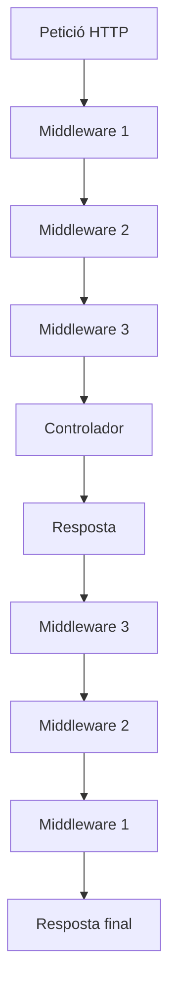

#  9.5. Middleware personalitzat

En l'**apartat 4** vas aprendre com autenticar usuaris amb Laravel Breeze. Però què passa si necessites aplicar **lògica comuna** a múltiples rutes abans que arriben al controlador?

El middleware personalitzat permet aplicar lògica comuna a múltiples rutes, mantenint el codi organitzat i reutilitzable. Laravel proporciona un sistema de middleware flexible que permet crear, registrar i aplicar middleware personalitzat per a diferents propòsits com logging, *rate limiting*, validacions específiques i transformació de respostes.

## 1. Fonaments del middleware

### 1.1. Què és el middleware?

El middleware és una capa de programari que processa les peticions HTTP **abans** que arriben als controladors i **després** que es genere la resposta. Actua com un filtre que pot modificar, validar o interceptar les peticions i les respostes.


### 1.2. Flux del middleware

El middleware opera en capes: la petició travessa cada middleware fins a arribar al controlador i després la resposta travessa els mateixos middleware en orde invers. Este flux bidireccional permet processar tant les peticions entrants com les respostes eixints.


<div class="figure-center">
<figure>

    <figcaption class="figure-caption-small">🖼️ Figura 9.6: Flux del middleware</figcaption>
</figure>
</div>

### 1.3. Tipus de middleware

Laravel organitza el middleware en diferents categories segons el seu abast i aplicació. Conéixer estos tipus t'ajuda a decidir on i com registrar el teu middleware personalitzat.

| Tipus | Descripció | Exemple |
| --- | --- | --- |
| **Global** | S'aplica a totes les peticions | CORS, Logging |
| **Grup** | S'aplica a grups de rutes | Web, API |
| **Ruta** | S'aplica a rutes específiques | Auth, Rate Limiting |
| **Personalitzat** | Lògica específica de l'aplicació | Validació, Transformació |

## 2. Crear middleware personalitzat

Laravel facilita la creació de middleware personalitzat mitjançant Artisan. Pots crear middleware per a qualsevol lògica específica de la teua aplicació: logging, validació, transformació de dades, control d'accés i més.

### 2.1. Generar el middleware

El primer pas per a crear middleware personalitzat és generar-lo amb Artisan. Això crearà una classe base amb l'estructura necessària, que podràs personalitzar segons les teues necessitats.

```bash
# Crear middleware personalizado
php artisan make:middleware LogUserActivity
```

### 2.2. Estructura del middleware

Un middleware típic té un mètode `handle()` que rep la petició i una funció `$next()`. Pots executar lògica abans de cridar `$next()` (abans del controlador) i després (després del controlador).

```php
<?php

namespace App\Http\Middleware;

use Closure;
use Illuminate\Http\Request;
use Illuminate\Support\Facades\Log;
use Symfony\Component\HttpFoundation\Response;

class LogUserActivity
{
    /**
     * Handle an incoming request.
     */
    public function handle(Request $request, Closure $next): Response
    {
        // Lógica antes de procesar la petición
        $startTime = microtime(true);
        
        // Procesar la petición
        $response = $next($request);
        
        // Lógica después de procesar la petición
        $endTime = microtime(true);
        $duration = round(($endTime - $startTime) * 1000, 2);
        
        // Log de la actividad
        Log::info('User activity', [
            'user_id' => auth()->id(),
            'user_name' => auth()->user()?->name,
            'method' => $request->method(),
            'url' => $request->fullUrl(),
            'ip' => $request->ip(),
            'user_agent' => $request->userAgent(),
            'duration_ms' => $duration,
            'status_code' => $response->getStatusCode(),
            'timestamp' => now(),
        ]);
        
        return $response;
    }
}
```

### 2.3. Middleware amb paràmetres

Els middleware poden acceptar paràmetres addicionals per a fer-los més flexibles i reutilitzables. Això et permet crear un sol middleware que es comporta de manera diferent segons els paràmetres que reba.

```php
<?php

namespace App\Http\Middleware;

use Closure;
use Illuminate\Http\Request;
use Symfony\Component\HttpFoundation\Response;

class CheckUserRole
{
    /**
     * Handle an incoming request.
     */
    public function handle(Request $request, Closure $next, string $role): Response
    {
        if (!auth()->check()) {
            return redirect()->route('login');
        }
        
        if (!auth()->user()->hasRole($role)) {
            abort(403, 'No tienes permisos para acceder a esta página');
        }
        
        return $next($request);
    }
}
```

## 3. Registrar el middleware

Després de crear el middleware, necessites registrar-lo perquè Laravel sàpia quan i com aplicar-lo. El registre determina si el middleware és global, de grup o de ruta.

### 3.1. Registre en bootstrap/app.php

Una vegada creat el middleware, has de registrar-lo en la teua aplicació perquè Laravel el reconega i el puga aplicar. El registre es fa en el fitxer `bootstrap/app.php` i en determina l'abast (global, grup o ruta específica).

```php
<?php
// bootstrap/app.php
->withMiddleware(function (Middleware $middleware) {
    // Middleware global
    $middleware->web(append: [
        \App\Http\Middleware\LogUserActivity::class,
    ]);
    
    // Middleware de grupo
    $middleware->group('admin', [
        \App\Http\Middleware\CheckUserRole::class,
    ]);
    
    // Alias de middleware
    $middleware->alias([
        'role' => \App\Http\Middleware\CheckUserRole::class,
        'log.activity' => \App\Http\Middleware\LogUserActivity::class,
    ]);
})
```

### 3.2. Aplicar middleware a rutes

Una vegada registrat amb un àlies, pots aplicar el middleware a rutes individuals o a grups de rutes usant el mètode `middleware()`. També pots combinar múltiples middleware.

```php
<?php
// Aplicar middleware a rutas específicas
Route::get('/admin', [AdminController::class, 'index'])
    ->middleware('role:admin');

Route::post('/products', [ProductController::class, 'store'])
    ->middleware(['auth', 'log.activity']);

// Aplicar middleware a grupos de rutas
Route::middleware(['auth', 'role:admin'])->group(function () {
    Route::get('/admin/users', [UserController::class, 'index']);
    Route::post('/admin/users', [UserController::class, 'store']);
    Route::delete('/admin/users/{user}', [UserController::class, 'destroy']);
});
```

## 4. Casos d'ús habituals
El middleware personalitzat pot resoldre molts problemes habituals en aplicacions web: 

- *rate limiting*, 
- validació d'API, 
- transformació de respostes, 
- logging 
- i més... 

Estos exemples et mostren patrons útils que pots adaptar.

### 4.1. Rate Limiting personalitzat

El *rate limiting* controla quantes peticions pot fer un usuari en un període de temps. Crear un *rate limiting* personalitzat et permet aplicar límits diferents segons el tipus d'usuari, l'acció que fa o el recurs al qual accedix.

```php
<?php

namespace App\Http\Middleware;

use Closure;
use Illuminate\Http\Request;
use Illuminate\Support\Facades\Cache;
use Symfony\Component\HttpFoundation\Response;

class RateLimitProductCreation
{
    /**
     * Handle an incoming request.
     */
    public function handle(Request $request, Closure $next): Response
    {
        $userId = auth()->id();
        $key = 'product_creation_' . $userId;
        $attempts = Cache::get($key, 0);
        $limit = auth()->user()->is_premium ? 20 : 5; // Límite diferente para usuarios premium
        
        if ($attempts >= $limit) {
            return response()->json([
                'error' => 'Has alcanzado el límite de productos que puedes crear por hora.',
                'limit' => $limit,
                'reset_time' => Cache::get($key . '_reset')
            ], 429);
        }
        
        $response = $next($request);
        
        // Incrementar contador solo si la petición fue exitosa
        if ($request->isMethod('POST') && $request->routeIs('products.store') && $response->getStatusCode() === 200) {
            Cache::put($key, $attempts + 1, 3600); // 1 hora
            Cache::put($key . '_reset', now()->addHour(), 3600);
        }
        
        return $response;
    }
}
```

### 4.2. Middleware de validació d'API

En les API REST és habitual requerir formats específics en les peticions (capçaleres, estructura JSON, autenticació per tokens). Un middleware de validació d'API verifica estos requisits abans que la petició arribe al controlador.


```php
<?php

namespace App\Http\Middleware;

use Closure;
use Illuminate\Http\Request;
use Symfony\Component\HttpFoundation\Response;

class ValidateApiRequest
{
    /**
     * Handle an incoming request.
     */
    public function handle(Request $request, Closure $next): Response
    {
        // Verificar header de API
        if (!$request->hasHeader('X-API-Key')) {
            return response()->json(['error' => 'API Key requerida'], 401);
        }
        
        // Verificar formato de API Key
        $apiKey = $request->header('X-API-Key');
        if (!preg_match('/^[a-zA-Z0-9]{32}$/', $apiKey)) {
            return response()->json(['error' => 'Formato de API Key inválido'], 401);
        }
        
        // Verificar que la API Key existe en la base de datos
        $user = \App\Models\User::where('api_key', $apiKey)->first();
        if (!$user) {
            return response()->json(['error' => 'API Key no válida'], 401);
        }
        
        // Añadir usuario a la petición
        $request->merge(['authenticated_user' => $user]);
        
        return $next($request);
    }
}
```

### 4.3. Middleware de transformació de la resposta

A vegades necessites transformar totes les respostes de certes rutes a un format específic, com embolcallar les dades en una estructura estàndard d'API o afegir metadades addicionals. Este middleware actua després que el controlador genere la resposta.


```php
<?php

namespace App\Http\Middleware;

use Closure;
use Illuminate\Http\Request;
use Symfony\Component\HttpFoundation\Response;

class TransformResponse
{
    /**
     * Handle an incoming request.
     */
    public function handle(Request $request, Closure $next): Response
    {
        $response = $next($request);
        
        // Solo transformar respuestas JSON
        if ($response->headers->get('Content-Type') === 'application/json') {
            $content = json_decode($response->getContent(), true);
            
            // Añadir metadatos
            $transformedContent = [
                'data' => $content,
                'meta' => [
                    'timestamp' => now()->toISOString(),
                    'version' => '1.0',
                    'request_id' => $request->header('X-Request-ID', uniqid()),
                ]
            ];
            
            $response->setContent(json_encode($transformedContent));
        }
        
        return $response;
    }
}
```

## 5. Middleware avançat

Els middleware avançats implementen patrons més complexos com la memòria cau de respostes, el logging d'errors amb context detallat i el sanejament automàtic de les entrades. Estos exemples mostren tècniques professionals de producció.

### 5.1. Middleware de memòria cau

La memòria cau (caching) de respostes pot millorar dràsticament el rendiment de la teua aplicació en emmagatzemar respostes completes i servir-les directament sense executar el controlador. Este middleware verifica si existix una resposta en memòria cau abans de processar-la.


```php
<?php

namespace App\Http\Middleware;

use Closure;
use Illuminate\Http\Request;
use Illuminate\Support\Facades\Cache;
use Symfony\Component\HttpFoundation\Response;

class CacheResponse
{
    /**
     * Handle an incoming request.
     */
    public function handle(Request $request, Closure $next, int $minutes = 60): Response
    {
        // Generar clave de cache
        $cacheKey = 'response_' . md5($request->fullUrl() . serialize($request->all()));
        
        // Verificar si existe en cache
        if (Cache::has($cacheKey)) {
            $cachedResponse = Cache::get($cacheKey);
            return response($cachedResponse['content'])
                ->withHeaders($cachedResponse['headers']);
        }
        
        // Procesar petición
        $response = $next($request);
        
        // Cachear respuesta si es exitosa
        if ($response->getStatusCode() === 200) {
            Cache::put($cacheKey, [
                'content' => $response->getContent(),
                'headers' => $response->headers->all(),
            ], $minutes * 60);
        }
        
        return $response;
    }
}
```

### 5.2. Middleware de logging d'errors

Capturar i registrar els errors de manera centralitzada és crucial per al manteniment de les aplicacions. Este middleware intercepta excepcions i les registra amb context addicional abans que Laravel les gestione.

```php
<?php

namespace App\Http\Middleware;

use Closure;
use Illuminate\Http\Request;
use Illuminate\Support\Facades\Log;
use Symfony\Component\HttpFoundation\Response;

class LogErrors
{
    /**
     * Handle an incoming request.
     */
    public function handle(Request $request, Closure $next): Response
    {
        $response = $next($request);
        
        // Log errores del servidor
        if ($response->getStatusCode() >= 500) {
            Log::error('Server error occurred', [
                'status_code' => $response->getStatusCode(),
                'url' => $request->fullUrl(),
                'method' => $request->method(),
                'ip' => $request->ip(),
                'user_agent' => $request->userAgent(),
                'user_id' => auth()->id(),
                'request_data' => $request->except(['password', 'password_confirmation']),
                'timestamp' => now(),
            ]);
        }
        
        // Log errores del cliente
        if ($response->getStatusCode() >= 400 && $response->getStatusCode() < 500) {
            Log::warning('Client error occurred', [
                'status_code' => $response->getStatusCode(),
                'url' => $request->fullUrl(),
                'method' => $request->method(),
                'ip' => $request->ip(),
                'user_id' => auth()->id(),
                'timestamp' => now(),
            ]);
        }
        
        return $response;
    }
}
```

### 5.3. Middleware de normalització de l'entrada

La normalització de les dades d'entrada millora la coherència (trim d'espais, normalització del format). Este middleware neteja i normalitza les entrades abans que arriben al controlador.

```php
<?php

namespace App\Http\Middleware;

use Closure;
use Illuminate\Http\Request;
use Symfony\Component\HttpFoundation\Response;

class NormalizeInput
{
    /**
     * Handle an incoming request.
     */
    public function handle(Request $request, Closure $next): Response
    {
        // Normalizar datos de entrada
        $input = $request->all();
        
        foreach ($input as $key => $value) {
            if (is_string($value)) {
                // ✅ Trim espacios en blanco al inicio y final
                $input[$key] = trim($value);
                
                // ✅ Normalizar múltiples espacios en blanco a uno solo
                $input[$key] = preg_replace('/\s+/', ' ', $input[$key]);
            }
        }
        
        // Reemplazar datos de la petición
        $request->merge($input);
        
        return $next($request);
    }
}
```

!!!warning "Antipatró: NO uses `htmlspecialchars()` en l'entrada"
    **MAI** uses `htmlspecialchars()`, `strip_tags()` o similars en les dades d'**entrada** abans de guardar-les en la base de dades.

    **❌ Malament (antipatró)**:

    ```php
    <?php
    // NO HACER: Escapar HTML en la entrada
    $input[$key] = htmlspecialchars($value, ENT_QUOTES, 'UTF-8');
    $user->name = $input['name']; // Guardas "&lt;script&gt;" en lugar de "<script>"
    ```

    Problemes:

    1. Pèrdua de dades: Si guardes `htmlspecialchars("Café & Copas")`, es convertix en `"Caf&eacute; &amp; Copas"`
    2. Doble escapament: Quan ho mostres amb Blade `{ { } }`, es veurà malament: `"Caf&amp;eacute; &amp;amp; Copas"`
    3. Dades corruptes: No pots buscar, ordenar o comparar correctament.

    **✅ Correcte**:

    ```php
    <?php
    // ✅ GUARDAR: Datos limpios sin escapar
    $user->name = $request->input('name'); // Guardas "<script>" tal cual
    ```

    ```php
    <?php
    // ✅ MOSTRAR: Blade escapa automáticamente en la salida
    {{ $user->name }}  // Muestra "&lt;script&gt;" (seguro)
    ```

    Regla d'or:

    * **Entrada**: Valida i normalitza (trim, format), però **NO escapes l'HTML**.
    * **Eixida**: Blade escapa automàticament (protecció XSS).
    * **Emmagatzematge**: Guarda les dades originals sense modificar.

## 6. Testing de middleware

Provar el middleware és essencial per a assegurar que les capes de seguretat i de lògica funcionen correctament. Laravel proporciona eines per a simular peticions i verificar respostes fàcilment.

### 6.1. Test bàsic

Els tests bàsics de middleware verifiquen que les peticions autoritzades passen i que les no autoritzades siguen bloquejades o redirigides correctament.

```php
<?php

namespace Tests\Feature;

use Tests\TestCase;
use Illuminate\Foundation\Testing\RefreshDatabase;
use App\Http\Middleware\CheckUserRole;

class CheckUserRoleTest extends TestCase
{
    use RefreshDatabase;

    public function test_middleware_allows_admin_access()
    {
        $user = \App\Models\User::factory()->create(['role' => 'admin']);
        
        $response = $this->actingAs($user)
            ->get('/admin')
            ->assertStatus(200);
    }

    public function test_middleware_denies_non_admin_access()
    {
        $user = \App\Models\User::factory()->create(['role' => 'user']);
        
        $response = $this->actingAs($user)
            ->get('/admin')
            ->assertStatus(403);
    }

    public function test_middleware_redirects_guests()
    {
        $response = $this->get('/admin')
            ->assertRedirect('/login');
    }
}
```

### 6.2. Test de rate limiting

Els tests de *rate limiting* verifiquen que els límits s'apliquen correctament, comptant les peticions i rebutjant les que excedixen el límit establit.

```php
<?php

namespace Tests\Feature;

use Tests\TestCase;
use Illuminate\Foundation\Testing\RefreshDatabase;
use Illuminate\Support\Facades\Cache;

class RateLimitProductCreationTest extends TestCase
{
    use RefreshDatabase;

    public function test_rate_limiting_works()
    {
        $user = \App\Models\User::factory()->create();
        
        // Crear 5 productos (límite para usuario normal)
        for ($i = 0; $i < 5; $i++) {
            $response = $this->actingAs($user)
                ->post('/products', [
                    'name' => 'Product ' . $i,
                    'description' => 'Description',
                    'price' => 100,
                ]);
            
            $this->assertEquals(200, $response->getStatusCode());
        }
        
        // El sexto producto debe ser rechazado
        $response = $this->actingAs($user)
            ->post('/products', [
                'name' => 'Product 6',
                'description' => 'Description',
                'price' => 100,
            ]);
        
        $this->assertEquals(429, $response->getStatusCode());
    }
}
```

## 7. Millors pràctiques

Seguir bones pràctiques en l'organització, la documentació i la configuració del middleware millora la mantenibilitat del codi i facilita el treball en equip.

### 7.1. Organització del codi

Organitza el teu middleware en carpetes segons el seu propòsit (Auth, API, Logging, Security). Això facilita trobar i mantindre el codi a mesura que creix la teua aplicació.

```php
<?php
// Agrupar middleware relacionado
app/Http/Middleware/
├── Auth/
│   ├── CheckUserRole.php
│   ├── CheckUserPermission.php
│   └── RedirectIfAuthenticated.php
├── Api/
│   ├── ValidateApiRequest.php
│   ├── TransformResponse.php
│   └── RateLimitApi.php
├── Logging/
│   ├── LogUserActivity.php
│   ├── LogErrors.php
│   └── LogApiRequests.php
└── Security/
    ├── SanitizeInput.php
    ├── PreventXSS.php
    └── ValidateCSRF.php
```

### 7.2. Documentació del middleware

Documenta els teus middleware amb PHPDoc detallat, explicant què fan, quins paràmetres accepten i com usar-los. Això és especialment útil per a middleware complexos o amb paràmetres.

```php
<?php

namespace App\Http\Middleware;

use Closure;
use Illuminate\Http\Request;
use Symfony\Component\HttpFoundation\Response;

/**
 * Middleware para verificar el rol del usuario
 * 
 * @param string $role Rol requerido (admin, user, moderator)
 * 
 * Uso:
 * Route::get('/admin', [AdminController::class, 'index'])
 *     ->middleware('role:admin');
 */
class CheckUserRole
{
    /**
     * Handle an incoming request.
     */
    public function handle(Request $request, Closure $next, string $role): Response
    {
        // Implementación...
    }
}
```

### 7.3. Configuració flexible

Dissenya middleware que accepte configuració mitjançant paràmetres. Això augmenta la reutilització i evita crear múltiples middleware semblants per a casos lleugerament diferents.


```php
<?php
// Configurar middleware con opciones
Route::get('/products', [ProductController::class, 'index'])
    ->middleware('cache:30'); // Cache por 30 minutos

Route::get('/admin', [AdminController::class, 'index'])
    ->middleware('role:admin,moderator'); // Múltiples roles
```
