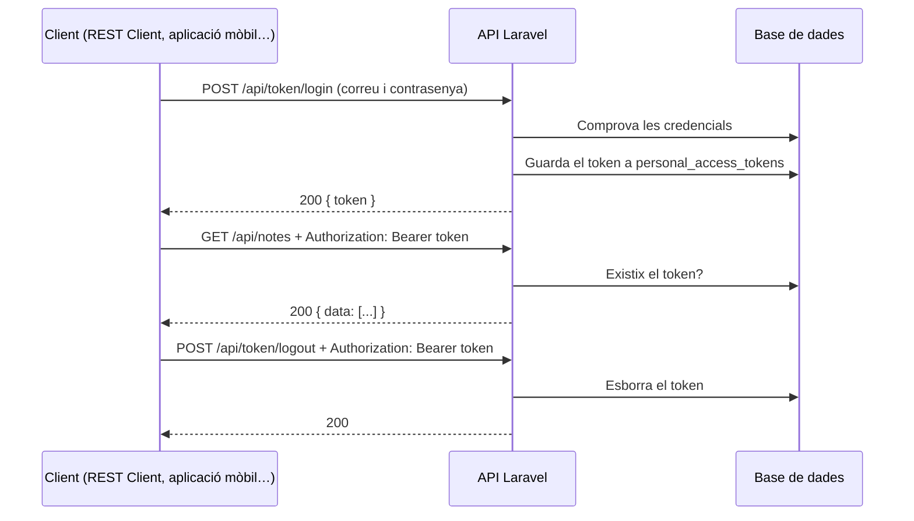

#  10.4. Autenticació amb tokens

Fins ara, qualsevol persona pot llegir, crear o esborrar notes. En este apartat protegim l'API perquè només la utilitzen clients **autenticats**.

## 1. Autenticació i autorització

| Concepte | Pregunta | Exemple | Codi si falla |
| --- | --- | --- | --- |
| **Autenticació** | Qui eres? | Enviar un token vàlid | `401 Unauthorized` |
| **Autorització** | Pots fer això? | Només l'autor pot esborrar la seua nota | `403 Forbidden` |

En este apartat tractem l'**autenticació**. L'autorització (propietaris, rols i *policies*) es tracta en la unitat 11.

## 2. Per què tokens i no sessió?

En la unitat 9 l'autenticació es basava en la **sessió**: després del login, el navegador guardava una galeta i l'enviava en cada petició. Una API REST és **sense estat**: el client pot ser Postman, una aplicació mòbil o un script, que no gestionen les galetes com un navegador. Per això el client s'identifica en **cada petició** amb un **token**:

```http
GET /api/notes
Authorization: Bearer 7|ssXEtwofGcjqDImgsgAo3REUs3YPVxLtpsVM1Kuf5d3db413
```

**Laravel Sanctum** (instal·lat per `php artisan install:api` en l'apartat 10.1) genera els tokens, els guarda a la taula `personal_access_tokens` i els comprova amb el middleware `auth:sanctum`.



## 3. El model `User`

Per a generar tokens, el model `User` ha d'utilitzar el trait **`HasApiTokens`** (`install:api` ho recorda en acabar):

```php hl_lines="1 6"
use Laravel\Sanctum\HasApiTokens;

class User extends Authenticatable
{
    /** @use HasFactory<\Database\Factories\UserFactory> */
    use HasApiTokens, HasFactory, Notifiable;
    // ...
}
```

Sense este trait no existix el mètode `createToken()`.

## 4. Controlador d'autenticació

```bash
php artisan make:controller Api/TokenAuthController
```

A `app/Http/Controllers/Api/TokenAuthController.php`:

```php
<?php

namespace App\Http\Controllers\Api;

use App\Http\Controllers\Controller;
use App\Models\User;
use Illuminate\Http\JsonResponse;
use Illuminate\Http\Request;
use Illuminate\Support\Facades\Hash;
use Illuminate\Validation\ValidationException;

class TokenAuthController extends Controller
{
    public function login(Request $request): JsonResponse
    {
        $credentials = $request->validate([
            'email' => ['required', 'email'],
            'password' => ['required'],
            'device_name' => ['nullable', 'string', 'max:255'],
        ]);

        $user = User::where('email', $credentials['email'])->first();

        if (! $user || ! Hash::check($credentials['password'], $user->password)) {
            throw ValidationException::withMessages([
                'email' => 'Las credenciales no son correctas.',
            ]);
        }

        $token = $user->createToken($credentials['device_name'] ?? 'rest-client');

        return response()->json([
            'success' => true,
            'token_type' => 'Bearer',
            'token' => $token->plainTextToken,
        ]);
    }

    public function logout(Request $request): JsonResponse
    {
        $request->user()->currentAccessToken()->delete();

        return response()->json([
            'success' => true,
            'message' => 'Logout correcto',
        ]);
    }
}
```

* El login **no utilitza la sessió**: busca l'usuari, comprova la contrasenya amb `Hash::check` i crea un token. És la manera que recomana la documentació de Sanctum per a clients que no són un navegador.
* Si les credencials no són correctes, respon **`422`** amb l'error al camp `email`, igual que qualsevol altra validació.
* `plainTextToken` només es pot llegir **en este moment**: a la base de dades es guarda xifrat. El client l'ha de guardar.
* `logout` esborra **només el token amb què s'ha fet la petició**. Si l'usuari té altres dispositius connectats, continuen funcionant.

## 5. Rutes

A `routes/api.php`:

```php
use App\Http\Controllers\Api\NoteController;
use App\Http\Controllers\Api\TokenAuthController;
use Illuminate\Http\Request;
use Illuminate\Support\Facades\Route;

// Pública: obtener un token (como mucho 6 intentos por minuto)
Route::post('/token/login', [TokenAuthController::class, 'login'])
    ->middleware('throttle:6,1');

// Protegidas: hace falta un token válido
Route::middleware('auth:sanctum')->group(function () {
    Route::get('/user', fn (Request $request) => $request->user());
    Route::post('/token/logout', [TokenAuthController::class, 'logout']);
    Route::apiResource('notes', NoteController::class);
});
```

Si una ruta protegida rep una petició sense token, o amb un token no vàlid, la resposta és **`401`** amb `{"message": "Unauthenticated."}`.

## 6. Usuari de prova

```bash
php artisan tinker
```

```php
App\Models\User::create([
    'name' => 'Admin',
    'email' => 'admin@testear.com',
    'password' => 'password',
]);
```

El model `User` aplica el *cast* `hashed` a la contrasenya, així que es guarda xifrada encara que l'escriguem en clar.

## 7. Proves amb REST Client

REST Client pot guardar el token d'una resposta i reutilitzar-lo: es posa nom a la petició de login amb `# @name` i es llig amb `{{login.response.body.token}}`.

```http
@base = http://testear.test/api

### Login
# @name login
POST {{base}}/token/login
Accept: application/json
Content-Type: application/json

{
    "email": "admin@testear.com",
    "password": "password"
}

### Notas sin token (debe responder 401)
GET {{base}}/notes
Accept: application/json

### Notas con token
GET {{base}}/notes
Accept: application/json
Authorization: Bearer {{login.response.body.token}}

### Logout
POST {{base}}/token/logout
Accept: application/json
Authorization: Bearer {{login.response.body.token}}
```

=== "Login correcte"
    <div class="figure-center">
    <figure>
        
        <figcaption class="figure-caption-small">
                Resposta de login correcte
        </figcaption>
    </figure>
    </div>
=== "Sense token"
    <div class="figure-center">
    <figure>
        
        <figcaption class="figure-caption-small">
                Resposta d'accés no autenticat (401)
        </figcaption>
    </figure>
    </div>
=== "Logout"
    <div class="figure-center">
    <figure>
        
        <figcaption class="figure-caption-small">
                Resposta de logout
        </figcaption>
    </figure>
    </div>

Després del logout, qualsevol petició amb eixe token torna `401`.

## 8. Actualitzar els tests

Ara les rutes de notes exigixen autenticació i els tests de l'apartat 10.3 rebrien `401`. Sanctum permet simular un usuari autenticat amb `Sanctum::actingAs`. Afig-lo al principi de cada test que necessite un usuari, i afig un test que comprove que sense autenticació es respon `401`:

```php
use App\Models\User;
use Laravel\Sanctum\Sanctum;

public function test_sin_token_responde_401(): void
{
    $this->getJson('/api/notes')->assertUnauthorized();
}

public function test_lista_las_notas_paginadas(): void
{
    Sanctum::actingAs(User::factory()->create());
    Note::factory()->count(3)->create();

    $this->getJson('/api/notes')
        ->assertOk()
        ->assertJsonCount(3, 'data');
}
```

## 9. Què aporta cada peça

| Element | Responsable |
| --- | --- |
| Fitxer `api.php`, Sanctum i taula de tokens | `php artisan install:api` |
| Crear i esborrar tokens | `TokenAuthController` (l'escrivim nosaltres) |
| Comprovar el token en cada petició | Middleware `auth:sanctum` |
| Limitar els intents de login | Middleware `throttle:6,1` |
| Provar el flux | REST Client i tests |

!!!tenencuenta "I si el client és una SPA al navegador?"
    Els tokens Bearer són la millor opció per a Postman, aplicacions mòbils o servidors. Per a un frontend en Vue servit al navegador, Sanctum oferix un mode més segur basat en **galetes de sessió**, que no obliga a guardar el token en JavaScript. El veurem en la unitat 11.
