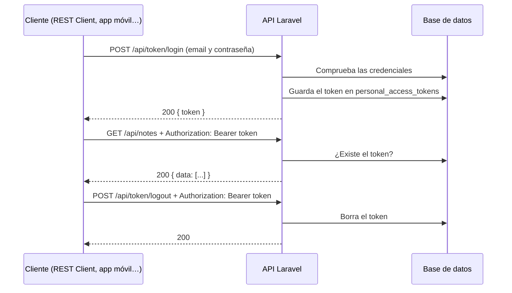

#  10.4. Autenticación con tokens

Hasta ahora, cualquiera puede leer, crear o borrar notas. En este apartado protegemos la API para que solo la usen clientes **autenticados**.

## 1. Autenticación y autorización

| Concepto | Pregunta | Ejemplo | Código si falla |
| --- | --- | --- | --- |
| **Autenticación** | ¿Quién eres? | Enviar un token válido | `401 Unauthorized` |
| **Autorización** | ¿Puedes hacer esto? | Solo el autor puede borrar su nota | `403 Forbidden` |

En este apartado tratamos la **autenticación**. La autorización (propietarios, roles y *policies*) se trata en la unidad 11.

## 2. ¿Por qué tokens y no sesión?

En la unidad 9 la autenticación se basaba en la **sesión**: después del login, el navegador guardaba una cookie y la enviaba en cada petición. Una API REST es **sin estado**: el cliente puede ser Postman, una app móvil o un script, que no gestionan cookies como un navegador. Por eso el cliente se identifica en **cada petición** con un **token**:

```http
GET /api/notes
Authorization: Bearer 7|ssXEtwofGcjqDImgsgAo3REUs3YPVxLtpsVM1Kuf5d3db413
```

**Laravel Sanctum** (instalado por `php artisan install:api` en el apartado 10.1) genera los tokens, los guarda en la tabla `personal_access_tokens` y los comprueba con el middleware `auth:sanctum`.



## 3. El modelo `User`

Para generar tokens, el modelo `User` debe usar el trait **`HasApiTokens`** (`install:api` lo recuerda al terminar):

```php hl_lines="1 6"
use Laravel\Sanctum\HasApiTokens;

class User extends Authenticatable
{
    /** @use HasFactory<\Database\Factories\UserFactory> */
    use HasApiTokens, HasFactory, Notifiable;
    // ...
}
```

Sin este trait no existe el método `createToken()`.

## 4. Controlador de autenticación

```bash
php artisan make:controller Api/TokenAuthController
```

En `app/Http/Controllers/Api/TokenAuthController.php`:

```php
<?php

namespace App\Http\Controllers\Api;

use App\Http\Controllers\Controller;
use App\Models\User;
use Illuminate\Http\JsonResponse;
use Illuminate\Http\Request;
use Illuminate\Support\Facades\Hash;
use Illuminate\Validation\ValidationException;

class TokenAuthController extends Controller
{
    public function login(Request $request): JsonResponse
    {
        $credentials = $request->validate([
            'email' => ['required', 'email'],
            'password' => ['required'],
            'device_name' => ['nullable', 'string', 'max:255'],
        ]);

        $user = User::where('email', $credentials['email'])->first();

        if (! $user || ! Hash::check($credentials['password'], $user->password)) {
            throw ValidationException::withMessages([
                'email' => 'Las credenciales no son correctas.',
            ]);
        }

        $token = $user->createToken($credentials['device_name'] ?? 'rest-client');

        return response()->json([
            'success' => true,
            'token_type' => 'Bearer',
            'token' => $token->plainTextToken,
        ]);
    }

    public function logout(Request $request): JsonResponse
    {
        $request->user()->currentAccessToken()->delete();

        return response()->json([
            'success' => true,
            'message' => 'Logout correcto',
        ]);
    }
}
```

* El login **no usa la sesión**: busca el usuario, comprueba la contraseña con `Hash::check` y crea un token. Es la forma que recomienda la documentación de Sanctum para clientes que no son un navegador.
* Si las credenciales no son correctas, responde **`422`** con el error en el campo `email`, igual que cualquier otra validación.
* `plainTextToken` solo se puede leer **en este momento**: en la base de datos se guarda cifrado. El cliente debe guardarlo.
* `logout` borra **solo el token con el que se ha hecho la petición**. Si el usuario tiene otros dispositivos conectados, siguen funcionando.

## 5. Rutas

En `routes/api.php`:

```php
use App\Http\Controllers\Api\NoteController;
use App\Http\Controllers\Api\TokenAuthController;
use Illuminate\Http\Request;
use Illuminate\Support\Facades\Route;

// Pública: obtener un token (como mucho 6 intentos por minuto)
Route::post('/token/login', [TokenAuthController::class, 'login'])
    ->middleware('throttle:6,1');

// Protegidas: hace falta un token válido
Route::middleware('auth:sanctum')->group(function () {
    Route::get('/user', fn (Request $request) => $request->user());
    Route::post('/token/logout', [TokenAuthController::class, 'logout']);
    Route::apiResource('notes', NoteController::class);
});
```

Si una ruta protegida recibe una petición sin token, o con un token no válido, la respuesta es **`401`** con `{"message": "Unauthenticated."}`.

## 6. Usuario de prueba

```bash
php artisan tinker
```

```php
App\Models\User::create([
    'name' => 'Admin',
    'email' => 'admin@testear.com',
    'password' => 'password',
]);
```

El modelo `User` aplica el *cast* `hashed` a la contraseña, así que se guarda cifrada aunque la escribamos en claro.

## 7. Pruebas con REST Client

REST Client puede guardar el token de una respuesta y reutilizarlo: se pone nombre a la petición de login con `# @name` y se lee con `{{login.response.body.token}}`.

```http
@base = http://testear.test/api

### Login
# @name login
POST {{base}}/token/login
Accept: application/json
Content-Type: application/json

{
    "email": "admin@testear.com",
    "password": "password"
}

### Notas sin token (debe responder 401)
GET {{base}}/notes
Accept: application/json

### Notas con token
GET {{base}}/notes
Accept: application/json
Authorization: Bearer {{login.response.body.token}}

### Logout
POST {{base}}/token/logout
Accept: application/json
Authorization: Bearer {{login.response.body.token}}
```

=== "Login correcto"
    <div class="figure-center">
    <figure>
        
        <figcaption class="figure-caption-small">
                Respuesta de login correcto
        </figcaption>
    </figure>
    </div>
=== "Sin token"
    <div class="figure-center">
    <figure>
        
        <figcaption class="figure-caption-small">
                Respuesta de acceso no autenticado (401)
        </figcaption>
    </figure>
    </div>
=== "Logout"
    <div class="figure-center">
    <figure>
        
        <figcaption class="figure-caption-small">
                Respuesta de logout
        </figcaption>
    </figure>
    </div>

Después del logout, cualquier petición con ese token devuelve `401`.

## 8. Actualizar los tests

Ahora las rutas de notas exigen autenticación y los tests del apartado 10.3 recibirían `401`. Sanctum permite simular un usuario autenticado con `Sanctum::actingAs`. Añádelo al principio de cada test que necesite un usuario, y añade un test que compruebe que sin autenticación se responde `401`:

```php
use App\Models\User;
use Laravel\Sanctum\Sanctum;

public function test_sin_token_responde_401(): void
{
    $this->getJson('/api/notes')->assertUnauthorized();
}

public function test_lista_las_notas_paginadas(): void
{
    Sanctum::actingAs(User::factory()->create());
    Note::factory()->count(3)->create();

    $this->getJson('/api/notes')
        ->assertOk()
        ->assertJsonCount(3, 'data');
}
```

## 9. Qué aporta cada pieza

| Elemento | Responsable |
| --- | --- |
| Archivo `api.php`, Sanctum y tabla de tokens | `php artisan install:api` |
| Crear y borrar tokens | `TokenAuthController` (lo escribimos nosotros) |
| Comprobar el token en cada petición | Middleware `auth:sanctum` |
| Limitar intentos de login | Middleware `throttle:6,1` |
| Probar el flujo | REST Client y tests |

!!!tenencuenta "¿Y si el cliente es una SPA en el navegador?"
    Los tokens Bearer son la mejor opción para Postman, apps móviles o servidores. Para un frontend en Vue servido en el navegador, Sanctum ofrece un modo más seguro basado en **cookies de sesión**, que no obliga a guardar el token en JavaScript. Lo veremos en la unidad 11.
