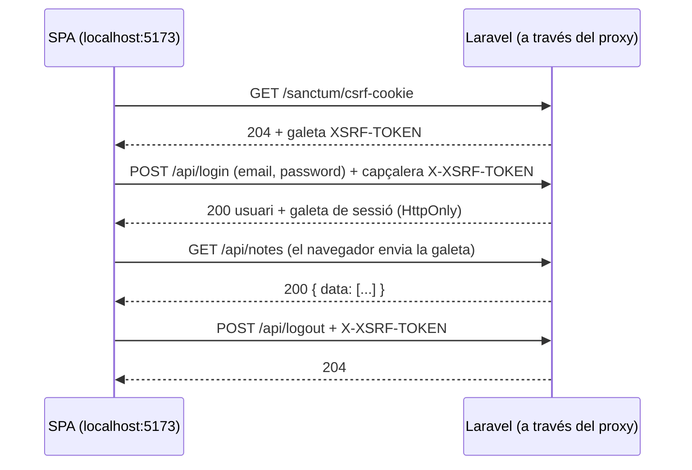

#  11.1. Sanctum en mode SPA

En este apartat preparem l'API perquè una SPA al navegador s'autentique amb la **sessió de Laravel** (galetes), sense tokens en JavaScript. Partim del projecte `testear` de la unitat 10, que ja té `install:api` executat, Sanctum instal·lat i l'API de notes.

!!!tenencuenta "No cal cap *starter kit*"
    Alguns tutorials instal·len **Laravel Breeze** en mode API per a això. Breeze ja no rep actualitzacions des de Laravel 12 i, a més, amaga el que passa. Amb Sanctum, una línia de configuració i un controlador d'unes 30 línies tenim el mateix i entenem cada peça.

## 1. La regla d'or: mateix domini

Les galetes de sessió només funcionen si el navegador considera que la SPA i l'API són del **mateix lloc**. Si Vue s'executa a `http://localhost:5173` i l'API a `http://testear.test`, són llocs diferents: el navegador no enviarà la galeta de sessió i el login semblarà que funciona, però la petició següent tornarà `401`.

En desenvolupament, la solució més senzilla és un **proxy**: el servidor de desenvolupament de Vite rep les peticions a `/api` i `/sanctum` i les reenvia a Laravel. Per al navegador, tot ve de `http://localhost:5173`:

```text
Navegador ──> http://localhost:5173/            ──> Vite (servix la SPA)
Navegador ──> http://localhost:5173/api/...     ──> Vite ──proxy──> http://testear.test/api/...
Navegador ──> http://localhost:5173/sanctum/... ──> Vite ──proxy──> http://testear.test/sanctum/...
```

Avantatges: no cal configurar CORS ni dominis de galetes, i és el mateix que passarà en producció si se servixen la SPA i l'API des del mateix domini. El proxy es configura en Vue (apartat 11.2). En Laravel només cal el següent.

## 2. Activar les peticions amb estat a `api.php`

Les rutes d'`api.php` no tenen sessió. Sanctum la pot activar **només per a les peticions que vénen de la nostra SPA**. A `bootstrap/app.php`:

```php hl_lines="2"
->withMiddleware(function (Middleware $middleware) {
    $middleware->statefulApi();
})
```

Amb `statefulApi()`, quan una petició arriba des d'un domini de confiança, Sanctum hi afig la sessió, les galetes xifrades i la **protecció CSRF**. Les peticions d'altres clients (REST Client, aplicacions) continuen sense estat i poden utilitzar tokens Bearer com en l'apartat 10.4.

## 3. Dominis de confiança

Sanctum decidix si una petició ve de la SPA mirant la capçalera `Origin` o `Referer` del navegador. A `.env`:

```env
SANCTUM_STATEFUL_DOMAINS=localhost:5173
SESSION_DOMAIN=null
```

* `SANCTUM_STATEFUL_DOMAINS`: domini i port de la SPA, **sense** `http://`. Si n'hi ha diversos, separats per comes.
* `SESSION_DOMAIN=null`: la galeta s'associa al domini que veu el navegador (`localhost`), que és el que volem amb el proxy.

Després de canviar `.env`:

```bash
php artisan config:clear
```

## 4. Controlador de login i logout

```bash
php artisan make:controller Api/SpaAuthController
```

A `app/Http/Controllers/Api/SpaAuthController.php`:

```php
<?php

namespace App\Http\Controllers\Api;

use App\Http\Controllers\Controller;
use Illuminate\Http\JsonResponse;
use Illuminate\Http\Request;
use Illuminate\Http\Response;
use Illuminate\Support\Facades\Auth;
use Illuminate\Validation\ValidationException;

class SpaAuthController extends Controller
{
    public function login(Request $request): JsonResponse
    {
        $credentials = $request->validate([
            'email' => ['required', 'email'],
            'password' => ['required'],
        ]);

        if (! Auth::guard('web')->attempt($credentials)) {
            throw ValidationException::withMessages([
                'email' => 'Las credenciales no son correctas.',
            ]);
        }

        $request->session()->regenerate();

        return response()->json(Auth::guard('web')->user());
    }

    public function logout(Request $request): Response
    {
        Auth::guard('web')->logout();

        $request->session()->invalidate();
        $request->session()->regenerateToken();

        return response()->noContent();
    }
}
```

* `Auth::guard('web')->attempt()` comprova les credencials i, si són correctes, guarda l'usuari a la **sessió** (la mateixa autenticació per sessió de la unitat 9).
* `session()->regenerate()` canvia l'identificador de sessió després del login per a evitar atacs de *fixació de sessió*.
* En el logout s'invalida la sessió i es regenera el token CSRF.
* Si les credencials fallen, es respon `422` amb l'error a `email`: Vue el mostrarà igual que qualsevol error de validació.

## 5. Rutes

A `routes/api.php`, al costat de les de la unitat 10:

```php
use App\Http\Controllers\Api\NoteController;
use App\Http\Controllers\Api\SpaAuthController;
use App\Http\Controllers\Api\TokenAuthController;
use Illuminate\Http\Request;
use Illuminate\Support\Facades\Route;

// SPA (sesión con cookies)
Route::post('/login', [SpaAuthController::class, 'login'])->middleware('throttle:6,1');
Route::post('/logout', [SpaAuthController::class, 'logout'])->middleware('auth:sanctum');

// Clientes externos (tokens Bearer, apartado 10.4)
Route::post('/token/login', [TokenAuthController::class, 'login'])->middleware('throttle:6,1');

Route::middleware('auth:sanctum')->group(function () {
    Route::get('/user', fn (Request $request) => $request->user());
    Route::post('/token/logout', [TokenAuthController::class, 'logout']);
    Route::apiResource('notes', NoteController::class);
});
```

`auth:sanctum` accepta **les dues formes** d'autenticació: primer mira si hi ha sessió (petició de la SPA) i, si no, si hi ha un token Bearer. No cal duplicar les rutes protegides.

## 6. El flux complet



1. **`GET /sanctum/csrf-cookie`**: ruta que registra Sanctum. Torna la galeta `XSRF-TOKEN`. Cal cridar-la **abans del login**; sense ella el login falla amb `419`.
2. **`POST /api/login`**: axios llig la galeta `XSRF-TOKEN` i l'envia a la capçalera `X-XSRF-TOKEN`. Laravel crea la sessió.
3. **Peticions protegides**: el navegador envia la galeta de sessió automàticament.
4. **`POST /api/logout`**: tanca la sessió.

## 7. Errors típics

| Símptoma | Causa probable |
| --- | --- |
| `419` en el login | No s'ha cridat `/sanctum/csrf-cookie`, o axios no envia `X-XSRF-TOKEN` |
| Login correcte, però després `401` | La galeta no viatja: SPA i API en llocs diferents (falta el proxy) o `SESSION_DOMAIN` incorrecte |
| `Session store not set on request` | La petició no ve d'un domini de `SANCTUM_STATEFUL_DOMAINS` (per exemple, des de REST Client), o falta `statefulApi()` |
| Error de CORS a la consola | La SPA crida directament `http://testear.test` en lloc d'utilitzar rutes relatives (`/api/...`) a través del proxy |

!!!tenencuenta "Este login no es prova amb REST Client"
    `POST /api/login` només funciona des d'un navegador en un domini de confiança (necessita sessió i CSRF). Per a provar l'API des de REST Client, continua utilitzant `/api/token/login` de l'apartat 10.4.
