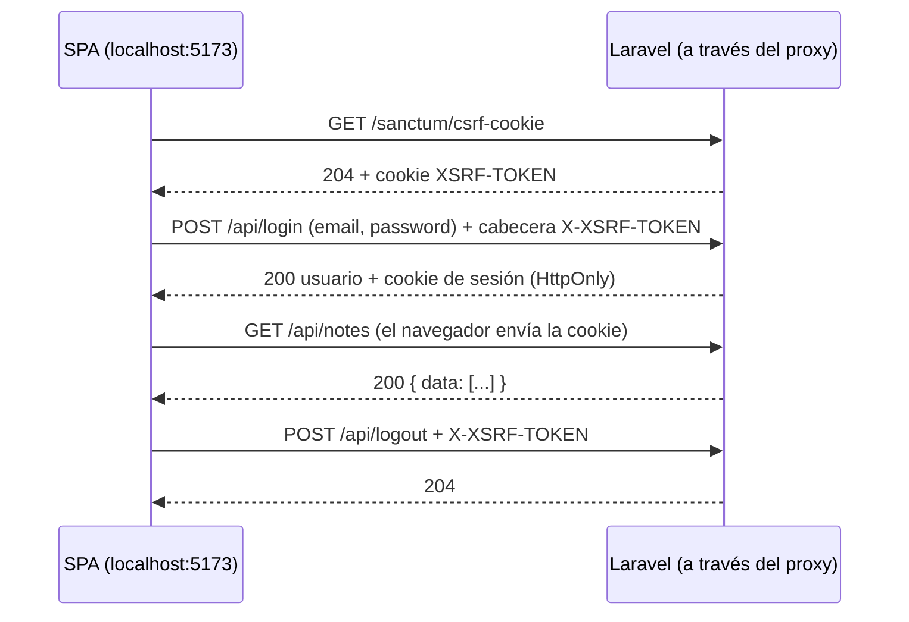

#  11.1. Sanctum en modo SPA

En este apartado preparamos la API para que una SPA en el navegador se autentique con la **sesión de Laravel** (cookies), sin tokens en JavaScript. Partimos del proyecto `testear` de la unidad 10, que ya tiene `install:api` ejecutado, Sanctum instalado y la API de notas.

!!!tenencuenta "No hace falta ningún *starter kit*"
    Algunos tutoriales instalan **Laravel Breeze** en modo API para esto. Breeze ya no recibe actualizaciones desde Laravel 12, y además esconde lo que pasa. Con Sanctum, una línea de configuración y un controlador de unas 30 líneas tenemos lo mismo y entendemos cada pieza.

## 1. La regla de oro: mismo dominio

Las cookies de sesión solo funcionan si el navegador considera que la SPA y la API son del **mismo sitio**. Si Vue se ejecuta en `http://localhost:5173` y la API en `http://testear.test`, son sitios distintos: el navegador no enviará la cookie de sesión y el login parecerá funcionar, pero la siguiente petición devolverá `401`.

En desarrollo, la solución más sencilla es un **proxy**: el servidor de desarrollo de Vite recibe las peticiones a `/api` y `/sanctum` y las reenvía a Laravel. Para el navegador, todo viene de `http://localhost:5173`:

```text
Navegador ──> http://localhost:5173/            ──> Vite (sirve la SPA)
Navegador ──> http://localhost:5173/api/...     ──> Vite ──proxy──> http://testear.test/api/...
Navegador ──> http://localhost:5173/sanctum/... ──> Vite ──proxy──> http://testear.test/sanctum/...
```

Ventajas: no hace falta configurar CORS ni dominios de cookies, y es lo mismo que pasará en producción si se sirve la SPA y la API desde el mismo dominio. El proxy se configura en Vue (apartado 11.2). En Laravel solo hace falta lo siguiente.

## 2. Activar las peticiones con estado en `api.php`

Las rutas de `api.php` no tienen sesión. Sanctum puede activarla **solo para las peticiones que vienen de nuestra SPA**. En `bootstrap/app.php`:

```php hl_lines="2"
->withMiddleware(function (Middleware $middleware) {
    $middleware->statefulApi();
})
```

Con `statefulApi()`, cuando una petición llega desde un dominio de confianza, Sanctum le añade la sesión, las cookies cifradas y la **protección CSRF**. Las peticiones de otros clientes (REST Client, apps) siguen sin estado y pueden usar tokens Bearer como en el apartado 10.4.

## 3. Dominios de confianza

Sanctum decide si una petición viene de la SPA mirando la cabecera `Origin` o `Referer` del navegador. En `.env`:

```env
SANCTUM_STATEFUL_DOMAINS=localhost:5173
SESSION_DOMAIN=null
```

* `SANCTUM_STATEFUL_DOMAINS`: dominio y puerto de la SPA, **sin** `http://`. Si hay varios, separados por comas.
* `SESSION_DOMAIN=null`: la cookie se asocia al dominio que ve el navegador (`localhost`), que es el que queremos con el proxy.

Después de cambiar `.env`:

```bash
php artisan config:clear
```

## 4. Controlador de login y logout

```bash
php artisan make:controller Api/SpaAuthController
```

En `app/Http/Controllers/Api/SpaAuthController.php`:

```php
<?php

namespace App\Http\Controllers\Api;

use App\Http\Controllers\Controller;
use Illuminate\Http\JsonResponse;
use Illuminate\Http\Request;
use Illuminate\Http\Response;
use Illuminate\Support\Facades\Auth;
use Illuminate\Validation\ValidationException;

class SpaAuthController extends Controller
{
    public function login(Request $request): JsonResponse
    {
        $credentials = $request->validate([
            'email' => ['required', 'email'],
            'password' => ['required'],
        ]);

        if (! Auth::guard('web')->attempt($credentials)) {
            throw ValidationException::withMessages([
                'email' => 'Las credenciales no son correctas.',
            ]);
        }

        $request->session()->regenerate();

        return response()->json(Auth::guard('web')->user());
    }

    public function logout(Request $request): Response
    {
        Auth::guard('web')->logout();

        $request->session()->invalidate();
        $request->session()->regenerateToken();

        return response()->noContent();
    }
}
```

* `Auth::guard('web')->attempt()` comprueba las credenciales y, si son correctas, guarda el usuario en la **sesión** (la misma autenticación por sesión de la unidad 9).
* `session()->regenerate()` cambia el identificador de sesión después del login para evitar ataques de *fijación de sesión*.
* En el logout se invalida la sesión y se regenera el token CSRF.
* Si las credenciales fallan, se responde `422` con el error en `email`: Vue lo mostrará igual que cualquier error de validación.

## 5. Rutas

En `routes/api.php`, junto a las de la unidad 10:

```php
use App\Http\Controllers\Api\NoteController;
use App\Http\Controllers\Api\SpaAuthController;
use App\Http\Controllers\Api\TokenAuthController;
use Illuminate\Http\Request;
use Illuminate\Support\Facades\Route;

// SPA (sesión con cookies)
Route::post('/login', [SpaAuthController::class, 'login'])->middleware('throttle:6,1');
Route::post('/logout', [SpaAuthController::class, 'logout'])->middleware('auth:sanctum');

// Clientes externos (tokens Bearer, apartado 10.4)
Route::post('/token/login', [TokenAuthController::class, 'login'])->middleware('throttle:6,1');

Route::middleware('auth:sanctum')->group(function () {
    Route::get('/user', fn (Request $request) => $request->user());
    Route::post('/token/logout', [TokenAuthController::class, 'logout']);
    Route::apiResource('notes', NoteController::class);
});
```

`auth:sanctum` acepta **las dos formas** de autenticación: primero mira si hay sesión (petición de la SPA) y, si no, si hay un token Bearer. No hace falta duplicar las rutas protegidas.

## 6. El flujo completo



1. **`GET /sanctum/csrf-cookie`**: ruta que registra Sanctum. Devuelve la cookie `XSRF-TOKEN`. Hay que llamarla **antes del login**; sin ella el login falla con `419`.
2. **`POST /api/login`**: axios lee la cookie `XSRF-TOKEN` y la envía en la cabecera `X-XSRF-TOKEN`. Laravel crea la sesión.
3. **Peticiones protegidas**: el navegador envía la cookie de sesión automáticamente.
4. **`POST /api/logout`**: cierra la sesión.

## 7. Errores típicos

| Síntoma | Causa probable |
| --- | --- |
| `419` en el login | No se ha llamado a `/sanctum/csrf-cookie`, o axios no envía `X-XSRF-TOKEN` |
| Login correcto, pero luego `401` | La cookie no viaja: SPA y API en sitios distintos (falta el proxy) o `SESSION_DOMAIN` incorrecto |
| `Session store not set on request` | La petición no viene de un dominio de `SANCTUM_STATEFUL_DOMAINS` (por ejemplo, desde REST Client), o falta `statefulApi()` |
| Error de CORS en la consola | La SPA llama directamente a `http://testear.test` en lugar de usar rutas relativas (`/api/...`) a través del proxy |

!!!tenencuenta "Este login no se prueba con REST Client"
    `POST /api/login` solo funciona desde un navegador en un dominio de confianza (necesita sesión y CSRF). Para probar la API desde REST Client, sigue usando `/api/token/login` del apartado 10.4.
